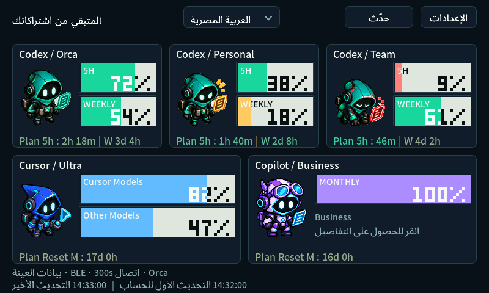
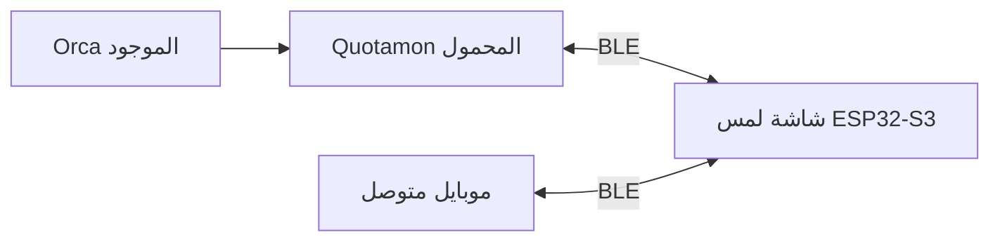

# Quotamon

**باقي اشتراكات الذكاء الاصطناعي على شاشة صغيرة قدامك.**

Codex · Cursor · Copilot · Claude · Grok 
شاشة 7 بوصة مع شخصيات بكسل وأشرطة للمتبقي

<strong>العربية المصرية</strong> · 16

[English](README.md) · [한국어](README.ko.md) · [简体中文](README.zh-CN.md) · [日本語](README.ja.md) · [Deutsch](README.de.md) · [हिन्दी](README.hi.md) · [Español](README.es.md) · [العربية](README.ar.md) 
[Français](README.fr.md) · [বাংলা](README.bn.md) · [Português](README.pt.md) · [Bahasa Indonesia](README.id.md) · [اردو](README.ur.md) · [Русский](README.ru.md) · [Naijá](README.pcm.md) · **العربية المصرية**

[افتح بلغة المتصفح](https://cdn.jsdelivr.net/gh/guyster323/ESP32_7inch_Quotamon@main/assets/readme/language.html) · [البداية](#quick-start) · [الجديد](#whats-new) · [السجل](#changelog) · [النسخة المحمولة](docs/PORTABLE_BRIDGE.md) · [البرنامج](docs/UPLOAD.md) · [البنية](docs/ARCHITECTURE.md)

الصورة والحركة من **نفس كود LVGL اللي على البورد**. الأرقام مثال. الإطار واللمس وقفل الشاشة وفتحها محاكاة، مش تصوير للجهاز.

## بص الأول، والتفاصيل باللمس

| خمس حسابات مع بعض | الوقت لحد الريست | تعرف البيانات جديدة ولا لأ |
|---|---|---|
| تلات حسابات Codex مع Cursor وCopilot. لحد 20 حساب على صفحات. | خطة الـ5 ساعات والأسبوع ظاهرين سوا. Cursor بيستخدم ريست واحد مشترك. | تحديث الشاشة ووقت المصدر منفصلين. |

| الشخصية بتوضّح الحالة | التفاصيل بلمسة | سيّب Orca زي ما هو |
|---|---|---|
| طبيعي، خد بالك، حرج، خلص، مش متصل، ومعلومة قديمة. | كل حد، واختيار الحسابات، وإعدادات العرض. | تطبيق ويندوز محمول بيبعت البيانات عن طريق BLE. |

## الشاشة بتقول إيه دلوقتي

Codex بيعرض أقرب رصيدين ريست بس. `R.T.1` أكبر و`R.T.2` أصغر. مفيش تالت ولا عدد ولا تاريخ ولا منطقة زمنية. الوقت `d / h / m`. خطة Codex هي `Plan 5h` و`W`، وCursor وCopilot بيستخدموا `Plan Reset M`. كل ما الوقت يقل اللون يحمر.

## الاتصال إزاي

ESP32 بيرسم وبياخد اللمس. كمبيوتر قريب شغّال عليه Orca والجسر المحمول بيبعت بيانات الاشتراك. مش محتاج Wi-Fi ولا تسجيل دخول على الشاشة. الإرسال كل **60 ثانية** والنبض كل **10 ثواني**. لو الاتصال قطع أو عدّت **35 ثانية** من غير ترافيك سليم العرض بيتمسح.

## البداية

1. **جهّز البورد.** المطلوب **Waveshare ESP32-S3-Touch-LCD-7 Rev1.2، 800×480**. [البرنامج](docs/UPLOAD.md).
2. **شغّل التطبيق المحمول.** نزّل `Quotamon-Portable-win-x64-preview` من [بناء ويندوز ناجح](https://github.com/guyster323/ESP32_7inch_Quotamon/actions/workflows/build.yml)، وفُك الـZIP كله، وشغّل **Quotamon.exe**.
3. **اختار الحسابات.** افتح Orca واحفظ الحسابات والأسماء والخطط والترتيب.
4. **اتّصل بـBLE.** ابدأ الاقتران على الجهاز، دوّر على الشاشة من الكمبيوتر، ووافق على نفس الـ6 أرقام في الناحيتين.

محتاج Windows 10 2004 أو أحدث / Windows 11 وx64 وBluetooth LE. سيّب الفولدر كله مع بعض. لو الاقتران فشل قبل الرقم، راجع [استعادة ويندوز](docs/PORTABLE_BRIDGE.md).

## اللغة وميعاد قفل الشاشة

على **أول شاشة** في الويب المحمول أو ESP32 اختيار لغة من 16 بيتسجل فورًا. تقدر كمان من **الإعدادات → اللغة → حفظ**. **الإعدادات → قفل مجدول** بيقفل نور الخلفية بس حسب توقيت الكمبيوتر. BLE بيفضل يستقبل. لمس الشاشة المقفولة بيشغّلها **5 دقايق**. على ESP32 المس الوقت واكتب 4 أرقام: `0730` يعني `07:30`. [الشرح](docs/LANGUAGES_AND_SCREEN_SCHEDULE.md)

## التحكم في الشاشة بموبايل متوصل مباشرة

البورد بيقرن **كمبيوتر واحد وموبايل واحد** لوحدهم. الكمبيوتر بيبعت الاستخدام، واتصال الموبايل الموثّق بيقول إذا كنت قريب. على LCD افتح **اتصال BLE → اكتشاف الموبايل → تسجيل الموبايل**، اختار Quotamon من بلوتوث الموبايل، ووافق على نفس الرقم.

- بعد **60 ثانية** من قطع الموبايل المسجّل الشاشة بتقفل وبتفتح تاني مع إعادة الاتصال الموثّقة.
- الجدول أهم من الاكتشاف. اللمس بيشغّل الشاشة 5 دقايق بالإضاءة المحفوظة.
- مفيش تطبيق زيادة ولا مسح إعلانات ولا مطابقة أسماء ولا Wi-Fi. الموبايل مش بيقرأ بيانات الحسابات.
- إعادة الاتصال اللي اتختبرناها HID للتحكم بالمستهلك، من غير كيبورد أو ماوس أو إدخال تلقائي.

## الشخصيات البكسل

بيرمشوا وبيتنفسوا وحركتهم بتتغير حسب المتبقي وحالة المصدر. حسابات الخدمة الواحدة بتتحرك في أوقات مختلفة.

| الخدمة | البيانات | الحسابات |
|---|---|---|
| Codex | حدود Orca لخمس ساعات والأسبوع وانتهاء أرصدة الريست | الافتراضي + الحسابات المُدارة |
| Claude | حدود Orca الأسبوعية والموديلات الإضافية | الافتراضي + الحسابات المُدارة |
| Cursor | Cursor Models · Other Models | الحساب النشط |
| Grok | مجموعات الاستخدام اللي Orca بيوفّرها | الحساب النشط |
| Copilot | حزمة حصة Windows Copilot CLI من npm العام أو مسار GitHub Copilot CLI | حساب CLI الحالي · تجريبي |

## الجديد

### 2026-11-18 — أزرار الشاشة الأولى و16 لغة

التحديث والإعدادات طولهم 36px وبعيدين 16px على الأقل عن أول كارت. اللغة اللي تتختار على أول شاشة بتتحفظ فورًا. الصفحة دي الدليل بالمصري.

### 2026-11-17 — أرصدة ريست Codex ووقت الخطة

كل كارت Codex بيعرض أقرب رصيدين بس بصيغة `R.T.1` / `R.T.2` و`d/h/m`. لون وقت الخطة بيتغير. لوحة الكمبيوتر زي LCD.

## السجل

- **2026-11-18:** أزرار الشاشة الأولى أصغر، و16 لغة بتتحفظ من أول شاشة.
- **2026-11-17:** أرصدة Codex ولون الخطة والتعرّف على مسار Copilot CLI في ويندوز.
- **2026-10-20:** اتصالات موثّقة منفصلة للكمبيوتر والموبايل بتتحكم في الشاشة.
- **2026-10-16:** خمس لغات وقفل يومي وحركة الشخصيات.
- السجلات الأقدم في [README الإنجليزي](README.md#changelog).

## التطوير والوثائق

| | |
|---|---|
| [Portable](docs/PORTABLE_BRIDGE.md) | [Architecture](docs/ARCHITECTURE.md) |
| [Firmware](docs/UPLOAD.md) | [BLE](docs/BLE_PROTOCOL.md) |

## الإسناد

فن البكسل وأشرطة النسبة من [F108pro Usage Monitor](https://github.com/guyster323/F108pro_Usage_monitor). روبوت Copilot البنفسجي رسم جديد للمشروع ده. الكود: [MIT](LICENSE). تراخيص الغير: [THIRD_PARTY_NOTICES.md](THIRD_PARTY_NOTICES.md).

