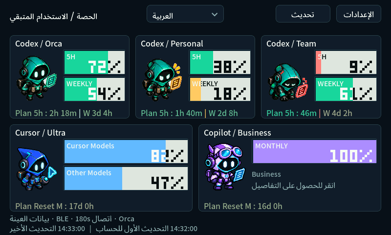
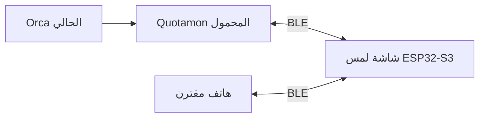

# Quotamon

**متبقي اشتراكات الذكاء الاصطناعي على شاشة صغيرة.**

Codex · Cursor · Copilot · Claude · Grok 
شاشة 7 بوصات مع رفاق بكسلي وأشرطة للمتبقي

<strong>العربية</strong> · 16

[English](README.md) · [한국어](README.ko.md) · [简体中文](README.zh-CN.md) · [日本語](README.ja.md) · [Deutsch](README.de.md) · [हिन्दी](README.hi.md) · [Español](README.es.md) · **العربية** 
[Français](README.fr.md) · [বাংলা](README.bn.md) · [Português](README.pt.md) · [Bahasa Indonesia](README.id.md) · [اردو](README.ur.md) · [Русский](README.ru.md) · [Naijá](README.pcm.md) · [العربية المصرية](README.ar-EG.md)

[افتح بلغة المتصفح](https://cdn.jsdelivr.net/gh/guyster323/ESP32_7inch_Quotamon@main/assets/readme/language.html) · [البدء](#quick-start) · [الجديد](#whats-new) · [السجل](#changelog) · [النسخة المحمولة](docs/PORTABLE_BRIDGE.md) · [البرنامج الثابت](docs/UPLOAD.md) · [البنية](docs/ARCHITECTURE.md)

الصورة والحركة من **كود LVGL نفسه المستخدم في اللوحة**. الأرقام أمثلة. الإطار واللمس وإطفاء الشاشة وإضاءتها محاكاة وليست تصويرًا للجهاز.

## نظرة أولاً، والتفاصيل باللمس

| خمسة حسابات معًا | الوقت حتى إعادة التعيين | اعرف حداثة البيانات |
|---|---|---|
| ثلاثة حسابات Codex مع Cursor وCopilot. حتى 20 حسابًا على صفحات. | خطة 5 ساعات والأسبوع تظهران معًا. Cursor يشارك إعادة تعيين واحدة. | تحديث الشاشة ووقت جمع المصدر منفصلان. |

| الشخصية تُظهر الحالة | التفاصيل باللمس | أبقِ Orca كما هو |
|---|---|---|
| طبيعي، تنبيه، حرج، نفد، غير متصل، ومعلومة قديمة. | كل حد، واختيار الحسابات، وإعدادات العرض. | تطبيق Windows محمول يرسل البيانات عبر BLE. |

## ما يظهر على الشاشة الآن

يعرض Codex أقرب رصيدَي إعادة تعيين فقط. `R.T.1` أكبر و`R.T.2` أصغر. لا يظهر ثالث ولا عدد ولا تاريخ ولا منطقة زمنية. الوقت بصيغة `d / h / m`. خطة Codex هي `Plan 5h` و`W`، وCursor وCopilot يستخدمان `Plan Reset M`. كلما قل الوقت اقترب اللون من الأحمر.

## طريقة الاتصال

يتولى ESP32 الرسم واللمس. يرسل حاسوب قريب يشغّل Orca والجسر المحمول بيانات الاشتراك. لا حاجة إلى Wi-Fi أو تسجيل دخول على الشاشة. الإرسال كل **60 ثانية** والنبض كل **10 ثوانٍ**. الانقطاع أو مرور **35 ثانية** بلا حركة صالحة يمسح العرض.

## البدء

1. **جهّز اللوحة.** الهدف **Waveshare ESP32-S3-Touch-LCD-7 Rev1.2، 800×480**. [البرنامج الثابت](docs/UPLOAD.md).
2. **شغّل التطبيق المحمول.** نزّل `Quotamon-Portable-win-x64-preview` من [بناء Windows الناجح](https://github.com/guyster323/ESP32_7inch_Quotamon/actions/workflows/build.yml)، وفُك ضغط ZIP كاملًا، ثم شغّل **Quotamon.exe**.
3. **اختر الحسابات.** افتح Orca واحفظ الحسابات والأسماء والخطط والترتيب.
4. **اتصل عبر BLE.** ابدأ الاقتران على الجهاز، وابحث عن الشاشة من الحاسوب، ووافق على الرقم نفسه المكوّن من 6 خانات في الطرفين.

يلزم Windows 10 2004 أو أحدث / Windows 11 وx64 وBluetooth LE. أبقِ المجلد كاملًا. إذا فشل الاقتران قبل الرقم فراجع [استعادة Windows](docs/PORTABLE_BRIDGE.md).

## اللغة وجدول إطفاء الشاشة

في **الشاشة الأولى** للويب المحمول أو ESP32 يُحفظ اختيار إحدى اللغات الست عشرة فورًا. يمكن أيضًا **الإعدادات → اللغة → حفظ**. **الإعدادات → إطفاء مجدول** يطفئ الإضاءة الخلفية فقط حسب توقيت الحاسوب المحلي. يستمر BLE في الاستقبال. لمس الشاشة المطفأة يشغّلها **5 دقائق**. على ESP32 المس الوقت وأدخل 4 أرقام: `0730` تعني `07:30`. [الدليل](docs/LANGUAGES_AND_SCREEN_SCHEDULE.md)

## التحكم بالشاشة عبر هاتف مقترن مباشرة

تقترن اللوحة مع **حاسوب واحد وهاتف واحد** بشكل منفصل. يرسل الحاسوب الاستخدام، ويحدد اتصال الهاتف المصدَّق الحضور. على LCD افتح **اتصال BLE → اكتشاف الهاتف → تسجيل الهاتف**، واختر Quotamon في بلوتوث الهاتف، ووافق على الرقم نفسه.

- بعد **60 ثانية** من انقطاع الهاتف المسجّل تنطفئ الشاشة وتضيء عند إعادة الاتصال المصدَّقة.
- الجدول أولى من الاكتشاف. اللمس يشغّل الشاشة 5 دقائق بالسطوع المحفوظ.
- لا تطبيق إضافي ولا مسح إعلانات ولا مطابقة أسماء ولا Wi-Fi. الهاتف لا يقرأ بيانات الحسابات.
- إعادة الاتصال المختبرة HID للتحكم بالمستهلك، بلا لوحة مفاتيح أو فأرة أو إدخال تلقائي.

## الرفاق البكسليون

يرمشون ويتنفسون وتتغير حركتهم حسب المتبقي وحالة المصدر. حسابات الخدمة الواحدة تتحرك في أوقات مختلفة.

| الخدمة | البيانات | الحسابات |
|---|---|---|
| Codex | حدود Orca لخمس ساعات والأسبوع وانتهاء أرصدة إعادة التعيين | الافتراضي + الحسابات المُدارة |
| Claude | حدود Orca الأسبوعية ونماذج إضافية | الافتراضي + الحسابات المُدارة |
| Cursor | Cursor Models · Other Models | الحساب النشط |
| Grok | مجموعات الاستخدام التي يقدّمها Orca | الحساب النشط |
| Copilot | حزمة حصة Windows Copilot CLI عبر npm العام أو مسار GitHub Copilot CLI | حساب CLI الحالي · تجريبي |

## الجديد

### 2026-11-18 — أزرار الصفحة الرئيسية و16 لغة

ارتفاع التحديث والإعدادات 36px وتبعدان 16px على الأقل عن أول بطاقة. اختيار اللغة في الشاشة الأولى يُحفظ فورًا. هذه الصفحة الدليل العربي.

### 2026-11-17 — أرصدة إعادة تعيين Codex ووقت الخطة

تعرض كل بطاقة Codex أقرب رصيدين فقط بصيغة `R.T.1` / `R.T.2` و`d/h/m`. يتغيّر لون وقت الخطة. لوحة الحاسوب تطابق LCD.

## السجل

- **2026-11-18:** أزرار الصفحة الرئيسية أصغر، و16 لغة تُحفظ من الشاشة الأولى.
- **2026-11-17:** أرصدة Codex ولون الخطة والتعرّف على مسار Copilot CLI في Windows.
- **2026-10-20:** اتصالات مصدَّقة منفصلة للحاسوب والهاتف تتحكم بالشاشة.
- **2026-10-16:** خمس لغات وإطفاء يومي وحركة الشخصيات.
- السجلات الأقدم في [README الإنجليزي](README.md#changelog).

## التطوير والوثائق

| | |
|---|---|
| [Portable](docs/PORTABLE_BRIDGE.md) | [Architecture](docs/ARCHITECTURE.md) |
| [Firmware](docs/UPLOAD.md) | [BLE](docs/BLE_PROTOCOL.md) |

## الإسناد

فن البكسل وأشرطة النسبة من [F108pro Usage Monitor](https://github.com/guyster323/F108pro_Usage_monitor). روبوت Copilot البنفسجي رسم جديد لهذا المشروع. الرمز: [MIT](LICENSE). تراخيص الغير: [THIRD_PARTY_NOTICES.md](THIRD_PARTY_NOTICES.md).

