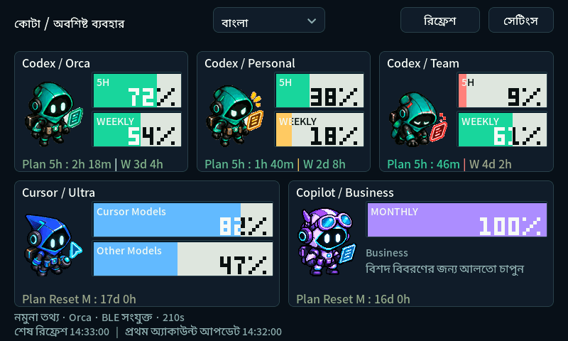
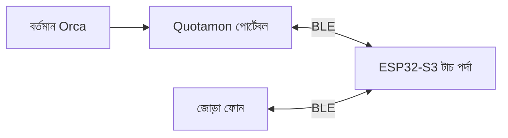

# Quotamon

**AI সাবস্ক্রিপশনের অবশিষ্ট, ডেস্কের ছোট পর্দায়।**

Codex · Cursor · Copilot · Claude · Grok 
পিক্সেল সঙ্গী ও অবশিষ্ট দণ্ডসহ ৭ ইঞ্চির মনিটর

<strong>বাংলা</strong> · 16

[English](README.md) · [한국어](README.ko.md) · [简体中文](README.zh-CN.md) · [日本語](README.ja.md) · [Deutsch](README.de.md) · [हिन्दी](README.hi.md) · [Español](README.es.md) · [العربية](README.ar.md) 
[Français](README.fr.md) · **বাংলা** · [Português](README.pt.md) · [Bahasa Indonesia](README.id.md) · [اردو](README.ur.md) · [Русский](README.ru.md) · [Naijá](README.pcm.md) · [العربية المصرية](README.ar-EG.md)

[ব্রাউজারের ভাষায় খুলুন](https://cdn.jsdelivr.net/gh/guyster323/ESP32_7inch_Quotamon@main/assets/readme/language.html) · [দ্রুত শুরু](#quick-start) · [নতুন](#whats-new) · [পরিবর্তন](#changelog) · [পোর্টেবল](docs/PORTABLE_BRIDGE.md) · [ফার্মওয়্যার](docs/UPLOAD.md) · [গঠন](docs/ARCHITECTURE.md)

ছবি ও নড়াচড়া বোর্ডের **LVGL কোড** দিয়ে আঁকা। সংখ্যা উদাহরণ। ফ্রেম, স্পর্শ, পর্দা বন্ধ ও জ্বলা অনুকরণ, আসল ছবি নয়।

## আগে এক নজর, দরকারে স্পর্শ

| এক পর্দায় পাঁচ অ্যাকাউন্ট | রিসেট পর্যন্ত সময় | তথ্য কতটা নতুন |
|---|---|---|
| তিনটি Codex অ্যাকাউন্ট, Cursor ও Copilot। সর্বোচ্চ ২০টি পৃষ্ঠায়। | ৫ ঘণ্টা ও সাপ্তাহিক পরিকল্পনা একসঙ্গে। Cursor-এর রিসেট ভাগ করা। | পর্দার আপডেট ও উৎসের সংগ্রহের সময় আলাদা। |

| চরিত্র অবস্থা জানায় | স্পর্শে বিস্তারিত | বর্তমান Orca অপরিবর্তিত |
|---|---|---|
| স্বাভাবিক, সতর্ক, জরুরি, শেষ, অফলাইন ও পুরোনো তথ্য। | প্রতিটি সীমা, অ্যাকাউন্ট বাছাই ও প্রদর্শন সেটিং। | ইনস্টল ছাড়া Windows ট্রে অ্যাপ BLE-তে পাঠায়। |

## এখন পর্দায় যা পড়া যায়

Codex শুধু দুটি নিকটতম রিসেট ক্রেডিট দেখায়। `R.T.1` বড়, `R.T.2` ছোট। তৃতীয়টি, সংখ্যা, তারিখ ও সময় অঞ্চল নেই। সময় `d / h / m`। Codex পরিকল্পনা `Plan 5h` ও `W`; Cursor ও Copilot `Plan Reset M`। সময় যত কম, রং তত লাল।

## সংযোগ

ESP32 ছবি ও স্পর্শ সামলায়। কাছের PC-তে চলা Orca ও পোর্টেবল ব্রিজ সাবস্ক্রিপশন ডেটা দেয়। Wi-Fi বা পর্দায় লগইন লাগে না। পাঠানো হয় প্রতি **৬০ সেকেন্ড**, হৃদস্পন্দন প্রতি **১০ সেকেন্ড**। ছিঁড়ে গেলে বা **৩৫ সেকেন্ড** বৈধ যোগাযোগ না থাকলে প্রদর্শন মুছে যায়।

## দ্রুত শুরু

1. **বোর্ড প্রস্তুত করুন।** লক্ষ্য **Waveshare ESP32-S3-Touch-LCD-7 Rev1.2, 800×480**। [ফার্মওয়্যার](docs/UPLOAD.md)।
2. **পোর্টেবল অ্যাপ চালান।** সফল [Windows Actions বিল্ড](https://github.com/guyster323/ESP32_7inch_Quotamon/actions/workflows/build.yml) থেকে `Quotamon-Portable-win-x64-preview` নিন, পুরো ZIP খুলুন এবং **Quotamon.exe** চালান।
3. **অ্যাকাউন্ট বেছে নিন।** Orca খুলে অ্যাকাউন্ট, উপনাম, পরিকল্পনা ও ক্রম সংরক্ষণ করুন।
4. **BLE-তে যুক্ত করুন।** ডিভাইসে জোড়া শুরু করুন, PC-তে ডিসপ্লে খুঁজুন এবং দুদিকে একই ৬ অঙ্ক অনুমোদন করুন।

Windows 10 2004 বা নতুন / Windows 11, x64 ও Bluetooth LE লাগে। পুরো ফোল্ডার রাখুন। অঙ্কের আগে ব্যর্থ হলে [Windows পুনরুদ্ধার](docs/PORTABLE_BRIDGE.md) দেখুন।

## ভাষা ও পর্দা বন্ধের সময়

পোর্টেবল ওয়েব বা ESP32-এর **প্রথম পর্দায়** ১৬টি ভাষার একটি বেছে নিলেই সেটি সংরক্ষিত হয়। **সেটিং → ভাষা → সংরক্ষণ** দিয়েও বদলানো যায়। **সেটিং → পর্দা বন্ধ** শুধু ব্যাকলাইট বন্ধ করে, PC-এর স্থানীয় সময়ে। BLE ডেটা নেয়। বন্ধ পর্দা স্পর্শ করলে **৫ মিনিট** জ্বলে। ESP32-তে সময় স্পর্শ করে ৪ অঙ্ক লিখুন: `0730` মানে `07:30`। [বর্ণনা](docs/LANGUAGES_AND_SCREEN_SCHEDULE.md)

## ফোন জুড়ে পর্দা নিয়ন্ত্রণ

বোর্ড **একটি PC ও একটি ফোন** আলাদা করে জোড়ে। PC ব্যবহার পাঠায়, প্রমাণিত ফোন সংযোগ উপস্থিতি বলে। LCD-তে **BLE সংযোগ → ফোন শনাক্ত → ফোন নিবন্ধন** খুলুন, ফোনের Bluetooth-এ Quotamon বেছে নিন এবং দুদিকে একই সংখ্যা অনুমোদন করুন।

- নিবন্ধিত ফোন ছিঁড়লে **৬০ সেকেন্ড** পরে পর্দা বন্ধ হয় এবং প্রমাণিত স্বয়ংক্রিয় সংযোগে জ্বলে।
- সময়সূচি ফোন শনাক্তের চেয়ে আগে। স্পর্শ সংরক্ষিত উজ্জ্বলতায় ৫ মিনিট জ্বালায়।
- অতিরিক্ত অ্যাপ, বিজ্ঞাপন স্ক্যান, নাম মেলানো বা Wi-Fi নেই। ফোন অ্যাকাউন্ট ডেটা পড়ে না।
- পরীক্ষিত স্বয়ংক্রিয় সংযোগ ভোক্তা-নিয়ন্ত্রণ HID, কীবোর্ড, মাউস বা স্বয়ংক্রিয় ইনপুট ছাড়া।

## পিক্সেল সঙ্গী

তারা চোখের পাতা ফেলে, শ্বাস নেয় এবং অবশিষ্ট ও উৎসের অবস্থা অনুসারে নড়ে। একই সেবার একাধিক অ্যাকাউন্ট আলাদা সময়ে নড়ে।

| সেবা | ডেটা | অ্যাকাউন্ট |
|---|---|---|
| Codex | Orca-এর ৫ ঘণ্টা ও সাপ্তাহিক সীমা এবং রিসেট ক্রেডিটের মেয়াদ | মূল + পরিচালিত |
| Claude | Orca-এর সাপ্তাহিক ও অতিরিক্ত মডেল সীমা | মূল + পরিচালিত |
| Cursor | Cursor Models · Other Models | সক্রিয় অ্যাকাউন্ট |
| Grok | Orca-এর দেওয়া ব্যবহার পুল | সক্রিয় অ্যাকাউন্ট |
| Copilot | Windows Copilot CLI-এর quota SDK, npm গ্লোবাল বা GitHub Copilot CLI পথ | বর্তমান CLI অ্যাকাউন্ট · পরীক্ষামূলক |

## নতুন

### 2026-11-18 — হোম বোতাম ও ১৬টি ভাষা

রিফ্রেশ ও সেটিং ৩৬px উঁচু এবং প্রথম কার্ড থেকে অন্তত ১৬px দূরে। প্রথম পর্দায় ভাষা বেছে নিলেই সংরক্ষিত হয়। এই পাতা বাংলা নির্দেশিকা।

### 2026-11-17 — Codex রিসেট ক্রেডিট ও পরিকল্পনার বাকি সময়

প্রতিটি Codex কার্ড শুধু দুটি নিকটতম ক্রেডিট `R.T.1` / `R.T.2` ও `d/h/m`-এ দেখায়। পরিকল্পনার সময় রং বদলায়। PC ড্যাশবোর্ড LCD-এর মতো।

## পরিবর্তন

- **2026-11-18:** হোম বোতাম ছোট এবং ১৬টি ভাষা প্রথম পর্দা থেকে সংরক্ষিত।
- **2026-11-17:** Codex রিসেট ক্রেডিট, পরিকল্পনার রং এবং Windows Copilot CLI শনাক্ত।
- **2026-10-20:** PC ও ফোনের প্রমাণিত সংযোগ আলাদা এবং পর্দা নিয়ন্ত্রণ করে।
- **2026-10-16:** পাঁচ ভাষা, প্রতিদিনের পর্দা বন্ধ এবং পিক্সেল অ্যানিমেশন।
- আগের ইংরেজি নথি [English README](README.md#changelog)-এ।

## উন্নয়ন ও নথি

| | |
|---|---|
| [Portable](docs/PORTABLE_BRIDGE.md) | [Architecture](docs/ARCHITECTURE.md) |
| [Firmware](docs/UPLOAD.md) | [BLE](docs/BLE_PROTOCOL.md) |

## কৃতজ্ঞতা

পিক্সেল শিল্প ও শতাংশ দণ্ড [F108pro Usage Monitor](https://github.com/guyster323/F108pro_Usage_monitor) থেকে। বেগুনি Copilot রোবট এই প্রকল্পের নতুন ছবি। কোড: [MIT](LICENSE)। তৃতীয় পক্ষ: [THIRD_PARTY_NOTICES.md](THIRD_PARTY_NOTICES.md)।

