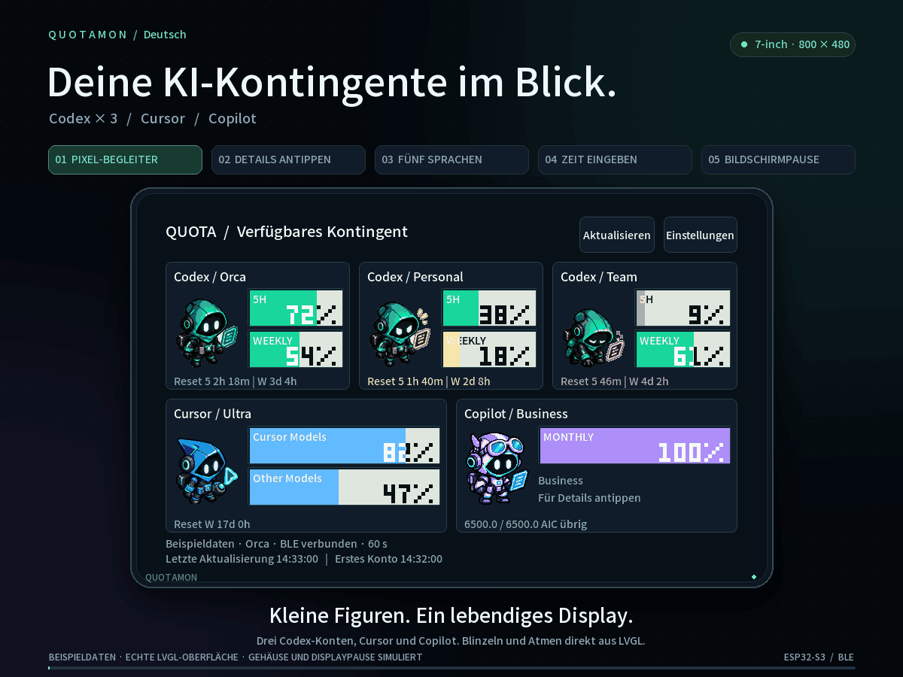
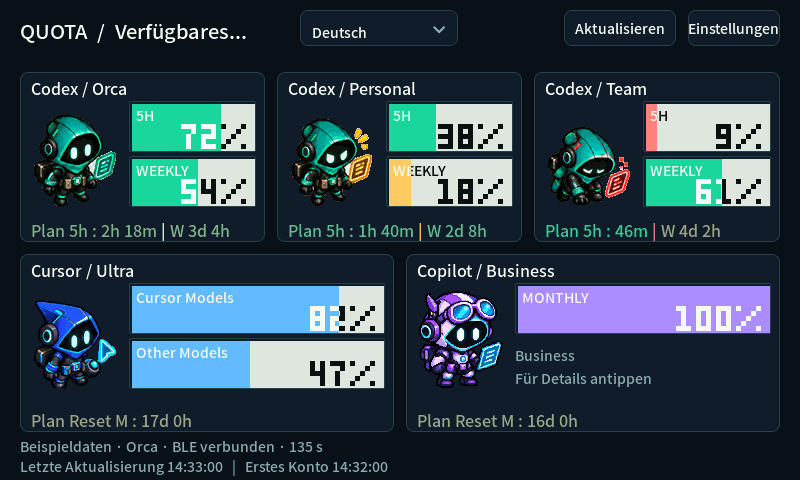
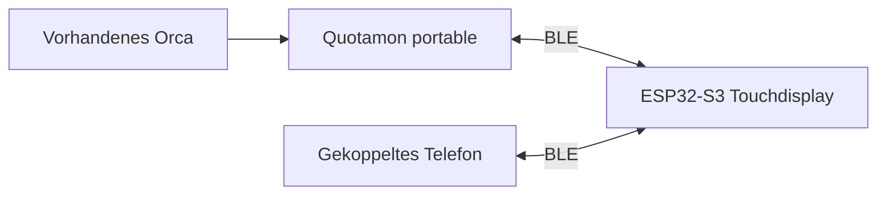

# Quotamon

**Deine KI-Kontingente auf einem kleinen Bildschirm.**

Codex · Cursor · Copilot · Claude · Grok 
Ein 7-Zoll-Monitor mit Pixelbegleitern und Restmengen

<strong>Deutsch</strong> · 16

[English](README.md) · [한국어](README.ko.md) · [简体中文](README.zh-CN.md) · [日本語](README.ja.md) · **Deutsch** · [हिन्दी](README.hi.md) · [Español](README.es.md) · [العربية](README.ar.md) 
[Français](README.fr.md) · [বাংলা](README.bn.md) · [Português](README.pt.md) · [Bahasa Indonesia](README.id.md) · [اردو](README.ur.md) · [Русский](README.ru.md) · [Naijá](README.pcm.md) · [العربية المصرية](README.ar-EG.md)

[In meiner Browsersprache öffnen](https://cdn.jsdelivr.net/gh/guyster323/ESP32_7inch_Quotamon@main/assets/readme/language.html) · [Schnellstart](#quick-start) · [Neu](#whats-new) · [Änderungen](#changelog) · [Portable](docs/PORTABLE_BRIDGE.md) · [Firmware](docs/UPLOAD.md) · [Architektur](docs/ARCHITECTURE.md)

Drei Codex-Konten + Cursor + Copilot · 24-Sekunden-Schleife · <a href="assets/readme/de/quotamon-demo.mp4">Video abspielen</a> · <a href="assets/readme/de/quotamon-display.png">PNG</a>

Bild und Bewegung stammen aus dem **LVGL-Code des Boards**. Die Werte sind Beispiele. Gehäuse, Touch-Markierungen, Display aus und an sind eine Simulation, keine Aufnahme des Geräts.

## Zuerst der Überblick, Details per Berührung

| Fünf Konten auf einen Blick | Zeit bis zum Reset | Aktualität erkennen |
|---|---|---|
| Drei Codex-Konten neben Cursor und Copilot. Bis zu 20 Konten über Seiten. | Fünf-Stunden- und Wochenplan gleichzeitig. Cursor teilt sich einen Reset. | Anzeige-Update und Erhebungszeit der Quelle stehen getrennt. |

| Zustand über Figuren | Details per Touch | Vorhandenes Orca behalten |
|---|---|---|
| Normal, Vorsicht, kritisch, aufgebraucht, offline, veraltet. | Alle Kontingente, Kontenwahl und Anzeige-Einstellungen. | Eine portable Windows-Tray-App sendet die Daten über BLE. |

## Was die Anzeige jetzt zeigt

Codex zeigt nur die zwei nächsten Reset-Guthaben. `R.T.1` ist größer, `R.T.2` kleiner. Ein drittes Guthaben, eine Anzahl, Datum und Zeitzone entfallen. Die Zeit nutzt `d / h / m`. Codex-Pläne heißen `Plan 5h` und `W`, Cursor und Copilot `Plan Reset M`. Kürzere Restzeit wird röter.

## So verbindet es sich

Der ESP32 zeichnet und verarbeitet Touch. Ein naher PC mit laufendem Orca und der portablen Brücke liefert die Abo-Daten. WLAN und Login auf dem Display sind unnötig. Übertragung alle **60 Sekunden**, Heartbeat **10 Sekunden**. Nach einer Trennung oder **35 Sekunden** ohne gültigen Verkehr wird die Anzeige geleert.

## Schnellstart

1. **Board vorbereiten.** Ziel ist **Waveshare ESP32-S3-Touch-LCD-7 Rev1.2, 800×480**. [Firmware-Upload](docs/UPLOAD.md).
2. **Portable App starten.** `Quotamon-Portable-win-x64-preview` aus einem erfolgreichen [Windows-Actions-Build](https://github.com/guyster323/ESP32_7inch_Quotamon/actions/workflows/build.yml) laden, das ganze ZIP entpacken und **Quotamon.exe** starten.
3. **Konten wählen.** Vorhandenes Orca öffnen und Konten, Aliase, Tarife und Reihenfolge speichern.
4. **Per BLE verbinden.** Kopplung am Gerät starten, das Display am PC suchen und auf beiden Seiten dieselbe sechsstellige Zahl bestätigen.

Windows 10 2004 oder neuer / Windows 11, x64 und Bluetooth LE. Den Ordner vollständig behalten. Wenn die Kopplung vor der Zahl scheitert: [Windows-Wiederherstellung](docs/PORTABLE_BRIDGE.md).

## Sprache und Display-Zeitplan

Auf dem **Startbildschirm** der portablen Web-App oder des ESP32 wird eine von 16 Sprachen sofort gespeichert. Alternativ **Einstellungen → Sprache → Speichern**. **Einstellungen → Display aus** schaltet nur die Hintergrundbeleuchtung nach der PC-Ortszeit ab. BLE bleibt aktiv. Eine Berührung schaltet für **fünf Minuten** ein. Auf dem ESP32 tippt man die Uhrzeit und gibt vier Ziffern ein: `0730` wird `07:30`. [Anleitung](docs/LANGUAGES_AND_SCREEN_SCHEDULE.md)

## Display über ein direkt gekoppeltes Telefon

Das Board koppelt **einen PC und ein Telefon** getrennt. Der PC sendet Verbrauch, die authentifizierte Telefonverbindung erkennt Anwesenheit. Auf dem LCD **BLE-Verbindung → Telefonerkennung → Telefon registrieren** öffnen, Quotamon in den Bluetooth-Einstellungen des Telefons wählen und auf beiden Seiten dieselbe Zahl bestätigen.

- **60 Sekunden** nach Trennung des registrierten Telefons geht das Display aus und bei authentifizierter Wiederverbindung wieder an.
- Der Zeitplan hat Vorrang. Eine Berührung schaltet für fünf Minuten mit gespeicherter Helligkeit ein.
- Keine Zusatz-App, kein Werbe-Scan, keine Namenssuche, kein WLAN. Das Telefon liest keine Kontodaten.
- Die getestete automatische Verbindung nutzt ein Consumer-Control-HID ohne Tastatur, Maus oder automatische Eingaben.

## Die Pixelcrew

Die Figuren blinzeln, atmen und ändern ihre Bewegung nach Restmenge und Erfassungszustand. Mehrere Konten desselben Dienstes bewegen sich zu unterschiedlichen Zeiten.

| Dienst | Daten | Konten |
|---|---|---|
| Codex | 5-Stunden- und Wochenlimits von Orca plus Ablauf der Reset-Guthaben | Standard + verwaltete Konten |
| Claude | Wochen- und Zusatzmodell-Limits von Orca | Standard + verwaltete Konten |
| Cursor | Cursor Models · Other Models | Aktives Konto |
| Grok | Von Orca gelieferte Kontingente | Aktives Konto |
| Copilot | Quota-SDK der Windows-Copilot-CLI, inklusive npm-Globalinstallation und GitHub-Copilot-CLI-Pfad | Aktuelles CLI-Konto · experimentell |

## Neu

### 2026-11-18 — Home-Buttons und 16 Sprachen

Aktualisieren und Einstellungen sind 36px hoch und liegen mindestens 16px über der ersten Karte. Die Sprache wird auf dem Startbildschirm sofort gespeichert. Diese Seite ist die deutsche Anleitung.

### 2026-11-17 — Codex-Reset-Guthaben und Plan-Restzeit

Jede Codex-Karte zeigt nur die zwei nächsten Guthaben als `R.T.1` / `R.T.2` in `d/h/m`. Die Plan-Restzeit wechselt die Farbe. Das PC-Dashboard zeigt dieselben Informationen wie das LCD.

## Änderungen

- **2026-11-18:** Home-Buttons enger gesetzt und 16 Sprachen direkt auf dem Startbildschirm gespeichert.
- **2026-11-17:** Codex-Reset-Guthaben, farbige Plan-Restzeit und der Windows-Installationspfad der Copilot-CLI.
- **2026-10-20:** Getrennte authentifizierte PC- und Telefonverbindung steuert das Display.
- **2026-10-16:** Fünf Sprachen, täglicher Display-Zeitplan und Pixelanimation.
- Ältere Einträge stehen im [englischen README](README.md#changelog).

## Entwicklung und Dokumentation

| | |
|---|---|
| [Portable starten und wiederherstellen](docs/PORTABLE_BRIDGE.md) | [Architektur](docs/ARCHITECTURE.md) |
| [Firmware und BOOT/RESET](docs/UPLOAD.md) | [BLE-Protokoll](docs/BLE_PROTOCOL.md) |

## Danksagung

Pixelgrafik und Prozentbalken stammen von [F108pro Usage Monitor](https://github.com/guyster323/F108pro_Usage_monitor). Der violette Copilot-Roboter ist eine neue Illustration dieses Projekts. Code: [MIT](LICENSE). Weitere Lizenzen: [THIRD_PARTY_NOTICES.md](THIRD_PARTY_NOTICES.md).

