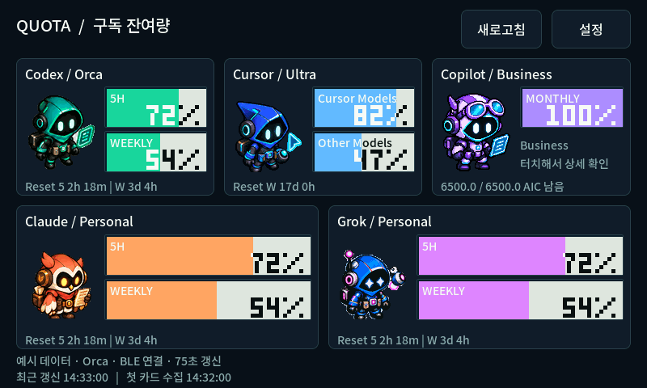

# Quotamon

**AI subscription quotas on one 7-inch desk display.**

[한국어](README.md) · [Portable setup](docs/PORTABLE_BRIDGE.md) · [Architecture](docs/ARCHITECTURE.md)



This is a real LVGL/RGB565 render with illustrative data, not a photograph of a flashed device.

Quotamon targets the **Waveshare ESP32-S3-Touch-LCD-7 Rev1.2**, with five account cards per page, touch details, multiple quota pools, configurable fields, Korean/Latin fonts, and six pixel-art states for Codex, Cursor, Copilot, Claude, and Grok. The percentage text changes from white to dark across the fill boundary, inspired by [F108pro Usage Monitor](https://github.com/guyster323/F108pro_Usage_monitor).

The product architecture is **unmodified Orca → portable Windows BLE bridge → standalone ESP32**. Extract the package and run Quotamon.exe; Node and .NET are included. The tray opens a local settings page for accounts, pairing and display preferences. Authentication stays with Orca and providers; only sanitized display fields cross BLE. ESP32 renders independently, but a nearby PC running Orca and the bridge supplies subscription data.

## Development preview

Stock Orca does not contain the BLE sender; the portable bridge supplies it without changing Orca. Live checks against Orca 1.4.224 read three Codex accounts and Cursor, plus the existing Copilot SDK account. Product UI tests cover account editing, numeric pairing approval, settings, reload, narrow layouts and clearing on source loss. Launcher crash cleanup was verified. Physical firmware upload and BLE pairing remain unverified. The older source-integration patch is optional developer material.

Native UI/pointer tests, C++/TypeScript fragmentation and privacy tests pass. The Windows resource compiles and detects BLE central support on the development PC. Firmware builds with ESP-IDF 5.5.3 and fits the 8 MB factory partition layout (about 6.36 MB). See [verification](docs/VERIFICATION.md) for precise boundaries.

Codex and Claude support Orca-managed accounts. Cursor and Grok currently expose one active account through the reviewed Orca API. Copilot uses an optional read-only quota RPC from an already installed Windows CLI; its SDK/AIC mapping is experimental. Missing data remains unknown; session usage is never treated as monthly quota. No universal 6,500-credit entitlement is assumed.

Default snapshot interval: 60 seconds. Heartbeat: 10 seconds. Values clear after disconnect or 35 seconds without traffic. Source freshness remains independent of BLE liveness. Pairing uses encrypted Secure Connections with numeric comparison and approval on both screens.

## Build

```powershell
python tools/bootstrap_dependencies.py
npm ci --prefix orca-integration
npm test --prefix orca-integration
tools\build_native.cmd
build\native\quotamon_protocol_test.exe
build\native\espmonitor_sim.exe
```

The simulator is a development tool. Download the `Quotamon-Portable-win-x64-preview` artifact from a successful [Windows Actions build](https://github.com/guyster323/ESP32_7inch_Quotamon/actions/workflows/build.yml), extract its inner ZIP and run Quotamon.exe. Enable Windows login startup in settings. Follow [portable setup](docs/PORTABLE_BRIDGE.md) and [firmware upload](docs/UPLOAD.md) for hardware setup. USB is used for flashing/power/logs; Wi-Fi and classic Bluetooth SPP are not used.

MIT project code. F108pro artwork/glyph shapes, Noto fonts, Orca patch context, Waveshare port and runtime dependencies retain their respective [notices](THIRD_PARTY_NOTICES.md). The new lavender Copilot pilot robot is original, unofficial artwork.
