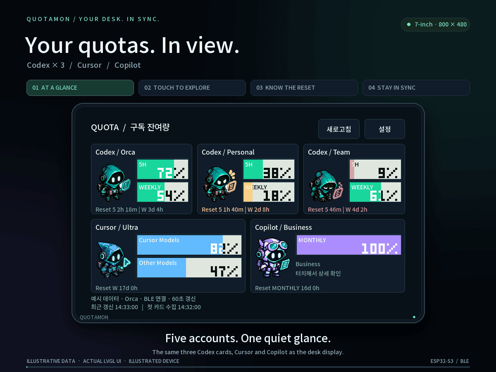
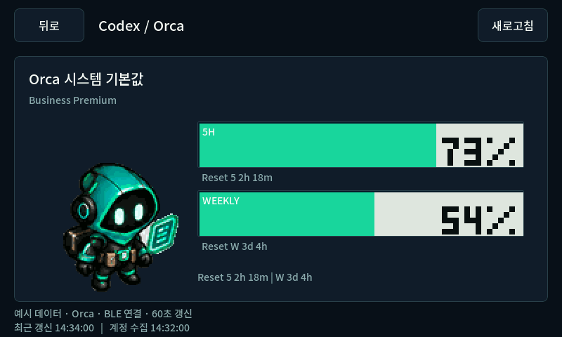
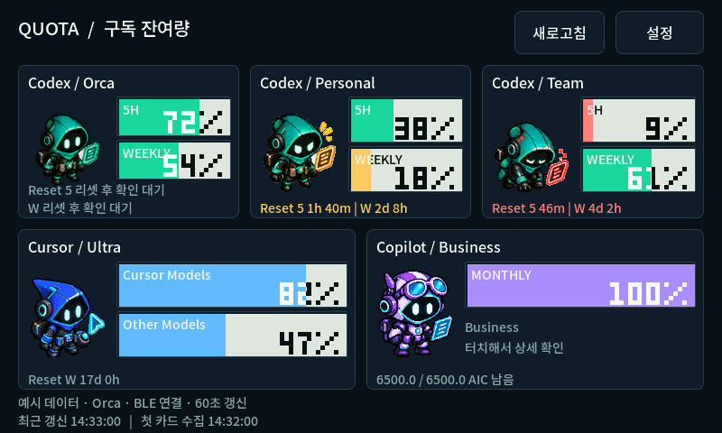
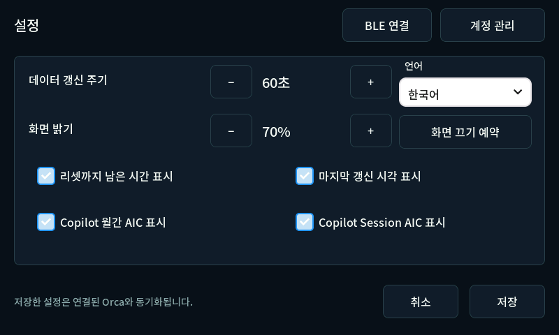
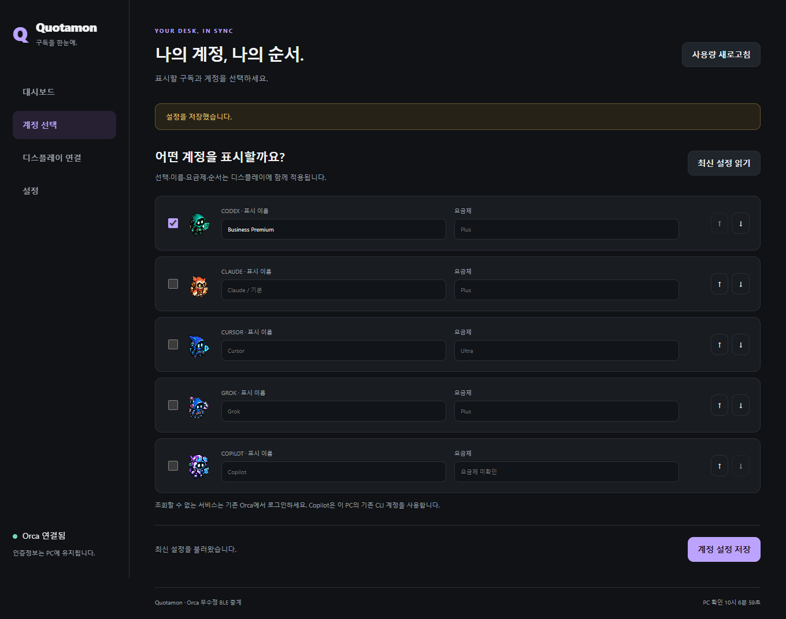
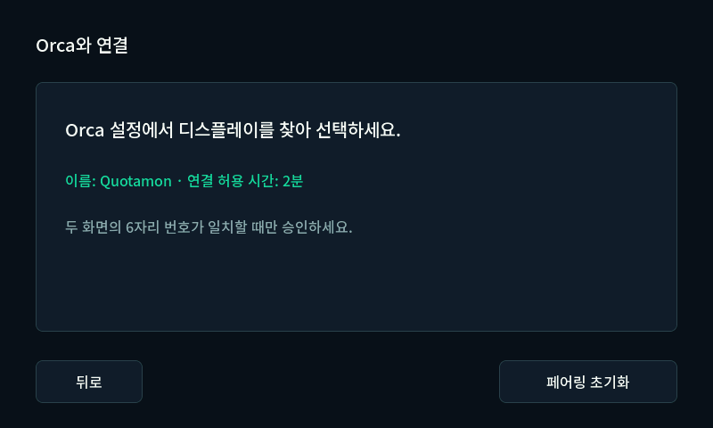
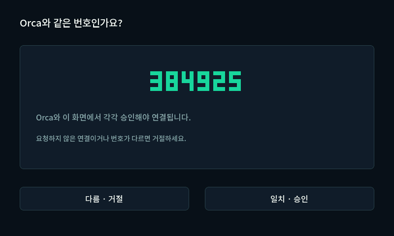
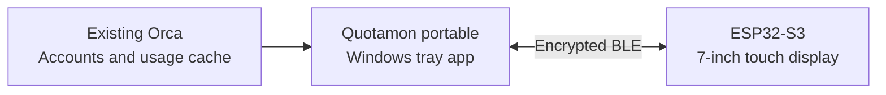
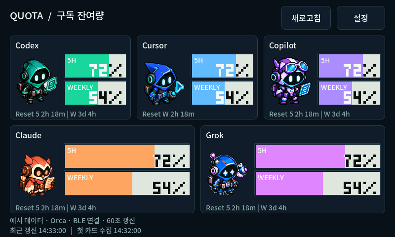

<div align="center">

# Quotamon

**Your AI subscription quotas. A screen of their own.**

Codex · Cursor · Copilot · Claude · Grok<br>
A 7-inch desk display with pixel companions and quota bars.

[](https://github.com/guyster323/ESP32_7inch_Quotamon/actions/workflows/build.yml)
[](firmware)
[](native)
[](orca-integration)
[](LICENSE)

[한국어](README.md) · [Quick start](#quick-start) · [Portable setup](docs/PORTABLE_BRIDGE.md) · [Firmware upload](docs/UPLOAD.md) · [Architecture](docs/ARCHITECTURE.md)

<a href="assets/readme/quotamon-demo.mp4">
  
</a>

<sub>Three Codex accounts + Cursor + Copilot, matching the desk setup · 14-second loop · <a href="assets/readme/quotamon-demo.mp4">Play the video</a> · <a href="assets/readme/quotamon-display.png">Still image</a></sub>

</div>

The screen uses **the actual LVGL code shared with the board**. Values are illustrative. The device bezel, highlights and transitions are presentation graphics; this is an illustrated demo rather than footage of the hardware.

## Glance first. Touch for more.

| Five accounts at a glance | Know when quotas reset | Know how fresh the data is |
|---|---|---|
| Three Codex accounts alongside Cursor and Copilot. Page through up to 20 accounts. | Five-hour and weekly schedules together, with one shared reset for Cursor. | Display refresh and provider collection time are shown separately. |

| Pixel companions with a purpose | Details one touch away | Keep your existing Orca |
|---|---|---|
| Six states: normal, caution, critical, exhausted, offline and stale. | Open every quota pool, choose accounts and adjust display settings. | A portable Windows tray app supplies data over BLE. Node and .NET are included. |

Quota numbers appear white over the filled bar and dark over its empty portion. Remaining quotas at **20% or less** trigger caution; **10% or less** trigger a critical state. Unknown and unlimited values remain distinct.

## On the current display

```text
Reset 5 2h 41m | W 5d 3h       Five-hour and weekly resets together
Reset W 17d 0h                 One shared reset for both Cursor pools
최근 갱신 14:34:00 | 첫 카드 수집 14:32:00
```

`5` means the five-hour window; `W` labels the weekly or shared Cursor reset. `d / h / m` mean days, hours and minutes. Long schedules use two lines and resize the card contents to avoid overlap. Cursor shows **Cursor Models** and **Other Models**, excluding the Monthly aggregate.

| Touch to open account details | Long schedules wrap to two lines |
|:---:|:---:|
| [](visuals/native/02-codex-detail.png) | [](visuals/native/18-wrapped-reset.png) |

<details>
<summary>More screens: settings, pairing and the PC companion</summary>

| LCD preferences | Account selection on the PC |
|:---:|:---:|
|  |  |
| Start BLE pairing | Compare the numbers |
|  |  |

These are mock examples rendered by the product UI. Physical upload, pairing, data transfer and display startup were checked separately; see the [verification record](docs/VERIFICATION.md).

</details>

## How it connects



ESP32 handles rendering and touch. A **nearby PC running Orca and the portable bridge** supplies subscription data. No Wi-Fi or on-device web login is required. Orca stays unmodified, and account credentials remain on the PC.

Default snapshot interval: **60 seconds**. Heartbeat: **10 seconds**. A disconnect or **35 seconds** without valid traffic clears display data. Provider collection has its own schedule, so a healthy BLE link never makes old source data look fresh.

## Quick start

1. **Prepare the board.** The target is **Waveshare ESP32-S3-Touch-LCD-7 Rev1.2, 800×480**. Follow the [firmware upload guide](docs/UPLOAD.md).
2. **Run the portable app.** Download `Quotamon-Portable-win-x64-preview` from a successful [Windows Actions build](https://github.com/guyster323/ESP32_7inch_Quotamon/actions/workflows/build.yml), extract the entire inner ZIP, and run **Quotamon.exe**. GitHub sign-in is required to download artifacts.
3. **Choose your accounts.** Start your existing Orca, then save the account selection, aliases, plans and order in the settings page.
4. **Connect over BLE.** Start pairing on the display, find it from the PC, and approve matching six-digit numbers on both screens. Saved devices reconnect automatically.

Requires Windows 10 2004 or later / Windows 11, x64 and Bluetooth LE. Keep the portable folder intact. Enable Windows login startup in tray settings. If pairing fails before showing numbers, use the [Windows native pairing recovery steps](docs/PORTABLE_BRIDGE.md).

## Languages and scheduled screen-off

The web UI and ESP32 support **Korean, Simplified Chinese, Japanese, English and German**. Choose **Settings → Language → Save** to synchronize the language between the PC and display.

Under **Settings → Screen-off schedule**, set daily off/on times. The default is **disabled, 23:00–07:00**. The schedule uses the PC's local time and switches off the backlight while BLE and data reception continue. Touch the dark display to wake it for **five minutes**.

On the ESP32, **tap a time → enter four digits → OK → Save**. For example, `0730` enters `07:30`. The `−` and `+` buttons still adjust it in 15-minute steps.

[Settings, clock sync, fonts and verification](docs/LANGUAGES_AND_SCREEN_SCHEDULE.md) · [English web settings](visuals/locales/web-en.png) · [Japanese LCD preview](visuals/locales/lcd-ja-home.png)

## Meet the pixel crew

| Codex | Cursor | Copilot | Claude | Grok |
|:---:|:---:|:---:|:---:|:---:|
|  |  |  |  |  |

Companions blink, breathe and make small gestures on both home cards and account details. Their movements follow quota/source state, with separate timing for each account.

[](visuals/native/character-animation.gif)

| State | Movement |
|---|---|
| Normal | Blinks, expression changes, breathing and occasional small leans or hops |
| Caution / critical | Looking from side to side / occasional brief shaking |
| Exhausted / unknown | Slow breathing in a tired or offline pose |
| Stale | Stale expression and occasional side-to-side movement |

Restored 24 additional F108pro expressions and added native LVGL eyelids for Copilot. **Lossless palette storage expands the set from 30 to 54 images while reducing asset bytes from 855,360 to 521,289—about 39%.** One 100ms timer updates visible characters; settings and pairing pages pause it.

The current firmware uses **74.9% of its flash partition** and **16.6% of static RAM capacity**. After adding languages and screen scheduling, the physical board was measured with BLE and animations running.

| Hardware measurement | Home: five characters, 70.32s |
|---|---:|
| CPU utilization: two-core mean | **6.28%** |
| Actual LVGL refresh rate | **7.47fps** |
| Current free PSRAM | **About 635KiB** |

Free PSRAM stayed at 650,584 bytes; the largest contiguous block was 608KiB. During 55.11s of scheduled screen-off, average CPU utilization was 1.49% and BLE stayed connected. FPS counts actual content updates, not LCD scan frequency or maximum throughput. [Latest samples](docs/screen-schedule-hardware.json) · [Methods and earlier firmware measurements](docs/RUNTIME_METRICS.md). The GIFs use illustrative data and are renderer output, not hardware footage.

[Detail GIF](visuals/native/character-detail-animation.gif) · [State GIF](visuals/native/character-states-animation.gif) · [Implementation, resources and hardware rollout](docs/CHARACTER_ANIMATION.md)

| Provider | Source data | Account coverage |
|---|---|---|
| Codex | Orca five-hour, weekly and other supplied limits | Default + managed accounts |
| Claude | Orca weekly and additional model limits | Default + managed accounts |
| Cursor | Cursor Models · Other Models | Current active account |
| Grok | Quota pools exposed by Orca | Current active account |
| Copilot | Quota SDK from an existing Windows Copilot CLI | Current CLI account · experimental |

Quota is never inferred from account count or a plan name. Copilot **session usage and monthly allowance are separate**. SDK request units still need independent AIC verification; a 6,500-credit allowance is not assumed for every plan. See [source research and limits](docs/RESEARCH.md).

## Implementation and verification

This is a **development preview**. Beyond the shared LVGL UI and portable bridge, physical firmware upload, pairing and reconnect have been checked.

| Scope | Evidence |
|---|---|
| Software | 38 TypeScript tests; C++ BLE framing; native UI, pointer and font checks |
| Character animation | Five providers × six states, 40 page cycles, unchanged pixels outside sprite regions and 54 lossless assets verified. All 380 rendered frames match before/after compression |
| Live data | Three Codex accounts and Cursor from unmodified Orca 1.4.224, plus the existing Copilot SDK account |
| Hardware | Full backup, application upload and readback verification; bootloader, partitions and pairing NVS preserved |
| Connection and display | Windows numeric pairing and five-account transfer/ACK on earlier firmware. After the animation update and BLE-helper restart, the user confirmed display startup, BLE reconnection and normal operation |

Refresh timestamps and compact reset layouts were checked in the native renderer. Individual on-device text layouts, extended operation and every recovery scenario have not all been verified. The [verification record](docs/VERIFICATION.md) separates these boundaries.

## Changelog

### 2026-10-16 — Languages and scheduled screen-off

- Added Korean, Simplified Chinese, Japanese, English and German selection, synchronized between the web UI and ESP32.
- Added a daily backlight-off schedule, overnight ranges and five-minute touch wake. BLE and incoming data remain active.
- Added a direct time-entry keypad and fixed device settings saves rebooting the ESP32 and reverting preferences.
- Added a shared translation catalog, complete UI glyph subsets and settings, time-boundary and rendering checks. [Usage and verification](docs/LANGUAGES_AND_SCREEN_SCHEDULE.md)

### 2026-10-16 — Pixel character animation

- **Periodic screen-shift fix:** Replaced CPU sampling's full task/stack scan with two idle-counter reads, and moved heap queries and BLE transmission outside the UI lock. Animations and five-second diagnostics remain enabled. Added a regression test using the firmware sampler itself. [Analysis and verification](docs/RUNTIME_METRICS.md)
- **Hardware resource measurements:** Home averages 6.10% CPU and 7.43fps; detail averages 6.08% and 2.57fps; free PSRAM is about 891KiB. Added five-second diagnostics, a numeric-only collector and tests for field filtering and unchanged dashboard cadence. [Measurement record](docs/RUNTIME_METRICS.md)
- Home cards and account details now breathe, blink, change expression and make occasional small gestures according to quota/source state, with separate timing for each account.
- Restored 24 original F108pro expression frames; Copilot uses native LVGL eyelids. One reusable timer updates visible characters only.
- Lossless palette storage and one shared decode buffer reduce asset storage by about 39%. CI now checks animation regressions and the PSRAM XIP/framebuffer budget alongside flash capacity.
- [Actual LVGL-rendered GIF](visuals/native/character-animation.gif) · [Implementation, resources and verification](docs/CHARACTER_ANIMATION.md). Flashed and verified the application while preserving the bootloader, partitions and pairing NVS. The user confirmed the physical display reconnected over BLE and operates normally.

### 2026-10-15 — Stable account quotas and scheduled web updates

- **Fixed quota ownership during account switches:** Codex and Claude usage follows the actual active account. Saved account IDs, order and aliases stay in place, and different members of the same organization remain separate.
- **Last confirmed readings and plans:** Only readings belonging to the same account are retained in memory. An inactive default account starts as unknown after an app restart if no reading is available. The saved “plan unknown” placeholder is cleared while user-defined plans are preserved.
- **Removed two-second web polling:** The dashboard refreshes once **two seconds before the next scheduled transfer**—58 seconds after the previous ACK with a 60-second interval. Interval changes reschedule the update. Source cache changes wait for the regular transfer; pairing, connection status and user actions remain immediate.
- **Verification and rollout:** All 35 tests and browser checks with simulated source/BLE passed. Applied to the existing installation while preserving account settings, startup registration and runtime binaries. Physical LCD behavior during actual account switches was not directly verified for this change. [Verification record](docs/VERIFICATION.md) · [Implementation commit](https://github.com/guyster323/ESP32_7inch_Quotamon/commit/4c0c839e85358287c8bb7f744e5df3814eeab969)

## Build and documentation

| Get started | Understand the system | Inspect the evidence |
|---|---|---|
| [Portable setup and recovery](docs/PORTABLE_BRIDGE.md) | [Architecture](docs/ARCHITECTURE.md) | [Verification](docs/VERIFICATION.md) |
| [Firmware and BOOT/RESET](docs/UPLOAD.md) | [BLE protocol](docs/BLE_PROTOCOL.md) | [Source research](docs/RESEARCH.md) |

<details>
<summary>Local builds and motion asset generation</summary>

The native preview uses Visual Studio C++/CMake on Windows. Generated sprites and Korean fonts are committed.

```powershell
python tools/bootstrap_dependencies.py
npm ci --prefix orca-integration
npm test --prefix orca-integration

tools\build_native.cmd
build\native\quotamon_protocol_test.exe
python tools/verify_native_visuals.py
python tools/verify_character_animation.py
build\native\espmonitor_sim.exe
```

The README GIF and still image use **Pillow and the native simulator**, with the local Noto Sans KR font or Windows Segoe UI.

```powershell
python -m pip install Pillow
python tools/generate_readme_media.py
```

For an MP4 export, install `imageio-ffmpeg` and run `python tools/generate_readme_media.py --video-only`. Open `assets/readme/index.html` locally in a browser for playback controls and looping.

The generator never reads running Orca or account data. Assets are written to `assets/readme/`, with generation metadata in `assets/readme/media.json`.

| Path | Purpose |
|---|---|
| `firmware/` | Waveshare RGB/GT911 port + ESP-IDF NimBLE receiver |
| `native/` | Shared LVGL UI, fonts, sprites and Windows simulator |
| `portable/` | Windows tray launcher and local settings UI |
| `orca-integration/` | Unmodified Orca access, shared bridge core and BLE control |
| `protocol/` | BLE frame decoder |
| `assets/` · `visuals/` | Pixel companions, motion graphics and native screen examples |

The older [internal Orca integration patch](docs/ORCA_INTEGRATION.md) remains optional developer reference material. The portable flow does not require it.

</details>

## Credits

Inspired by the pixel artwork and split percentage bars of [F108pro Usage Monitor](https://github.com/guyster323/F108pro_Usage_monitor). Codex/Cursor/Claude/Grok use its MIT assets. The lavender Copilot pilot robot is original, unofficial artwork created for this project.

[Orca](https://github.com/stablyai/orca) · [Waveshare LCD-7](https://docs.waveshare.com/ESP32-S3-Touch-LCD-7/Instructions-For-Use) · [LVGL](https://github.com/lvgl/lvgl) · [ESP-IDF](https://github.com/espressif/esp-idf) · [Noto Sans KR](https://github.com/google/fonts/tree/main/ofl/notosanskr)

Project code: [MIT](LICENSE). Artwork, fonts, ports and runtime dependencies retain their respective [third-party notices](THIRD_PARTY_NOTICES.md).
