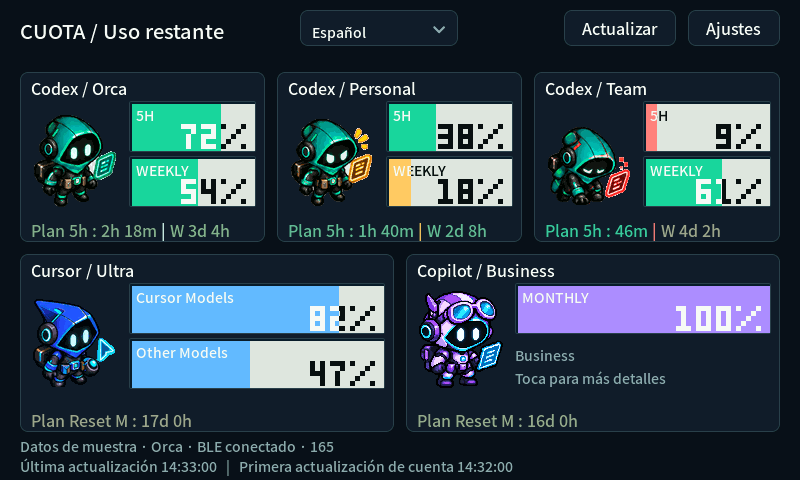
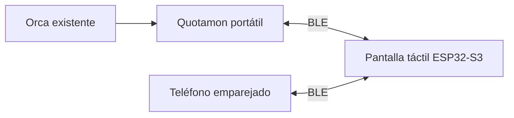

# Quotamon

**Las cuotas de tus suscripciones de IA, en una pantalla pequeña.**

Codex · Cursor · Copilot · Claude · Grok 
Un monitor de 7 pulgadas con compañeros píxel y barras de restante

<strong>Español</strong> · 16

[English](README.md) · [한국어](README.ko.md) · [简体中文](README.zh-CN.md) · [日本語](README.ja.md) · [Deutsch](README.de.md) · [हिन्दी](README.hi.md) · **Español** · [العربية](README.ar.md) 
[Français](README.fr.md) · [বাংলা](README.bn.md) · [Português](README.pt.md) · [Bahasa Indonesia](README.id.md) · [اردو](README.ur.md) · [Русский](README.ru.md) · [Naijá](README.pcm.md) · [العربية المصرية](README.ar-EG.md)

[Abrir en el idioma del navegador](https://cdn.jsdelivr.net/gh/guyster323/ESP32_7inch_Quotamon@main/assets/readme/language.html) · [Inicio rápido](#quick-start) · [Novedades](#whats-new) · [Cambios](#changelog) · [Portable](docs/PORTABLE_BRIDGE.md) · [Firmware](docs/UPLOAD.md) · [Arquitectura](docs/ARCHITECTURE.md)

La imagen y el movimiento usan el **código LVGL compartido con la placa**. Las cifras son ejemplos. El marco, el toque, el apagado y el encendido son una simulación, no una foto del aparato.

## Primero la vista general; el detalle, al tocar

| Cinco cuentas a la vez | Tiempo hasta el reinicio | Saber si el dato es reciente |
|---|---|---|
| Tres cuentas de Codex junto a Cursor y Copilot. Hasta 20 cuentas por páginas. | El plan de 5 horas y el semanal se ven juntos. Cursor comparte un reinicio. | La actualización de la pantalla y la hora de origen van por separado. |

| El personaje indica el estado | Detalle con un toque | Conserva tu Orca |
|---|---|---|
| Normal, precaución, crítico, agotado, sin conexión e información antigua. | Cada límite, la elección de cuentas y los ajustes de pantalla. | Una app portátil de Windows envía los datos por BLE. Incluye Node y .NET. |

## Lo que se lee en la pantalla

Codex muestra solo los dos créditos de reinicio más próximos. `R.T.1` es más grande y `R.T.2` más pequeño. No aparecen un tercero, la cantidad, la fecha ni la zona horaria. El tiempo usa `d / h / m`. El plan de Codex es `Plan 5h` y `W`; Cursor y Copilot usan `Plan Reset M`. Cuanto menos tiempo queda, más rojo es el texto.

## Cómo se conecta

El ESP32 dibuja y recibe el toque. Un PC cercano con Orca y el puente portátil envía los datos de suscripción. No hace falta Wi-Fi ni iniciar sesión en la pantalla. El envío es cada **60 segundos** y el latido cada **10 segundos**. Si se corta o pasan **35 segundos** sin tráfico válido, se borra lo mostrado.

## Inicio rápido

1. **Prepara la placa.** El objetivo es **Waveshare ESP32-S3-Touch-LCD-7 Rev1.2, 800×480**. [Firmware](docs/UPLOAD.md).
2. **Ejecuta la app portátil.** Descarga `Quotamon-Portable-win-x64-preview` de una [compilación de Windows](https://github.com/guyster323/ESP32_7inch_Quotamon/actions/workflows/build.yml) correcta, descomprime todo el ZIP y abre **Quotamon.exe**.
3. **Elige las cuentas.** Abre tu Orca y guarda cuentas, alias, planes y orden.
4. **Conecta por BLE.** Inicia el emparejamiento en el aparato, busca la pantalla en el PC y aprueba el mismo número de 6 cifras en ambos lados.

Hace falta Windows 10 2004 o posterior / Windows 11, x64 y Bluetooth LE. Conserva la carpeta completa. Si falla antes del número, consulta la [recuperación de Windows](docs/PORTABLE_BRIDGE.md).

## Idioma y apagado programado

En la **pantalla inicial** de la web portátil o del ESP32, elegir uno de los 16 idiomas lo guarda al momento. También vale **Ajustes → Idioma → Guardar**. **Ajustes → Apagado programado** apaga solo la retroiluminación según la hora local del PC. BLE sigue recibiendo. Tocar la pantalla apagada la enciende **5 minutos**. En el ESP32 se toca la hora y se escriben 4 cifras: `0730` es `07:30`. [Guía](docs/LANGUAGES_AND_SCREEN_SCHEDULE.md)

## Control de pantalla con un teléfono emparejado

La placa empareja **un PC y un teléfono** por separado. El PC envía el uso y la conexión autenticada del teléfono indica si estás cerca. En la LCD abre **Conexión BLE → Presencia del teléfono → Registrar teléfono**, elige Quotamon en el Bluetooth del teléfono y aprueba el mismo número.

- A los **60 segundos** de desconectarse el teléfono registrado, la pantalla se apaga y vuelve a encenderse con la reconexión autenticada.
- El horario tiene prioridad. Un toque enciende 5 minutos con el brillo guardado.
- No usa otra app, escaneo de anuncios, coincidencia de nombres ni Wi-Fi. El teléfono no lee los datos de las cuentas.
- La reconexión probada usa un HID de control de consumidor, sin teclado, ratón ni entradas automáticas.

## Los compañeros píxel

Parpadean, respiran y cambian el gesto según el restante y el estado de la fuente. Varias cuentas del mismo servicio se mueven en momentos distintos.

| Servicio | Datos | Cuentas |
|---|---|---|
| Codex | Límites de 5 horas y semanales de Orca, y el vencimiento de los créditos de reinicio | Predeterminada + administradas |
| Claude | Límites semanales y de modelos extra de Orca | Predeterminada + administradas |
| Cursor | Cursor Models · Other Models | Cuenta activa |
| Grok | Grupos de uso que entrega Orca | Cuenta activa |
| Copilot | SDK de cuota de la CLI de Copilot para Windows, en npm global o en la ruta de GitHub Copilot CLI | Cuenta CLI actual · experimental |

## Novedades

### 2026-11-18 — Botones de inicio y 16 idiomas

Actualizar y Ajustes miden 36px de alto y quedan al menos a 16px de la primera tarjeta. El idioma elegido en la pantalla inicial se guarda al momento. Esta página es la guía en español.

### 2026-11-17 — Créditos de reinicio de Codex y tiempo del plan

Cada tarjeta de Codex muestra solo los dos créditos más próximos como `R.T.1` / `R.T.2` en `d/h/m`. El tiempo del plan cambia de color. El panel del PC coincide con la LCD.

## Cambios

- **2026-11-18:** Botones del inicio más compactos y 16 idiomas guardados desde la primera pantalla.
- **2026-11-17:** Créditos de reinicio de Codex, color del plan y detección de la CLI de Copilot para Windows.
- **2026-10-20:** Conexiones autenticadas separadas de PC y teléfono para controlar la pantalla.
- **2026-10-16:** Cinco idiomas, apagado diario y animación de los personajes.
- Los cambios anteriores están en el [README en inglés](README.md#changelog).

## Desarrollo y documentación

| | |
|---|---|
| [Portable](docs/PORTABLE_BRIDGE.md) | [Architecture](docs/ARCHITECTURE.md) |
| [Firmware](docs/UPLOAD.md) | [BLE](docs/BLE_PROTOCOL.md) |

## Créditos

El pixel art y las barras de porcentaje parten de [F108pro Usage Monitor](https://github.com/guyster323/F108pro_Usage_monitor). El robot violeta de Copilot es una ilustración nueva de este proyecto. Código: [MIT](LICENSE). Avisos de terceros: [THIRD_PARTY_NOTICES.md](THIRD_PARTY_NOTICES.md).

