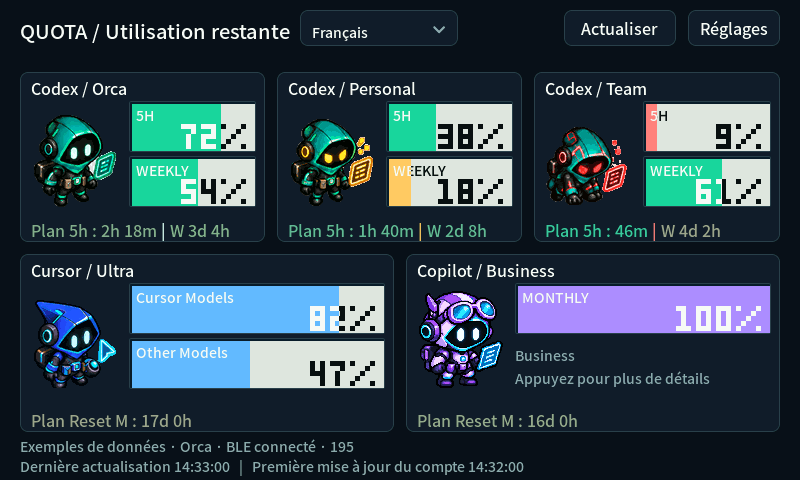
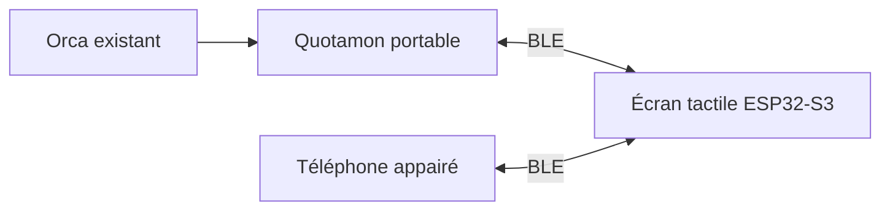

# Quotamon

**Vos quotas d’abonnement IA, sur un petit écran.**

Codex · Cursor · Copilot · Claude · Grok 
Un moniteur 7 pouces avec des compagnons pixel et des barres de reste

<strong>Français</strong> · 16

[English](README.md) · [한국어](README.ko.md) · [简体中文](README.zh-CN.md) · [日本語](README.ja.md) · [Deutsch](README.de.md) · [हिन्दी](README.hi.md) · [Español](README.es.md) · [العربية](README.ar.md) 
**Français** · [বাংলা](README.bn.md) · [Português](README.pt.md) · [Bahasa Indonesia](README.id.md) · [اردو](README.ur.md) · [Русский](README.ru.md) · [Naijá](README.pcm.md) · [العربية المصرية](README.ar-EG.md)

[Ouvrir dans la langue du navigateur](https://cdn.jsdelivr.net/gh/guyster323/ESP32_7inch_Quotamon@main/assets/readme/language.html) · [Démarrage](#quick-start) · [Nouveautés](#whats-new) · [Historique](#changelog) · [Portable](docs/PORTABLE_BRIDGE.md) · [Micrologiciel](docs/UPLOAD.md) · [Architecture](docs/ARCHITECTURE.md)

L’image et le mouvement viennent du **code LVGL partagé avec la carte**. Les chiffres sont des exemples. Le cadre, le toucher, l’extinction et l’allumage sont une simulation, pas une photo de l’appareil.

## D’abord la vue d’ensemble, le détail au toucher

| Cinq comptes à l’écran | Temps avant réinitialisation | Voir si la donnée est fraîche |
|---|---|---|
| Trois comptes Codex avec Cursor et Copilot. Jusqu’à 20 comptes par pages. | Le créneau de 5 heures et la semaine s’affichent ensemble. Cursor partage une réinitialisation. | Le rafraîchissement de l’écran et l’heure de collecte sont distincts. |

| Le personnage porte l’état | Le détail au toucher | Garder Orca tel quel |
|---|---|---|
| Normal, attention, critique, épuisé, hors ligne, information ancienne. | Chaque limite, le choix des comptes et les réglages d’affichage. | Une application portable Windows envoie les données en BLE. |

## Ce que l’écran affiche

Codex ne montre que les deux crédits de réinitialisation les plus proches. `R.T.1` est plus grand, `R.T.2` plus petit. Pas de troisième crédit, de nombre, de date ni de fuseau. Le temps utilise `d / h / m`. Le plan Codex s’écrit `Plan 5h` et `W` ; Cursor et Copilot utilisent `Plan Reset M`. Moins il reste de temps, plus le texte rougit.

## La connexion

L’ESP32 dessine et gère le toucher. Un PC proche, avec Orca et le pont portable, fournit les données d’abonnement. Pas de Wi-Fi ni de connexion sur l’écran. Envoi toutes les **60 secondes**, battement toutes les **10 secondes**. Une coupure ou **35 secondes** sans trafic valide efface l’affichage.

## Démarrage

1. **Préparez la carte.** Cible : **Waveshare ESP32-S3-Touch-LCD-7 Rev1.2, 800×480**. [Micrologiciel](docs/UPLOAD.md).
2. **Lancez l’application portable.** Téléchargez `Quotamon-Portable-win-x64-preview` depuis une [compilation Windows](https://github.com/guyster323/ESP32_7inch_Quotamon/actions/workflows/build.yml) réussie, extrayez tout le ZIP et lancez **Quotamon.exe**.
3. **Choisissez les comptes.** Ouvrez Orca et enregistrez comptes, alias, formules et ordre.
4. **Connectez-vous en BLE.** Démarrez l’appairage sur l’appareil, trouvez l’écran sur le PC et approuvez le même nombre à 6 chiffres des deux côtés.

Windows 10 2004 ou plus récent / Windows 11, x64 et Bluetooth LE. Gardez le dossier entier. Si l’appairage échoue avant le nombre : [récupération Windows](docs/PORTABLE_BRIDGE.md).

## Langue et extinction programmée

Sur l’**écran d’accueil** du Web portable ou de l’ESP32, choisir une des 16 langues l’enregistre tout de suite. **Réglages → Langue → Enregistrer** fonctionne aussi. **Réglages → Extinction programmée** coupe seulement le rétroéclairage selon l’heure locale du PC. Le BLE continue. Toucher l’écran éteint l’allume **5 minutes**. Sur l’ESP32, touchez l’heure et saisissez 4 chiffres : `0730` devient `07:30`. [Guide](docs/LANGUAGES_AND_SCREEN_SCHEDULE.md)

## Contrôler l’écran avec un téléphone appairé

La carte appaire **un PC et un téléphone** séparément. Le PC envoie l’usage ; la liaison authentifiée du téléphone sert à la présence. Sur l’écran LCD, ouvrez **Connexion BLE → Présence du téléphone → Enregistrer le téléphone**, choisissez Quotamon dans le Bluetooth du téléphone et approuvez le même nombre.

- **60 secondes** après la déconnexion du téléphone enregistré, l’écran s’éteint et se rallume lors d’une reconnexion authentifiée.
- L’horaire prime sur la présence. Un toucher allume 5 minutes à la luminosité enregistrée.
- Pas d’application supplémentaire, de scan publicitaire, de correspondance de nom ni de Wi-Fi. Le téléphone ne lit pas les comptes.
- La reconnexion testée utilise un HID de contrôle consommateur, sans clavier, souris ni saisie automatique.

## Les compagnons pixel

Ils clignent des yeux, respirent et changent de geste selon le reste et l’état de la source. Plusieurs comptes du même service bougent à des moments différents.

| Service | Données | Comptes |
|---|---|---|
| Codex | Limites de 5 heures et hebdomadaires d’Orca, plus l’expiration des crédits | Compte par défaut + comptes gérés |
| Claude | Limites hebdomadaires et modèles supplémentaires d’Orca | Compte par défaut + comptes gérés |
| Cursor | Cursor Models · Other Models | Compte actif |
| Grok | Pools fournis par Orca | Compte actif |
| Copilot | SDK de quota de la CLI Copilot pour Windows, via npm global ou le chemin GitHub Copilot CLI | Compte CLI actuel · expérimental |

## Nouveautés

### 2026-11-18 — Boutons d’accueil et 16 langues

Actualiser et Réglages font 36px de haut et restent à au moins 16px de la première carte. La langue choisie sur l’accueil est enregistrée immédiatement. Cette page est le guide en français.

### 2026-11-17 — Crédits de réinitialisation Codex et temps du plan

Chaque carte Codex montre seulement les deux crédits les plus proches, en `R.T.1` / `R.T.2` et `d/h/m`. Le temps du plan change de couleur. Le tableau de bord PC reprend les mêmes informations que l’écran LCD.

## Historique

- **2026-11-18 :** boutons d’accueil resserrés et 16 langues enregistrées depuis l’écran d’accueil.
- **2026-11-17 :** crédits Codex, couleur du plan et détection de la CLI Copilot pour Windows.
- **2026-10-20 :** liaisons authentifiées séparées pour le PC et le téléphone.
- **2026-10-16 :** cinq langues, extinction quotidienne et animation des personnages.
- Les entrées plus anciennes sont dans le [README anglais](README.md#changelog).

## Développement et documentation

| | |
|---|---|
| [Portable](docs/PORTABLE_BRIDGE.md) | [Architecture](docs/ARCHITECTURE.md) |
| [Firmware](docs/UPLOAD.md) | [BLE](docs/BLE_PROTOCOL.md) |

## Crédits

Les pixels et les barres de pourcentage viennent de [F108pro Usage Monitor](https://github.com/guyster323/F108pro_Usage_monitor). Le robot violet Copilot est une illustration nouvelle de ce projet. Code : [MIT](LICENSE). Licences tierces : [THIRD_PARTY_NOTICES.md](THIRD_PARTY_NOTICES.md).

