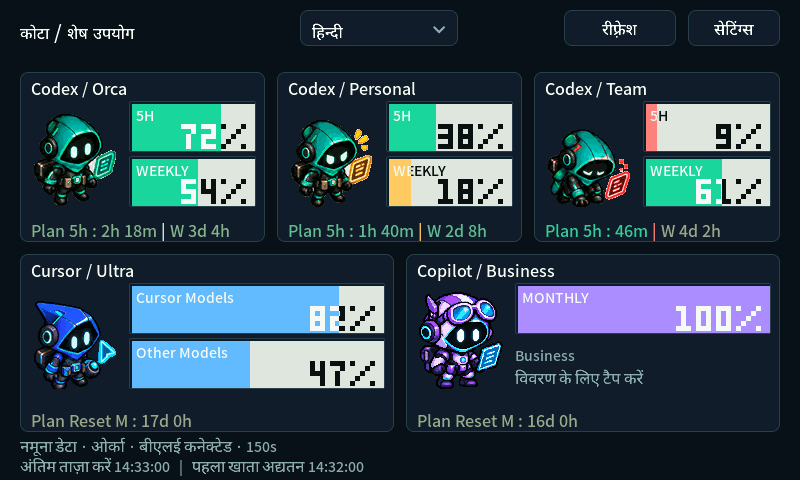
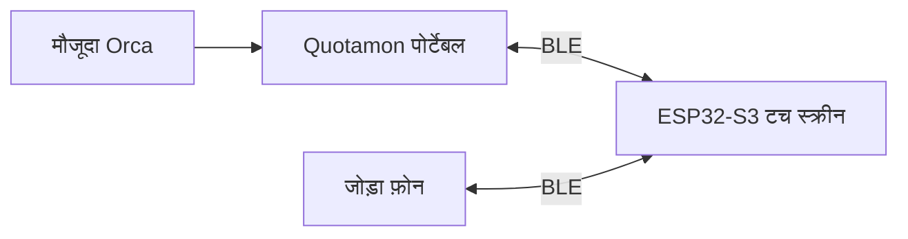

# Quotamon

**AI सदस्यता की शेष मात्रा, मेज़ की छोटी स्क्रीन पर।**

Codex · Cursor · Copilot · Claude · Grok 
पिक्सेल साथियों और शेष पट्टियों वाला 7 इंच का मॉनिटर

<strong>हिन्दी</strong> · 16

[English](README.md) · [한국어](README.ko.md) · [简体中文](README.zh-CN.md) · [日本語](README.ja.md) · [Deutsch](README.de.md) · **हिन्दी** · [Español](README.es.md) · [العربية](README.ar.md) 
[Français](README.fr.md) · [বাংলা](README.bn.md) · [Português](README.pt.md) · [Bahasa Indonesia](README.id.md) · [اردو](README.ur.md) · [Русский](README.ru.md) · [Naijá](README.pcm.md) · [العربية المصرية](README.ar-EG.md)

[ब्राउज़र की भाषा में खोलें](https://cdn.jsdelivr.net/gh/guyster323/ESP32_7inch_Quotamon@main/assets/readme/language.html) · [जल्दी शुरू](#quick-start) · [नया](#whats-new) · [परिवर्तन](#changelog) · [पोर्टेबल](docs/PORTABLE_BRIDGE.md) · [फ़र्मवेयर](docs/UPLOAD.md) · [संरचना](docs/ARCHITECTURE.md)

चित्र और गति बोर्ड वाले **LVGL कोड** से बनती है। अंक उदाहरण हैं। फ्रेम, स्पर्श, स्क्रीन बंद और चालू होना प्रदर्शन का अनुकरण है, असली फ़ोटो नहीं।

## पहले एक नज़र, ज़रूरत पर स्पर्श

| एक स्क्रीन पर पाँच खाते | रीसेट तक का समय | डेटा कितना नया है |
|---|---|---|
| तीन Codex खाते, Cursor और Copilot साथ। अधिकतम 20 खाते पृष्ठों में। | 5 घंटे और साप्ताहिक योजना साथ दिखती है। Cursor का रीसेट साझा है। | स्क्रीन का अद्यतन और स्रोत का संग्रह समय अलग हैं। |

| पात्र स्थिति बताता है | स्पर्श से विवरण | मौजूदा Orca ज्यों का त्यों |
|---|---|---|
| सामान्य, सावधानी, आपात, समाप्त, ऑफ़लाइन और पुरानी जानकारी। | हर सीमा, खाता चयन और प्रदर्शन सेटिंग। | बिना इंस्टॉल वाला Windows ट्रे ऐप BLE से डेटा भेजता है। |

## अभी स्क्रीन पर क्या है

Codex केवल दो निकटतम रीसेट क्रेडिट दिखाता है। `R.T.1` बड़ा है, `R.T.2` छोटा। तीसरा क्रेडिट, संख्या, तिथि और समय क्षेत्र नहीं दिखते। समय `d / h / m` में है। Codex योजना `Plan 5h` और `W` है; Cursor और Copilot `Plan Reset M` लिखते हैं। समय जितना कम, रंग उतना लाल।

## कनेक्शन

ESP32 चित्र और स्पर्श संभालता है। पास का PC, जिस पर Orca और पोर्टेबल ब्रिज चल रहे हों, सदस्यता डेटा भेजता है। Wi-Fi या स्क्रीन पर लॉगिन ज़रूरी नहीं। भेजना हर **60 सेकंड**, दिल की धड़कन हर **10 सेकंड**। टूटने या **35 सेकंड** बिना वैध संचार के प्रदर्शन मिट जाता है।

## जल्दी शुरू

1. **बोर्ड तैयार करें।** लक्ष्य **Waveshare ESP32-S3-Touch-LCD-7 Rev1.2, 800×480** है। [फ़र्मवेयर](docs/UPLOAD.md)।
2. **पोर्टेबल ऐप चलाएँ।** सफल [Windows Actions बिल्ड](https://github.com/guyster323/ESP32_7inch_Quotamon/actions/workflows/build.yml) से `Quotamon-Portable-win-x64-preview` लें, पूरा ZIP खोलें और **Quotamon.exe** चलाएँ।
3. **खाते चुनें।** मौजूदा Orca खोलें और खाते, उपनाम, योजना और क्रम सहेजें।
4. **BLE से जोड़ें।** डिवाइस पर जोड़ना शुरू करें, PC पर डिस्प्ले खोजें और दोनों ओर एक ही 6 अंक स्वीकार करें।

Windows 10 2004 या नया / Windows 11, x64 और Bluetooth LE चाहिए। पूरा फ़ोल्डर साथ रखें। अंक से पहले असफल हो तो [Windows पुनर्प्राप्ति](docs/PORTABLE_BRIDGE.md) देखें।

## भाषा और स्क्रीन बंद करने का समय

पोर्टेबल वेब या ESP32 की **पहली स्क्रीन** पर 16 भाषाओं में से एक चुनते ही वह सहेज ली जाती है। **सेटिंग → भाषा → सहेजें** से भी बदल सकते हैं। **सेटिंग → स्क्रीन बंद** केवल बैकलाइट बंद करता है, PC के स्थानीय समय पर। BLE डेटा लेता रहता है। बंद स्क्रीन छूने पर **5 मिनट** जलती है। ESP32 पर समय छूकर 4 अंक लिखें: `0730` यानी `07:30`। [विवरण](docs/LANGUAGES_AND_SCREEN_SCHEDULE.md)

## फ़ोन से सीधे जोड़कर स्क्रीन नियंत्रण

बोर्ड **एक PC और एक फ़ोन** अलग-अलग जोड़ता है। PC उपयोग भेजता है, प्रमाणित फ़ोन कनेक्शन उपस्थिति बताता है। LCD पर **BLE कनेक्शन → फ़ोन पहचान → फ़ोन पंजीकरण** खोलें, फ़ोन के Bluetooth में Quotamon चुनें और दोनों ओर एक ही अंक मंजूर करें।

- पंजीकृत फ़ोन टूटने के **60 सेकंड** बाद स्क्रीन बंद होती है और प्रमाणित स्वतः कनेक्शन पर जलती है।
- समय-सारणी फ़ोन पहचान से ऊपर है। स्पर्श सहेजी चमक पर 5 मिनट जलाता है।
- अतिरिक्त ऐप, विज्ञापन स्कैन, नाम मिलान या Wi-Fi नहीं। फ़ोन खाता डेटा नहीं पढ़ता।
- जाँचा गया स्वतः कनेक्शन उपभोक्ता-नियंत्रण HID है, बिना कीबोर्ड, माउस या स्वचालित इनपुट के।

## पिक्सेल साथी

वे पलक झपकाते और साँस लेते हैं। गति शेष मात्रा और स्रोत की स्थिति पर बदलती है। एक सेवा के कई खाते अलग समय पर हिलते हैं।

| सेवा | डेटा | खाते |
|---|---|---|
| Codex | Orca की 5 घंटे और साप्ताहिक सीमा तथा रीसेट क्रेडिट की समाप्ति | मूल + प्रबंधित खाते |
| Claude | Orca की साप्ताहिक और अतिरिक्त मॉडल सीमा | मूल + प्रबंधित खाते |
| Cursor | Cursor Models · Other Models | सक्रिय खाता |
| Grok | Orca द्वारा दिए उपयोग पूल | सक्रिय खाता |
| Copilot | Windows Copilot CLI का quota SDK, npm वैश्विक इंस्टॉल या GitHub Copilot CLI पथ | वर्तमान CLI खाता · प्रयोगात्मक |

## नया

### 2026-11-18 — होम बटन और 16 भाषाएँ

रीफ़्रेश और सेटिंग 36px ऊँचे हैं और पहले कार्ड से कम से कम 16px दूर। पहली स्क्रीन पर चुनी भाषा तुरंत सहेजती है। यह पृष्ठ हिन्दी मार्गदर्शिका है।

### 2026-11-17 — Codex रीसेट क्रेडिट और योजना का शेष समय

हर Codex कार्ड केवल दो निकटतम क्रेडिट `R.T.1` / `R.T.2` और `d/h/m` में दिखाता है। योजना का समय रंग बदलता है। PC डैशबोर्ड LCD जैसा ही है।

## परिवर्तन

- **2026-11-18:** होम बटन सिकुड़े और 16 भाषाएँ पहली स्क्रीन से सहेजती हैं।
- **2026-11-17:** Codex रीसेट क्रेडिट, योजना का रंग और Windows Copilot CLI की पहचान।
- **2026-10-20:** PC और फ़ोन के प्रमाणित कनेक्शन अलग हैं और स्क्रीन नियंत्रित करते हैं।
- **2026-10-16:** पाँच भाषाएँ, रोज़ का स्क्रीन बंद और पिक्सेल एनिमेशन।
- पुराने अंग्रेज़ी अभिलेख [English README](README.md#changelog) में हैं।

## विकास और दस्तावेज़

| | |
|---|---|
| [Portable](docs/PORTABLE_BRIDGE.md) | [Architecture](docs/ARCHITECTURE.md) |
| [Firmware](docs/UPLOAD.md) | [BLE](docs/BLE_PROTOCOL.md) |

## आभार

पिक्सेल कला और प्रतिशत पट्टियाँ [F108pro Usage Monitor](https://github.com/guyster323/F108pro_Usage_monitor) से हैं। बैंगनी Copilot रोबोट इस परियोजना का नया चित्र है। कोड: [MIT](LICENSE)। तीसरे पक्ष: [THIRD_PARTY_NOTICES.md](THIRD_PARTY_NOTICES.md)।

