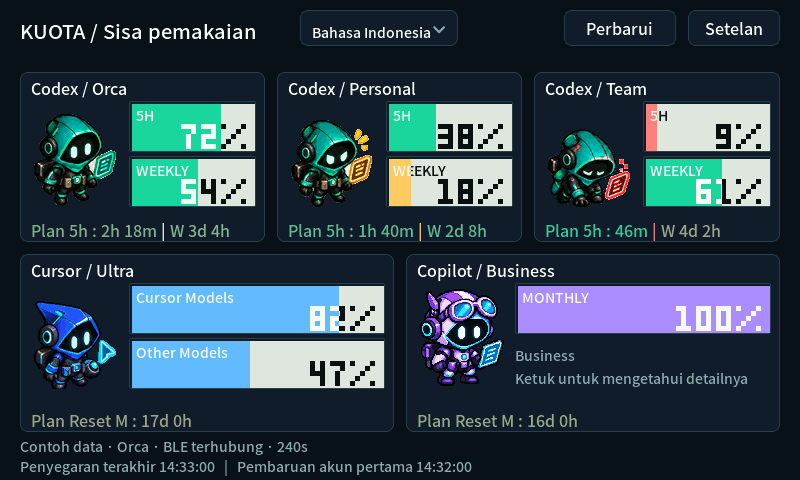
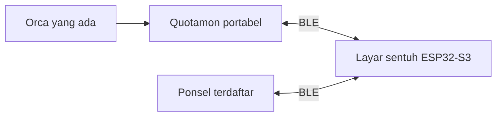

# Quotamon

**Sisa kuota langganan AI, di layar kecil di meja.**

Codex · Cursor · Copilot · Claude · Grok 
Monitor 7 inci dengan teman piksel dan batang sisa kuota

<strong>Bahasa Indonesia</strong> · 16

[English](README.md) · [한국어](README.ko.md) · [简体中文](README.zh-CN.md) · [日本語](README.ja.md) · [Deutsch](README.de.md) · [हिन्दी](README.hi.md) · [Español](README.es.md) · [العربية](README.ar.md) 
[Français](README.fr.md) · [বাংলা](README.bn.md) · [Português](README.pt.md) · **Bahasa Indonesia** · [اردو](README.ur.md) · [Русский](README.ru.md) · [Naijá](README.pcm.md) · [العربية المصرية](README.ar-EG.md)

[Buka dalam bahasa peramban](https://cdn.jsdelivr.net/gh/guyster323/ESP32_7inch_Quotamon@main/assets/readme/language.html) · [Mulai cepat](#quick-start) · [Yang baru](#whats-new) · [Perubahan](#changelog) · [Portabel](docs/PORTABLE_BRIDGE.md) · [Firmware](docs/UPLOAD.md) · [Arsitektur](docs/ARCHITECTURE.md)

Gambar dan gerak memakai **kode LVGL yang sama dengan papan**. Angka hanya contoh. Bingkai, sentuhan, layar mati, dan layar nyala adalah simulasi, bukan foto perangkat.

## Lihat ringkasan dulu, detail saat disentuh

| Lima akun sekaligus | Waktu sampai reset | Ketahui seberapa baru data |
|---|---|---|
| Tiga akun Codex bersama Cursor dan Copilot. Sampai 20 akun berhalaman. | Jadwal 5 jam dan mingguan tampil bersama. Cursor memakai satu reset bersama. | Waktu penyegaran layar dan waktu pengumpulan sumber dipisah. |

| Karakter menyampaikan status | Detail dengan sentuhan | Orca yang sudah ada tetap dipakai |
|---|---|---|
| Normal, hati-hati, kritis, habis, offline, dan informasi lama. | Setiap batas, pilihan akun, dan pengaturan tampilan. | Aplikasi portabel Windows mengirim data lewat BLE. |

## Yang terbaca di layar

Codex hanya menampilkan dua kredit reset terdekat. `R.T.1` lebih besar, `R.T.2` lebih kecil. Kredit ketiga, jumlah, tanggal, dan zona waktu tidak ditampilkan. Waktu memakai `d / h / m`. Paket Codex ditulis `Plan 5h` dan `W`; Cursor serta Copilot memakai `Plan Reset M`. Semakin sedikit waktu tersisa, teks semakin merah.

## Cara terhubung

ESP32 menggambar dan menerima sentuhan. PC di dekatnya yang menjalankan Orca dan jembatan portabel mengirim data langganan. Wi-Fi dan masuk lewat layar tidak diperlukan. Pengiriman setiap **60 detik**, detak setiap **10 detik**. Putus atau **35 detik** tanpa lalu lintas yang sah menghapus tampilan.

## Mulai cepat

1. **Siapkan papan.** Targetnya **Waveshare ESP32-S3-Touch-LCD-7 Rev1.2, 800×480**. [Firmware](docs/UPLOAD.md).
2. **Jalankan aplikasi portabel.** Unduh `Quotamon-Portable-win-x64-preview` dari [build Windows](https://github.com/guyster323/ESP32_7inch_Quotamon/actions/workflows/build.yml) yang berhasil, ekstrak seluruh ZIP, lalu jalankan **Quotamon.exe**.
3. **Pilih akun.** Buka Orca, lalu simpan akun, alias, paket, dan urutan.
4. **Hubungkan lewat BLE.** Mulai pemasangan di perangkat, cari layar di PC, dan setujui angka 6 digit yang sama di kedua sisi.

Perlu Windows 10 2004 atau lebih baru / Windows 11, x64, dan Bluetooth LE. Simpan seluruh folder. Jika gagal sebelum angka muncul, lihat [pemulihan Windows](docs/PORTABLE_BRIDGE.md).

## Bahasa dan jadwal layar mati

Di **layar pertama** web portabel atau ESP32, memilih satu dari 16 bahasa langsung disimpan. Bisa juga lewat **Pengaturan → Bahasa → Simpan**. **Pengaturan → Jadwal layar mati** hanya mematikan lampu latar menurut waktu lokal PC. BLE tetap menerima data. Menyentuh layar yang mati menyalakannya selama **5 menit**. Di ESP32, sentuh waktu lalu masukkan 4 angka: `0730` menjadi `07:30`. [Panduan](docs/LANGUAGES_AND_SCREEN_SCHEDULE.md)

## Mengontrol layar dengan ponsel yang dipasangkan

Papan memasangkan **satu PC dan satu ponsel** secara terpisah. PC mengirim pemakaian, sambungan ponsel yang terautentikasi dipakai untuk mengetahui kehadiran. Di LCD buka **Sambungan BLE → Kehadiran ponsel → Daftarkan ponsel**, pilih Quotamon di Bluetooth ponsel, lalu setujui angka yang sama.

- **60 detik** setelah ponsel terdaftar terputus, layar mati dan menyala lagi saat tersambung otomatis dan terautentikasi.
- Jadwal lebih diutamakan daripada kehadiran. Sentuhan menyalakan layar 5 menit dengan kecerahan tersimpan.
- Tidak memakai aplikasi tambahan, pemindaian iklan, pencocokan nama, atau Wi-Fi. Ponsel tidak dapat membaca data akun.
- Sambungan ulang yang diuji memakai HID kendali konsumen, tanpa keyboard, tetikus, atau masukan otomatis.

## Teman piksel

Mereka berkedip, bernapas, dan mengubah gerak sesuai sisa kuota serta keadaan sumber. Beberapa akun layanan yang sama bergerak pada waktu berbeda.

| Layanan | Data | Akun |
|---|---|---|
| Codex | Batas 5 jam dan mingguan Orca serta kedaluwarsa kredit reset | Bawaan + akun kelolaan |
| Claude | Batas mingguan dan model tambahan Orca | Bawaan + akun kelolaan |
| Cursor | Cursor Models · Other Models | Akun aktif |
| Grok | Kelompok kuota yang disediakan Orca | Akun aktif |
| Copilot | SDK kuota CLI Copilot Windows, lewat npm global atau jalur GitHub Copilot CLI | Akun CLI saat ini · percobaan |

## Yang baru

### 2026-11-18 — Tombol beranda dan 16 bahasa

Segarkan dan Pengaturan setinggi 36px dan berjarak sedikitnya 16px dari kartu pertama. Bahasa yang dipilih di layar pertama langsung disimpan. Halaman ini adalah panduan Bahasa Indonesia.

### 2026-11-17 — Kredit reset Codex dan sisa waktu paket

Setiap kartu Codex hanya menampilkan dua kredit terdekat sebagai `R.T.1` / `R.T.2` dalam `d/h/m`. Sisa waktu paket berubah warna. Dasbor PC menampilkan informasi yang sama dengan LCD.

## Perubahan

- **2026-11-18:** tombol beranda lebih rapat dan 16 bahasa disimpan dari layar pertama.
- **2026-11-17:** kredit reset Codex, warna paket, dan pengenalan CLI Copilot Windows.
- **2026-10-20:** sambungan terautentikasi PC dan ponsel dipisah untuk mengontrol layar.
- **2026-10-16:** lima bahasa, layar mati harian, dan animasi karakter.
- Entri yang lebih lama ada di [README bahasa Inggris](README.md#changelog).

## Pengembangan dan dokumen

| | |
|---|---|
| [Portable](docs/PORTABLE_BRIDGE.md) | [Architecture](docs/ARCHITECTURE.md) |
| [Firmware](docs/UPLOAD.md) | [BLE](docs/BLE_PROTOCOL.md) |

## Kredit

Seni piksel dan batang persen berasal dari [F108pro Usage Monitor](https://github.com/guyster323/F108pro_Usage_monitor). Robot ungu Copilot adalah ilustrasi baru proyek ini. Kode: [MIT](LICENSE). Lisensi pihak ketiga: [THIRD_PARTY_NOTICES.md](THIRD_PARTY_NOTICES.md).

