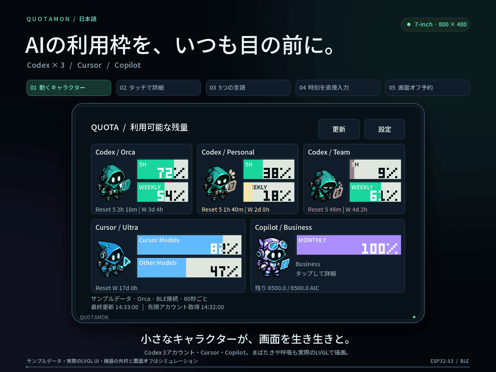
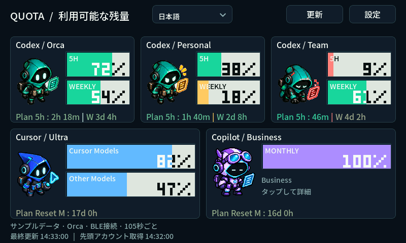
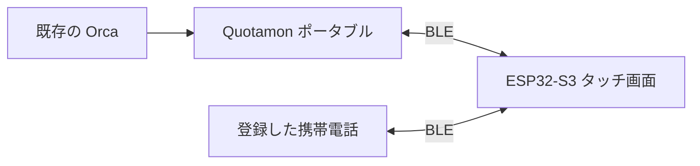

# Quotamon

**AIサブスクリプションの余裕を、机の小さな画面へ。**

Codex · Cursor · Copilot · Claude · Grok 
ピクセルキャラクターと見る 7 インチ残量モニター

<strong>日本語</strong> · 16

[English](README.md) · [한국어](README.ko.md) · [简体中文](README.zh-CN.md) · **日本語** · [Deutsch](README.de.md) · [हिन्दी](README.hi.md) · [Español](README.es.md) · [العربية](README.ar.md) 
[Français](README.fr.md) · [বাংলা](README.bn.md) · [Português](README.pt.md) · [Bahasa Indonesia](README.id.md) · [اردو](README.ur.md) · [Русский](README.ru.md) · [Naijá](README.pcm.md) · [العربية المصرية](README.ar-EG.md)

[ブラウザの言語で開く](https://cdn.jsdelivr.net/gh/guyster323/ESP32_7inch_Quotamon@main/assets/readme/language.html) · [クイックスタート](#quick-start) · [新着](#whats-new) · [変更履歴](#changelog) · [ポータブル](docs/PORTABLE_BRIDGE.md) · [ファームウェア](docs/UPLOAD.md) · [設計](docs/ARCHITECTURE.md)

Codex 3 アカウント + Cursor + Copilot · 24 秒ループ · <a href="assets/readme/ja/quotamon-demo.mp4">動画を再生</a> · <a href="assets/readme/ja/quotamon-display.png">PNG</a>

画面とキャラクターの動きはボードと同じ **LVGL コード**で描いています。数値は公開用の例です。筐体、タッチ表示、画面オフと点灯は紹介用のシミュレーションで、実機の撮影ではありません。

## まず一覧、必要なときだけタッチ

| 1画面に5アカウント | リセットまでの時間 | 更新時刻を区別 |
|---|---|---|
| Codex 3件と Cursor、Copilot を同時表示。最大20件はページ移動。 | 5時間と週間の予定を同時に表示。Cursor は共通リセット。 | 画面の更新と、サービス側の収集時刻を分けて示します。 |

| 状態を伝えるキャラクター | タッチで詳細 | 今の Orca をそのまま |
|---|---|---|
| 正常、注意、緊急、尽きた、接続待ち、古い情報。 | 各上限、アカウント選択、表示設定を確認します。 | インストール不要の Windows トレイアプリが BLE で送ります。 |

## 今の画面で読めること

Codex は期限が近いリセット券を2件だけ表示します。`R.T.1` が大きく、`R.T.2` は小さいです。3件目、個数、日付、タイムゾーンは出しません。時間は `d / h / m` です。Codex のプランは `Plan 5h` と `W`、Cursor と Copilot は `Plan Reset M` です。残りが短いほど赤に近づきます。

## 接続

ESP32 が画面とタッチを処理します。近くの PC で動いている Orca と中継アプリが購読データを送ります。Wi-Fi や画面上のログインは不要です。送信は **60秒**、heartbeat は **10秒**。切断、または有効な通信が **35秒** ないと表示を消します。

## クイックスタート

1. **ボードを準備します。** 対象は **Waveshare ESP32-S3-Touch-LCD-7 Rev1.2、800×480** です。[ファームウェア](docs/UPLOAD.md)。
2. **ポータブルアプリを実行します。** 成功した [Windows Actions ビルド](https://github.com/guyster323/ESP32_7inch_Quotamon/actions/workflows/build.yml) から `Quotamon-Portable-win-x64-preview` を受け取り、ZIP 全体を展開して **Quotamon.exe** を実行します。
3. **表示するアカウントを選びます。** 既存の Orca を開き、設定でアカウント、別名、プラン、順序を保存します。
4. **BLE で接続します。** 機器で接続を始め、PC でディスプレイを探し、両方で同じ6桁を承認します。以後は自動再接続します。

Windows 10 2004 以降 / 11、x64、Bluetooth LE が必要です。フォルダーはまとめて保管してください。番号の前に失敗したら [Windows の復旧手順](docs/PORTABLE_BRIDGE.md) を確認します。

## 言語と画面オフ予約

ポータブル Web または ESP32 の **最初の画面**で16言語の一つを選ぶと、すぐに保存されます。**設定 → 言語 → 保存** でも変更できます。**設定 → 画面オフ予約** は PC の現地時刻でバックライトだけを消し、BLE 受信は続きます。消えた画面に触れると **5分** 点灯します。ESP32 では時刻をタッチして4桁を入力します。`0730` は `07:30` です。[説明](docs/LANGUAGES_AND_SCREEN_SCHEDULE.md)

## 携帯電話と直接ペアリングする画面制御

ボードは **PC 1台と携帯電話 1台** を別々にペアリングします。PC は使用量を送り、認証された携帯電話の接続で在席を判断します。LCD の **BLE 接続 → 携帯電話検知 → 携帯電話登録** を開き、携帯電話の標準 Bluetooth で Quotamon を選び、両方の番号を承認します。

- 登録した携帯電話が切れて **60秒** 後に画面を消し、認証された自動再接続で点灯します。
- 画面オフ予約は携帯電話検知より優先します。タッチすると保存した明るさで5分点灯します。
- 追加アプリ、広告スキャン、名前照合、Wi-Fi は使いません。携帯電話はアカウントデータを読めません。
- 試験で使った自動接続はコンシューマ制御 HID で、キーボードやマウスのコレクションと自動入力はありません。

## ピクセルクルー

キャラクターは瞬きと呼吸をし、残量と収集状態で動きが変わります。同じサービスの複数アカウントも別のタイミングで動きます。

| サービス | 取得するデータ | アカウント範囲 |
|---|---|---|
| Codex | Orca の5時間・週間上限とリセット券の期限 | 既定 + 管理アカウント |
| Claude | Orca の週間・追加モデル上限 | 既定 + 管理アカウント |
| Cursor | Cursor Models · Other Models | 現在のアクティブアカウント |
| Grok | Orca が提供する使用量プール | 現在のアクティブアカウント |
| Copilot | Windows Copilot CLI の quota SDK。npm 全体インストールと GitHub Copilot CLI のパスを探します | 現在の CLI アカウント · 実験的 |

## 新着

### 2026-11-18 — ホームのボタンと16言語

ホームの更新と設定ボタンは高さ36pxで、最初のカードから16px以上離れています。同じ行で言語を選べます。このページは日本語の説明です。

### 2026-11-17 — Codex のリセット券とプラン残り時間

Codex カードは近いリセット券を2件だけ、`R.T.1` / `R.T.2` と `d/h/m` で表示します。プランの残り時間は長さで色が変わります。PC のダッシュボードも LCD と同じ情報です。

## 変更履歴

- **2026-11-18：** ホームボタンの間隔を詰め、16言語を最初の画面で保存できるようにしました。
- **2026-11-17：** Codex のリセット券と色つきプラン表示を追加し、Windows 版 Copilot CLI のインストール先も認識します。
- **2026-10-20：** PC と携帯電話の認証接続を分け、在席で画面を制御します。
- **2026-10-16：** 5言語、毎日の画面オフ予約、ピクセルアニメーションを追加しました。
- それ以前の英語の記録は [English README](README.md#changelog) にあります。

## 開発と文書

| | |
|---|---|
| [ポータブルの実行と復旧](docs/PORTABLE_BRIDGE.md) | [アーキテクチャ](docs/ARCHITECTURE.md) |
| [ファームウェアと BOOT/RESET](docs/UPLOAD.md) | [BLE プロトコル](docs/BLE_PROTOCOL.md) |

## クレジット

ピクセル素材とパーセント表示は [F108pro Usage Monitor](https://github.com/guyster323/F108pro_Usage_monitor) から始まっています。Copilot の紫のロボットはこのプロジェクトの新しいイラストです。コードは [MIT](LICENSE)。第三者ライセンスは [THIRD_PARTY_NOTICES.md](THIRD_PARTY_NOTICES.md) です。

