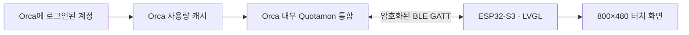
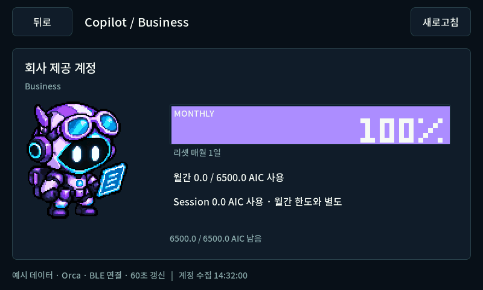
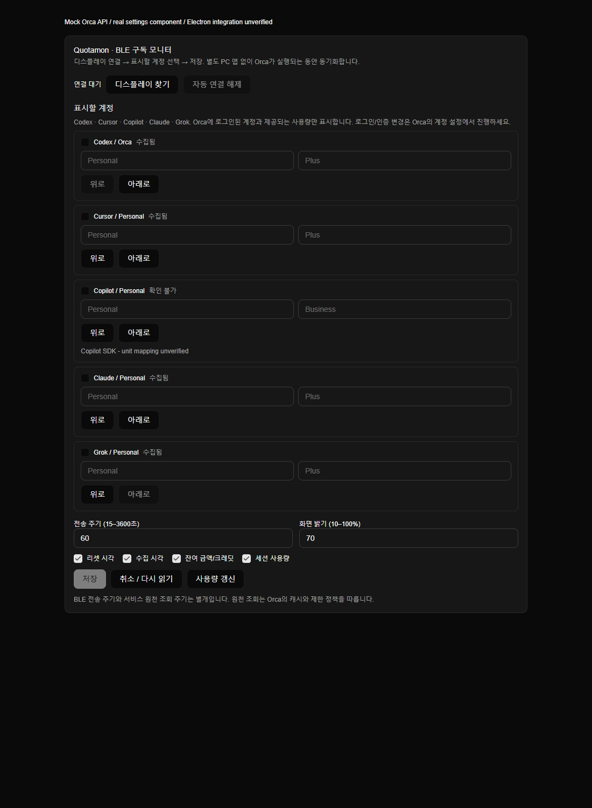

<div align="center">

# Quotamon

**AI 구독 잔여량을, 책상 위 7인치 화면 하나에.**

[](firmware)
[](native)
[](orca-integration)
[](LICENSE)

[English](README.en.md) · [설치·연결](docs/ORCA_INTEGRATION.md) · [업로드](docs/UPLOAD.md) · [구조](docs/ARCHITECTURE.md)


*실제 LVGL/RGB565 렌더러로 만든 800×480 예시 화면입니다. 수치는 모의 데이터이며 장비 사진이 아닙니다.*

</div>

## 한눈에 보고, 터치로 자세히

- 한 화면에 계정 5개. 더 많으면 페이지를 넘기고, 카드를 누르면 모든 한도를 펼칩니다.
- 캐릭터와 색으로 상태를 읽습니다. 잔여 20% 이하는 주의, 10% 이하는 긴급, 확인 불가는 `?`로 구분합니다.
- 채워진 막대에는 흰 글자, 빈 부분에는 어두운 글자. [F108pro Usage Monitor](https://github.com/guyster323/F108pro_Usage_monitor)의 픽셀 자산과 퍼센트 표현을 이어갑니다.
- **Orca에 통합된 BLE 송신 기능 → ESP32 디스플레이.** 별도 PC 수집기나 트레이 앱은 제품 구성에 포함하지 않습니다.
- Orca 설정에서 계정 선택·별칭·요금제·표시 순서·갱신 주기를 관리합니다. 화면에서도 표시 항목과 계정을 조정할 수 있습니다.
- Orca 종료·연결 해제 시 값을 지웁니다. 연결이 살아 있어도 오래된 원천 데이터는 최신 수치로 바꾸지 않습니다.

## 픽셀 크루

| Codex | Cursor | Copilot | Claude | Grok |
|:---:|:---:|:---:|:---:|:---:|
|  |  |  |  |  |

각 캐릭터는 정상·주의·긴급·소진·연결 대기·오래된 정보의 6개 상태를 가집니다. Codex/Cursor/Claude/Grok은 F108pro의 MIT 자산을 사용했습니다. 보라색 Copilot 파일럿 로봇은 이 프로젝트의 새 비공식 일러스트입니다. [자산 출처와 라이선스](THIRD_PARTY_NOTICES.md)를 확인하세요.

## 현재 상태: 개발 프리뷰

| 항목 | 상태 |
|---|---|
| 5개 서비스의 LVGL UI, 다중 계정, 상세·설정·페어링 화면 | Windows 네이티브 렌더러와 포인터 테스트 검증 |
| BLE 분할 전송·CRC·ACK·정보 필터링·설정 충돌 처리 | C++/TypeScript 테스트 검증 |
| Windows BLE 모듈 | 컴파일 및 실제 PC의 BLE central 지원 확인 |
| ESP32 펌웨어 | ESP-IDF 5.5.3 빌드 통과, 8 MB 앱 영역의 약 76.4% 사용 |
| Orca 설정 패널 | 실제 UI 부품과 모의 API로 온보딩·페어링·설정 조작 검사 |
| Orca 통합 | 소스 패치와 모듈 제공, 기준 커밋에 패치 적용 확인 |
| 전체 Orca 앱 빌드 및 실제 ESP32 BLE 왕복 | 아직 검증 전 |

**일반 배포판 Orca에는 이 프로젝트의 BLE 송신 기능이 없습니다.** 현재는 통합 패치를 적용한 Orca 소스 빌드가 필요합니다. 설치된 Orca 실행 파일을 덮어쓰거나 계정 인증정보를 ESP32에 복사하는 방식은 사용하지 않습니다.

## 어떤 잔여량을 받을 수 있나요?

| 서비스 | 원천 | 계정 범위와 제한 |
|---|---|---|
| Codex | Orca rate limits | 기본 계정 + 관리 계정, 5시간/주간 등 원천이 제공한 한도 |
| Claude | Orca rate limits | 기본 계정 + 관리 계정, 주간·추가 모델 한도 포함 |
| Cursor | Orca rate limits | 현재 로그인 계정의 월간·이름 있는 사용량 풀 |
| Grok | Orca rate limits | 현재 로그인 계정의 제공되는 사용량 풀 |
| Copilot | 기존 Windows Copilot CLI의 선택적 quota SDK | 현재 CLI 계정. SDK 실험적 경로이며 AIC 단위 대응은 추가 검증 필요 |

현재 검토한 Orca API에는 Cursor/Grok의 여러 독립 계정 사용량을 동시에 내보내는 경로가 없습니다. 계정 수나 요금제만으로 잔여량을 계산하지 않습니다. 정보가 없으면 ‘확인 불가’, 무제한은 별도 상태, 리셋이 지나면 ‘리셋 후 확인 대기’로 표시합니다.

Copilot의 세션 사용량과 월간 포함량은 다른 값입니다. `Session: 0 AIC`를 월간 잔여 100%로 해석하지 않습니다. 월간 리셋은 1일 UTC 정책을 사용하며, 6,500 AIC를 모든 구독의 한도로 고정하지 않습니다. [수집 검토](docs/RESEARCH.md)에 실험적 경로의 한계를 기록했습니다.

## 연결 구조



ESP32는 UI와 BLE 수신을 자체 실행합니다. Wi-Fi, 웹 로그인, 별도 PC 앱은 필요하지 않습니다. **구독 데이터를 공급하려면 Orca가 실행 중인 PC는 필요합니다.** PC 없는 클라우드 직접 조회 제품을 의미하는 ‘스탠드얼론’은 아닙니다.

기본 전송 60초, heartbeat 10초, 무응답 35초 후 값 삭제. 원천 조회는 Orca의 캐시·재조회 제한을 따르며 BLE 전송 주기와 분리합니다. 페어링은 양쪽의 6자리 숫자 비교와 명시적 승인을 거칩니다.

## 화면 둘러보기

| 상세 보기 | 설정 |
|---|---|
|  |  |
| BLE 연결 시작 | 번호 비교 |
|  |  |

## 개발 시작

<details><summary>Orca 설정 패널 미리보기 (분리 렌더, 모의 API)</summary>



실제 설정 컴포넌트와 Orca UI 부품을 사용했으며 전체 Electron 앱이나 실제 Bluetooth를 시험한 화면은 아닙니다.

</details>

대상 보드는 **Waveshare ESP32-S3-Touch-LCD-7, Rev1.2**입니다. 7C/7C-BOX용 핀 설정과 혼용하지 않습니다.

```powershell
python tools/bootstrap_dependencies.py
npm ci --prefix orca-integration
npm test --prefix orca-integration
tools\build_native.cmd
build\native\quotamon_protocol_test.exe
```

네이티브 UI는 Visual Studio C++/CMake 도구로 빌드합니다. 생성된 자산과 한글 폰트는 저장소에 포함되어 있어 다시 생성할 필요가 없습니다.

```powershell
build\native\espmonitor_sim.exe
# 모의 화면을 직접 확인하는 개발 시뮬레이터
```

실제 연결을 준비하려면 [Orca 통합 빌드](docs/ORCA_INTEGRATION.md), [펌웨어·BOOT/RESET 업로드 절차](docs/UPLOAD.md)를 순서대로 따르세요. [검증 범위](docs/VERIFICATION.md)와 [BLE 프로토콜](docs/BLE_PROTOCOL.md)도 제공합니다.

## 저장소 안내

| 경로 | 내용 |
|---|---|
| `firmware/` | Waveshare RGB/GT911 포트 + ESP-IDF NimBLE 수신기 |
| `native/` | 보드와 공유하는 LVGL UI, 폰트·스프라이트, Windows 시뮬레이터 |
| `orca-integration/` | 계정 정규화·연결 제어·설정 패널·Orca 소스 패치 |
| `protocol/` | 보드 BLE 프레임 디코더 |
| `assets/` | 5개 캐릭터와 원본·생성 기록·라이선스 |
| `docs/` | 연결·업로드·설계·조사·검증 문서 |

인증·로그인 처리는 Orca와 각 서비스가 담당합니다. 이 프로젝트는 화면에 필요한 항목만 허용 목록으로 구성합니다. 연구 중 얻은 실제 계정 스냅샷, 토큰, 장치 식별정보는 저장소에 포함하지 않습니다.

## 크레딧

[F108pro Usage Monitor](https://github.com/guyster323/F108pro_Usage_monitor) · [Orca](https://github.com/stablyai/orca) · [Waveshare LCD-7](https://docs.waveshare.com/ESP32-S3-Touch-LCD-7/Instructions-For-Use) · [LVGL](https://github.com/lvgl/lvgl) · [ESP-IDF](https://github.com/espressif/esp-idf) · [Noto Sans KR](https://github.com/google/fonts/tree/main/ofl/notosanskr)

프로젝트 코드: [MIT](LICENSE). 참조 자산·폰트·포트·런타임의 라이선스는 [THIRD_PARTY_NOTICES.md](THIRD_PARTY_NOTICES.md)에 별도 기록합니다.
