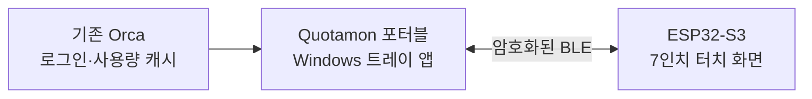

<div align="center">

# Quotamon

**AI 구독의 여유를, 책상 위 작은 화면에.**

Codex · Cursor · Copilot · Claude · Grok<br>
픽셀 캐릭터와 함께 보는 7인치 구독 잔여량 모니터

[](https://github.com/guyster323/ESP32_7inch_Quotamon/actions/workflows/build.yml)
[](firmware)
[](native)
[](orca-integration)
[](LICENSE)

[English](README.en.md) · [빠른 시작](#빠른-시작) · [변경 기록](#변경-기록) · [연결 가이드](docs/PORTABLE_BRIDGE.md) · [펌웨어 업로드](docs/UPLOAD.md) · [설계 문서](docs/ARCHITECTURE.md)

<a href="assets/readme/quotamon-demo.mp4">
  
</a>

<sub>현재 기기와 같은 Codex 3개 + Cursor + Copilot 구성 · 14초 반복 데모 · <a href="assets/readme/quotamon-demo.mp4">영상으로 재생</a> · <a href="assets/readme/quotamon-display.png">정지 화면</a></sub>

</div>

화면 안은 보드와 공유하는 **실제 LVGL 코드로 렌더링**했습니다. 수치는 공개용 예시이며, 기기 프레임·강조 효과·화면 전환은 소개용 모션 그래픽입니다. 실제 기기 사진이나 촬영 영상은 아닙니다.

## 한눈에 보고, 필요할 때 터치하세요

| 한 화면에 5개 계정 | 리셋까지 남은 시간 | 갱신 시각을 분명하게 |
|---|---|---|
| Codex 계정 3개와 Cursor·Copilot을 함께. 최대 20계정을 페이지로 넘깁니다. | 5시간·주간 일정을 동시에 보고, Cursor는 공통 리셋 하나로 읽습니다. | 화면의 최근 갱신과 서비스 원천 수집 시각을 구분합니다. |

| 캐릭터가 전하는 상태 | 터치로 여는 상세 | 기존 Orca를 그대로 |
|---|---|---|
| 정상·주의·긴급·소진·연결 대기·오래된 정보의 6개 상태. | 계정별 모든 한도와 리셋, 계정 선택·표시 설정을 확인합니다. | 설치 없는 Windows 트레이 앱이 BLE로 전달합니다. Node/.NET도 포함합니다. |

막대의 채워진 부분은 흰 숫자, 빈 부분은 어두운 숫자입니다. 잔여 **20% 이하**는 주의, **10% 이하**는 긴급으로 표시하고, 확인 불가·무제한은 별도 상태로 다룹니다.

## 지금 디스플레이에서 읽을 수 있는 것

```text
Reset 5 2h 41m | W 5d 3h       5시간과 주간 리셋을 함께
Reset W 17d 0h                 Cursor 두 모델 풀의 공통 리셋
최근 갱신 14:34:00 | 첫 카드 수집 14:32:00
```

`5`는 5시간 한도, `W`는 주간 또는 Cursor의 공통 리셋 표시입니다. `d / h / m`은 일·시간·분입니다. 일정이 길면 두 줄로 바꾸고 막대·캐릭터와 겹치지 않게 배치합니다. **Cursor Models**와 **Other Models**는 각각 잔여량을 표시하며 Monthly 합계는 제외합니다.

| 터치해서 여는 계정 상세 | 긴 리셋 일정도 두 줄로 |
|:---:|:---:|
| [](visuals/native/02-codex-detail.png) | [](visuals/native/18-wrapped-reset.png) |

<details>
<summary>설정·페어링·PC 관리 화면 더 보기</summary>

| LCD 표시 설정 | PC 계정 선택 |
|:---:|:---:|
|  |  |
| BLE 연결 시작 | 양쪽 번호 비교 |
|  |  |

제품 UI를 사용한 모의 예시입니다. 실물 업로드·페어링·전송과 화면 기동은 별도로 검증했으며, 세부 범위는 [검증 기록](docs/VERIFICATION.md)에 구분했습니다.

</details>

## 연결은 이렇게



ESP32가 화면과 터치를 직접 처리하고, **가까운 PC에서 실행 중인 Orca와 포터블 중계**가 구독 데이터를 공급합니다. Wi-Fi나 디스플레이에서의 웹 로그인은 필요하지 않습니다. 기존 Orca를 수정하거나 재설치하지 않으며, 인증정보는 PC에 남습니다.

기본 화면 데이터 전송은 **60초**, heartbeat는 **10초**입니다. 연결이 끊기거나 유효 통신이 **35초** 동안 없으면 표시 데이터를 지웁니다. 원천 조회는 별도로 관리하므로, 연결이 살아 있다는 이유로 오래된 사용량을 최신으로 표시하지 않습니다.

## 빠른 시작

1. **보드를 준비합니다.** 대상은 **Waveshare ESP32-S3-Touch-LCD-7 Rev1.2, 800×480**입니다. [펌웨어 업로드 안내](docs/UPLOAD.md)를 따릅니다.
2. **포터블 앱을 실행합니다.** 성공한 [Windows Actions 빌드](https://github.com/guyster323/ESP32_7inch_Quotamon/actions/workflows/build.yml)의 `Quotamon-Portable-win-x64-preview` 아티팩트를 받아, 안의 ZIP 전체를 풀고 **Quotamon.exe**를 실행합니다. 아티팩트 다운로드에는 GitHub 로그인이 필요합니다.
3. **표시할 계정을 고릅니다.** 기존 Orca를 켜고, 설정 페이지에서 계정·별칭·요금제·순서를 정해 저장합니다.
4. **BLE로 연결합니다.** 기기의 **BLE 연결 시작**과 PC의 **디스플레이 찾기**를 누른 뒤, 양쪽의 같은 6자리 번호를 승인합니다. 이후 저장된 기기에 자동 재연결합니다.

Windows 10 2004 이상/11, x64와 Bluetooth LE가 필요합니다. 폴더 전체를 함께 유지하세요. Windows 로그인 시 실행은 트레이 설정에서 켤 수 있습니다. 번호 화면 전에 연결이 실패하면 [Windows 기본 페어링을 사용하는 복구 절차](docs/PORTABLE_BRIDGE.md)를 확인하세요.

## 언어와 화면 끄기 예약

웹과 ESP32에서 **한국어·중국어 간체·일본어·영어·독일어**를 선택할 수 있습니다. **설정 → 언어 → 저장**으로 변경하며 연결된 두 화면에 같은 설정이 적용됩니다.

**설정 → 화면 끄기 예약**에서 매일 화면을 끄고 켤 시간을 정할 수 있습니다. 기본값은 **예약 해제 / 23:00~07:00**입니다. PC 현지 시각을 기준으로 백라이트만 끄며 BLE 연결과 데이터 수신은 계속됩니다. 꺼진 화면을 터치하면 **5분 동안** 켜집니다.

[설정 방법·시간 동기화·폰트·검증](docs/LANGUAGES_AND_SCREEN_SCHEDULE.md) · [영어 웹 설정 예시](visuals/locales/web-en.png) · [일본어 LCD 예시](visuals/locales/lcd-ja-home.png)

## 함께하는 픽셀 크루

| Codex | Cursor | Copilot | Claude | Grok |
|:---:|:---:|:---:|:---:|:---:|
|  |  |  |  |  |

캐릭터는 홈 카드와 상세 화면에서 눈을 깜박이고 숨을 쉬며, 잔여량과 수집 상태에 따라 다른 동작을 합니다. 같은 서비스의 계정이 여러 개여도 각기 다른 시점에 움직입니다.

[](visuals/native/character-animation.gif)

| 상태 | 움직임 |
|---|---|
| 정상 | 눈깜박임·표정 변화, 숨쉬기, 가끔 몸 기울이기와 작은 반동 |
| 주의 / 긴급 | 좌우 살피기 / 간헐적인 짧은 떨림 |
| 소진 / 확인 불가 | 지친 자세나 offline 표정으로 느린 호흡 |
| 오래된 정보 | stale 표정과 간헐적인 좌우 움직임 |

원본 F108pro의 추가 표정 24장을 복원하고 Copilot에는 LVGL 눈꺼풀을 더했습니다. **자산은 30장→54장으로 늘었지만 무손실 팔레트 저장으로 855,360→521,289바이트, 약 39% 줄었습니다.** 한 개의 100ms 타이머가 보이는 캐릭터만 갱신하며, 설정·페어링 화면에서는 멈춥니다.

현재 펌웨어는 앱 파티션의 **74.9%**, 정적 RAM의 **16.6%**를 사용합니다. 다국어·화면 예약 적용 후, 실제 BLE 연결과 애니메이션이 실행 중인 홈 화면을 측정했습니다.

| 실물 측정 | 홈: 캐릭터 5개, 60.27초 |
|---|---:|
| CPU 평균: 두 코어 평균 | **6.23%** |
| 실제 LVGL 갱신률 | **7.48fps** |
| 현재 가용 PSRAM | **약 636KiB** |

PSRAM 여유는 651,272바이트로 유지됐고 가장 큰 연속 블록은 608KiB였습니다. FPS는 실제 내용 갱신 빈도이며 LCD 스캔 주파수나 최대 처리량을 뜻하지 않습니다. [최신 실측 표본](docs/runtime-metrics-languages.json) · [측정 방법·앞선 버전 기록](docs/RUNTIME_METRICS.md). GIF는 예시 사용량을 렌더한 화면이며 실물 촬영은 아닙니다.

[상세 화면 GIF](visuals/native/character-detail-animation.gif) · [상태별 GIF](visuals/native/character-states-animation.gif) · [구현·자원·실물 적용 기록](docs/CHARACTER_ANIMATION.md)

| 서비스 | 가져오는 데이터 | 계정 범위 |
|---|---|---|
| Codex | Orca의 5시간·주간 등 사용량 한도 | 기본 계정 + 관리 계정 |
| Claude | Orca의 주간·추가 모델 한도 | 기본 계정 + 관리 계정 |
| Cursor | Cursor Models · Other Models | 현재 활성 계정 |
| Grok | Orca가 제공하는 사용량 풀 | 현재 활성 계정 |
| Copilot | 기존 Windows Copilot CLI의 quota SDK | 현재 CLI 계정 · 실험적 연결 |

계정 수나 요금제 이름으로 잔여량을 추정하지 않습니다. Copilot의 **Session 사용량과 월간 포함량은 별개**이며, SDK 요청 단위와 AIC 대응은 추가 검증이 필요합니다. 6,500 AIC를 모든 구독의 한도로 가정하지 않습니다. [원천 검토와 제한](docs/RESEARCH.md)을 확인하세요.

## 구현·검증 현황

현재는 **개발 프리뷰**입니다. 공유 LVGL UI와 포터블 중계에 더해 실제 보드 업로드·페어링·재연결까지 확인했습니다.

| 범위 | 확인한 내용 |
|---|---|
| 소프트웨어 | TypeScript 38개 테스트, C++ BLE 프레이밍, LVGL 화면·포인터·폰트 검사 통과 |
| 캐릭터 애니메이션 | 5종×6상태, 40회 화면 전환, 캐릭터 영역 밖 픽셀 불변, 54개 자산 무손실 검사 통과. 압축 전후 실제 렌더 380프레임 일치 |
| 실제 데이터 | Orca 1.4.224 무수정으로 Codex 3계정·Cursor, 기존 Copilot SDK 계정 조회 |
| 실제 보드 | 전체 백업 후 앱 업로드·읽기 검증, 부트로더·파티션·페어링 NVS 보존 확인 |
| 연결·화면 | Windows 번호 비교 페어링, 앞선 펌웨어의 5계정 전송·ACK. 최신 애니메이션 펌웨어 업로드 후 BLE 도우미 재시작, 실물 기동·BLE 연결·정상 동작 사용자 확인 |

최근 갱신 시각과 축약 리셋 배치는 네이티브 렌더러로 검사했습니다. 실물 문구별 배치·장시간 동작·모든 오류 복구를 검증한 것은 아닙니다. 상세 근거는 [검증 기록](docs/VERIFICATION.md)에 있습니다.

## 변경 기록

### 2026-10-16 — 다국어·화면 끄기 예약

- 웹·ESP32에 한국어·중국어 간체·일본어·영어·독일어 선택과 설정 동기화를 추가했습니다.
- 매일 반복하는 백라이트 끄기 예약, 자정 경과 구간, 터치 시 5분 점등을 지원합니다. 예약 중에도 BLE·데이터 수신을 유지합니다.
- 5개 언어 UI 폰트·공통 번역 원본, 설정 호환성·시간 경계·렌더 회귀 검사를 추가했습니다. [사용법·검증](docs/LANGUAGES_AND_SCREEN_SCHEDULE.md)

### 2026-10-16 — 픽셀 캐릭터 애니메이션

- **주기적인 화면 밀림 개선:** CPU 계측의 전체 태스크·스택 순회를 두 idle 카운터 조회로 교체하고, 힙 조회·BLE 전송을 화면 잠금 밖으로 옮겼습니다. 애니메이션과 5초 통계는 유지하며, 실제 펌웨어 코드를 사용하는 회귀 검사를 추가했습니다. [원인 분석·검증](docs/RUNTIME_METRICS.md)
- **실물 자원 실측:** 홈 CPU 평균 6.10%·7.43fps, 상세 6.08%·2.57fps, 가용 PSRAM 약 891KiB. 5초 주기 계측·수치 수집기와 개인정보 필드 배제·웹 갱신 불변 검사를 추가했습니다. [실측 기록](docs/RUNTIME_METRICS.md)
- 홈과 상세 화면에 눈깜박임·표정 변화·숨쉬기·좌우 살피기·작은 반동을 추가했습니다. 잔여량과 수집 상태에 따라 동작이 달라집니다.
- 원본 F108pro의 추가 표정 24장을 복원하고, Copilot은 LVGL 눈꺼풀을 사용합니다. 계정마다 다른 시점에 움직이며 화면에 보이는 캐릭터만 갱신합니다.
- 무손실 팔레트 저장과 공유 복원 버퍼로 자산 저장량을 약 39% 줄였습니다. 플래시 적합성에 더해 PSRAM의 XIP·LCD 버퍼 예산 검사와 애니메이션 회귀 검사를 CI에 추가했습니다.
- [실제 LVGL 렌더 GIF](visuals/native/character-animation.gif) · [구현·자원·검증 기록](docs/CHARACTER_ANIMATION.md). 펌웨어 업로드·플래시 검증과 기존 페어링 보존을 완료했고, 사용자가 실물 BLE 연결·정상 동작을 확인했습니다.

### 2026-10-15 — 계정별 할당량 고정 · 웹 갱신 주기 개선

- **계정 전환 시 할당량 혼선 수정:** Codex·Claude의 사용량을 실제 활성 계정에 연결합니다. 기본·관리 계정의 저장 ID·순서·별칭을 유지하고, 같은 조직의 다른 구성원도 구분합니다.
- **마지막 확인값과 요금제 처리:** 같은 계정의 마지막 확인값만 메모리에 유지합니다. 비활성 기본 계정은 앱 재시작 직후 값이 없으면 확인 불가로 표시합니다. 저장된 `요금제 미확인` 문구는 빈 값으로 정리하고, 사용자가 지정한 요금제는 보존합니다.
- **웹의 2초 주기 갱신 제거:** 다음 정기 전송 **2초 전 한 번** 갱신합니다. 60초 설정이면 이전 전송 ACK 후 58초이며, 전송 간격 변경 시 다시 예약합니다. 원천 캐시 변경은 정기 전송에 반영하고, 페어링·연결 상태와 사용자 조작은 즉시 표시합니다.
- **검증·적용:** 테스트 35개와 모의 원천·BLE를 사용한 웹 UI 검사 통과. 기존 실행 폴더에 적용했으며, 계정 설정·자동 실행·런타임을 보존했습니다. 이번 수정의 실제 계정 전환에 따른 실물 LCD 표시는 직접 검증하지 않았습니다. [상세 검증 기록](docs/VERIFICATION.md) · [구현 커밋](https://github.com/guyster323/ESP32_7inch_Quotamon/commit/4c0c839e85358287c8bb7f744e5df3814eeab969)

## 개발과 문서

| 시작하기 | 구조와 동작 | 검증과 출처 |
|---|---|---|
| [포터블 실행·복구](docs/PORTABLE_BRIDGE.md) | [아키텍처](docs/ARCHITECTURE.md) | [검증 기록](docs/VERIFICATION.md) |
| [펌웨어·BOOT/RESET](docs/UPLOAD.md) | [BLE 프로토콜](docs/BLE_PROTOCOL.md) | [원천 조사](docs/RESEARCH.md) |

<details>
<summary>로컬 빌드와 모션 그래픽 재생성</summary>

네이티브 미리보기는 Windows의 Visual Studio C++/CMake 도구를 사용합니다. 생성된 스프라이트와 한글 폰트는 저장소에 포함되어 있습니다.

```powershell
python tools/bootstrap_dependencies.py
npm ci --prefix orca-integration
npm test --prefix orca-integration

tools\build_native.cmd
build\native\quotamon_protocol_test.exe
python tools/verify_native_visuals.py
python tools/verify_character_animation.py
build\native\espmonitor_sim.exe
```

README의 GIF·정지 이미지는 **Pillow와 네이티브 시뮬레이터**로 생성합니다. 로컬의 Noto Sans KR 폰트 또는 Windows Segoe UI 폰트를 사용합니다.

```powershell
python -m pip install Pillow
python tools/generate_readme_media.py
```

MP4 영상도 만들려면 `imageio-ffmpeg`를 설치한 뒤 `python tools/generate_readme_media.py --video-only`를 실행합니다. 로컬에서는 `assets/readme/index.html`을 브라우저로 열어 재생·정지·반복을 제어할 수 있습니다.

생성기는 실행 중인 Orca나 계정 데이터를 읽지 않습니다. 출력은 `assets/readme/`, 생성 정보는 `assets/readme/media.json`에 기록됩니다.

| 경로 | 역할 |
|---|---|
| `firmware/` | Waveshare RGB/GT911 포트 + ESP-IDF NimBLE 수신기 |
| `native/` | 보드와 공유하는 LVGL UI, 폰트·스프라이트, Windows 시뮬레이터 |
| `portable/` | Windows 트레이 실행기와 로컬 설정 UI |
| `orca-integration/` | 무수정 Orca 조회·공유 중계 core·BLE 제어 |
| `protocol/` | BLE 프레임 디코더 |
| `assets/` · `visuals/` | 픽셀 캐릭터·모션 그래픽·네이티브 화면 예시 |

기존 [Orca 내부 통합 패치](docs/ORCA_INTEGRATION.md)는 선택적인 개발 참고 자료입니다. 현재 포터블 실행 경로에는 필요하지 않습니다.

</details>

## 크레딧

[F108pro Usage Monitor](https://github.com/guyster323/F108pro_Usage_monitor)의 픽셀 자산·퍼센트 표현에서 출발했습니다. Codex/Cursor/Claude/Grok은 해당 MIT 자산을 사용하며, 보라색 Copilot 파일럿 로봇은 이 프로젝트의 새 비공식 일러스트입니다.

[Orca](https://github.com/stablyai/orca) · [Waveshare LCD-7](https://docs.waveshare.com/ESP32-S3-Touch-LCD-7/Instructions-For-Use) · [LVGL](https://github.com/lvgl/lvgl) · [ESP-IDF](https://github.com/espressif/esp-idf) · [Noto Sans KR](https://github.com/google/fonts/tree/main/ofl/notosanskr)

프로젝트 코드: [MIT](LICENSE). 참조 자산·폰트·포트·런타임의 라이선스는 [THIRD_PARTY_NOTICES.md](THIRD_PARTY_NOTICES.md)에 기록합니다.
