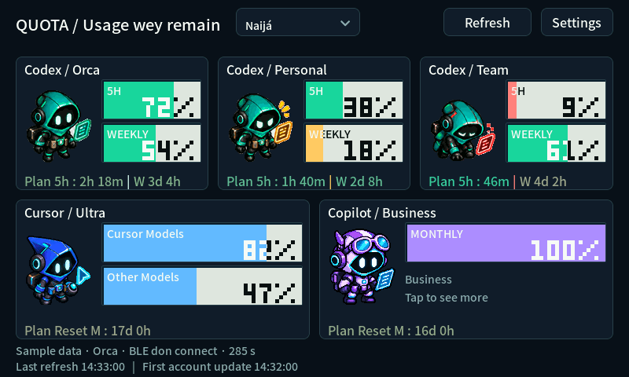
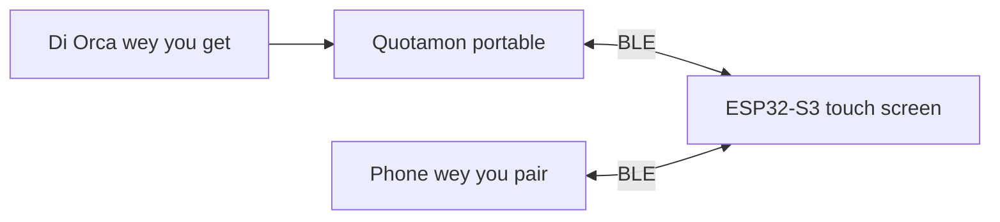

# Quotamon

**Your AI subscription wey remain, for small screen for desk.**

Codex · Cursor · Copilot · Claude · Grok 
7-inch monitor with pixel people and bars wey show wetin remain

<strong>Naijá</strong> · 16

[English](README.md) · [한국어](README.ko.md) · [简体中文](README.zh-CN.md) · [日本語](README.ja.md) · [Deutsch](README.de.md) · [हिन्दी](README.hi.md) · [Español](README.es.md) · [العربية](README.ar.md) 
[Français](README.fr.md) · [বাংলা](README.bn.md) · [Português](README.pt.md) · [Bahasa Indonesia](README.id.md) · [اردو](README.ur.md) · [Русский](README.ru.md) · **Naijá** · [العربية المصرية](README.ar-EG.md)

[Open am for my browser language](https://cdn.jsdelivr.net/gh/guyster323/ESP32_7inch_Quotamon@main/assets/readme/language.html) · [Quick start](#quick-start) · [Wetin new](#whats-new) · [Changes](#changelog) · [Portable](docs/PORTABLE_BRIDGE.md) · [Firmware](docs/UPLOAD.md) · [Architecture](docs/ARCHITECTURE.md)

Di screen and character movement na di **same LVGL code** wey di board dey use. Numbers na example. Di frame, touch, screen off and screen on na show, no be real photo.

## Look am first, touch am if you need more

| Five accounts for one screen | Time before reset | Know how fresh di data be |
|---|---|---|
| Three Codex accounts with Cursor and Copilot. Up to 20 accounts dey waka page. | 5-hour and weekly plan dey show together. Cursor share one reset. | Screen refresh time and source time no be di same. |

| Character dey talk di state | Touch am for details | Leave your Orca as e be |
|---|---|---|
| Normal, caution, critical, finish, offline, and old info. | Every limit, account choice, and display setting. | Windows tray app wey you no need install dey send am over BLE. |

## Wetin di screen dey show now

Codex dey show only di two reset credits wey dey near. `R.T.1` big, `R.T.2` small. E no show third one, count, date, or timezone. Time na `d / h / m`. Codex plan na `Plan 5h` and `W`. Cursor and Copilot na `Plan Reset M`. Di smaller di time, di red di text.

## How e connect

ESP32 dey draw and take touch. PC wey near you, wey Orca and di portable bridge dey run, dey send subscription data. Wi-Fi and login for di screen no dey needed. E send every **60 seconds**, heartbeat every **10 seconds**. If e cut or **35 seconds** pass without correct traffic, di display clear.

## Quick start

1. **Prepare di board.** Target na **Waveshare ESP32-S3-Touch-LCD-7 Rev1.2, 800×480**. [Firmware](docs/UPLOAD.md).
2. **Run di portable app.** Download `Quotamon-Portable-win-x64-preview` from successful [Windows Actions build](https://github.com/guyster323/ESP32_7inch_Quotamon/actions/workflows/build.yml), open di whole ZIP, run **Quotamon.exe**.
3. **Choose accounts.** Open di Orca wey you get and save accounts, aliases, plans, and order.
4. **Connect with BLE.** Start pairing for di device, find di display for PC, and approve di same 6 numbers for both sides.

You need Windows 10 2004 or later / Windows 11, x64, and Bluetooth LE. Keep di whole folder. If pairing fail before di number, check [Windows recovery](docs/PORTABLE_BRIDGE.md).

## Language and screen-off time

For di **first screen** of di portable web or ESP32, if you pick one of 16 languages e save am now now. You fit also use **Settings → Language → Save**. **Settings → Screen-off** only off backlight for PC local time. BLE still dey receive. Touch di dark screen and e go light for **5 minutes**. For ESP32, touch di time and type 4 numbers: `0730` na `07:30`. [Guide](docs/LANGUAGES_AND_SCREEN_SCHEDULE.md)

## Control di screen with phone wey you pair direct

Di board dey pair **one PC and one phone** separate. PC dey send usage, di phone connection wey don authenticate dey tell if person dey near. For LCD open **BLE connection → Phone presence → Register phone**, pick Quotamon for di phone Bluetooth, and approve di same number.

- After di registered phone disconnect for **60 seconds**, screen go off, and authenticated auto reconnect go on am.
- Schedule pass phone presence. Touch dey on am for 5 minutes with di brightness wey you save.
- No extra phone app, advert scan, name match, or Wi-Fi. Phone no fit read account data.
- Di auto reconnect wey dem test na consumer-control HID. No keyboard, mouse, or automatic input.

## Pixel crew

Dem dey blink, breathe, and change movement based on wetin remain and source state. Many accounts for di same service dey move for different time.

| Service | Data | Accounts |
|---|---|---|
| Codex | Orca 5-hour and weekly limits plus when reset credit go expire | Default + managed accounts |
| Claude | Orca weekly and extra model limits | Default + managed accounts |
| Cursor | Cursor Models · Other Models | Di account wey dey active |
| Grok | Usage pools wey Orca provide | Di account wey dey active |
| Copilot | Windows Copilot CLI quota SDK, from global npm or GitHub Copilot CLI path | Current CLI account · experiment |

## Wetin new

### 2026-11-18 — Home buttons and 16 languages

Refresh and Settings na 36px tall and dem dey at least 16px above di first card. Language wey you pick for di first screen save now now. Dis page na Naijá guide.

### 2026-11-17 — Codex reset credits and plan time wey remain

Each Codex card show only di two nearest credits as `R.T.1` / `R.T.2` for `d/h/m`. Plan time change color. PC dashboard match di LCD.

## Changes

- **2026-11-18:** Home buttons smaller and 16 languages dey save from di first screen.
- **2026-11-17:** Codex reset credits, plan color, and Windows Copilot CLI path.
- **2026-10-20:** PC and phone authenticated links separate and dey control di screen.
- **2026-10-16:** Five languages, daily screen-off, and pixel animation.
- Older English notes dey for [English README](README.md#changelog).

## Build and docs

| | |
|---|---|
| [Portable](docs/PORTABLE_BRIDGE.md) | [Architecture](docs/ARCHITECTURE.md) |
| [Firmware](docs/UPLOAD.md) | [BLE](docs/BLE_PROTOCOL.md) |

## Credits

Pixel art and percent bars start from [F108pro Usage Monitor](https://github.com/guyster323/F108pro_Usage_monitor). Di purple Copilot robot na new drawing for dis project. Code: [MIT](LICENSE). Other licenses: [THIRD_PARTY_NOTICES.md](THIRD_PARTY_NOTICES.md).

