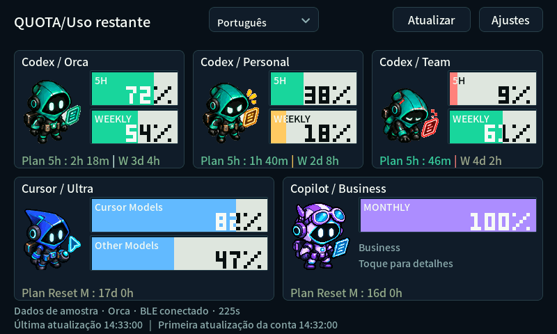
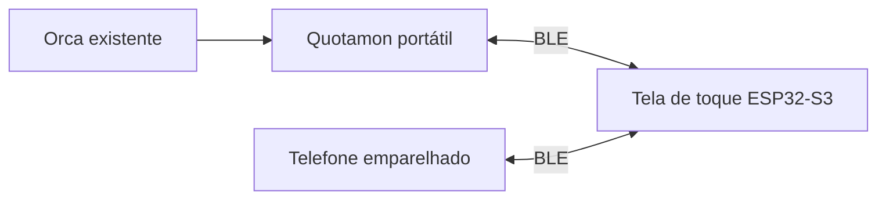

# Quotamon

**As cotas das suas assinaturas de IA, numa tela pequena.**

Codex · Cursor · Copilot · Claude · Grok 
Um monitor de 7 polegadas com companheiros em pixel e barras de restante

<strong>Português</strong> · 16

[English](README.md) · [한국어](README.ko.md) · [简体中文](README.zh-CN.md) · [日本語](README.ja.md) · [Deutsch](README.de.md) · [हिन्दी](README.hi.md) · [Español](README.es.md) · [العربية](README.ar.md) 
[Français](README.fr.md) · [বাংলা](README.bn.md) · **Português** · [Bahasa Indonesia](README.id.md) · [اردو](README.ur.md) · [Русский](README.ru.md) · [Naijá](README.pcm.md) · [العربية المصرية](README.ar-EG.md)

[Abrir no idioma do navegador](https://cdn.jsdelivr.net/gh/guyster323/ESP32_7inch_Quotamon@main/assets/readme/language.html) · [Início rápido](#quick-start) · [Novidades](#whats-new) · [Mudanças](#changelog) · [Portátil](docs/PORTABLE_BRIDGE.md) · [Firmware](docs/UPLOAD.md) · [Arquitetura](docs/ARCHITECTURE.md)

A imagem e o movimento usam o **código LVGL compartilhado com a placa**. Os números são exemplos. A moldura, o toque, o desligar e o acender são uma simulação, não uma foto do aparelho.

## Primeiro a visão geral; o detalhe, ao tocar

| Cinco contas de uma vez | Tempo até reiniciar | Saber se o dado é recente |
|---|---|---|
| Três contas Codex junto de Cursor e Copilot. Até 20 contas em páginas. | O plano de 5 horas e o semanal aparecem juntos. O Cursor partilha um reinício. | A atualização da tela e a hora da origem ficam separadas. |

| O personagem mostra o estado | Detalhe com um toque | Manter o Orca atual |
|---|---|---|
| Normal, atenção, crítico, esgotado, desligado e informação antiga. | Cada limite, a escolha de contas e os ajustes de tela. | Um aplicativo portátil do Windows envia os dados por BLE. |

## O que a tela mostra

O Codex mostra só os dois créditos de reinício mais próximos. `R.T.1` é maior e `R.T.2` é menor. Não há terceiro crédito, quantidade, data nem fuso. O tempo usa `d / h / m`. O plano do Codex é `Plan 5h` e `W`; Cursor e Copilot usam `Plan Reset M`. Quanto menos tempo resta, mais vermelho fica o texto.

## Como se conecta

O ESP32 desenha e recebe o toque. Um PC próximo, com o Orca e a ponte portátil, envia os dados da assinatura. Não precisa de Wi-Fi nem de login na tela. O envio é a cada **60 segundos** e o batimento a cada **10 segundos**. Uma queda ou **35 segundos** sem tráfego válido apaga o que está na tela.

## Início rápido

1. **Prepare a placa.** O alvo é **Waveshare ESP32-S3-Touch-LCD-7 Rev1.2, 800×480**. [Firmware](docs/UPLOAD.md).
2. **Execute o aplicativo portátil.** Baixe `Quotamon-Portable-win-x64-preview` de uma [compilação do Windows](https://github.com/guyster323/ESP32_7inch_Quotamon/actions/workflows/build.yml) bem-sucedida, extraia o ZIP inteiro e abra **Quotamon.exe**.
3. **Escolha as contas.** Abra o Orca e salve contas, apelidos, planos e ordem.
4. **Conecte por BLE.** Inicie o emparelhamento no aparelho, procure a tela no PC e aprove o mesmo número de 6 dígitos nos dois lados.

É preciso Windows 10 2004 ou mais recente / Windows 11, x64 e Bluetooth LE. Mantenha a pasta inteira. Se falhar antes do número, veja a [recuperação no Windows](docs/PORTABLE_BRIDGE.md).

## Idioma e desligamento programado

Na **tela inicial** da web portátil ou do ESP32, escolher um dos 16 idiomas salva na hora. Também dá para usar **Configurações → Idioma → Salvar**. **Configurações → Desligamento programado** apaga só a luz de fundo no horário local do PC. O BLE continua. Tocar a tela apagada acende por **5 minutos**. No ESP32, toque a hora e digite 4 números: `0730` é `07:30`. [Guia](docs/LANGUAGES_AND_SCREEN_SCHEDULE.md)

## Controlar a tela com um telefone emparelhado

A placa emparelha **um PC e um telefone** separadamente. O PC envia o uso e a ligação autenticada do telefone indica presença. Na LCD, abra **Ligação BLE → Presença do telefone → Registrar telefone**, escolha Quotamon no Bluetooth do telefone e aprove o mesmo número.

- **60 segundos** depois de o telefone registrado desligar, a tela apaga e volta a acender na reconexão autenticada.
- O horário tem prioridade. Um toque acende 5 minutos no brilho salvo.
- Não usa outro aplicativo, varredura de anúncios, comparação de nomes nem Wi-Fi. O telefone não lê os dados das contas.
- A reconexão testada usa um HID de controle do consumidor, sem teclado, rato nem entrada automática.

## Os companheiros em pixel

Piscam, respiram e mudam o gesto conforme o restante e o estado da fonte. Várias contas do mesmo serviço movem-se em momentos diferentes.

| Serviço | Dados | Contas |
|---|---|---|
| Codex | Limites de 5 horas e semanais do Orca e o vencimento dos créditos | Padrão + contas administradas |
| Claude | Limites semanais e de modelos extra do Orca | Padrão + contas administradas |
| Cursor | Cursor Models · Other Models | Conta ativa |
| Grok | Grupos de uso fornecidos pelo Orca | Conta ativa |
| Copilot | SDK de cota da CLI do Copilot para Windows, no npm global ou no caminho do GitHub Copilot CLI | Conta CLI atual · experimental |

## Novidades

### 2026-11-18 — Botões iniciais e 16 idiomas

Atualizar e Configurações têm 36px de altura e ficam a pelo menos 16px do primeiro cartão. O idioma escolhido na tela inicial é salvo na hora. Esta página é o guia em português.

### 2026-11-17 — Créditos de reinício do Codex e tempo do plano

Cada cartão Codex mostra só os dois créditos mais próximos, como `R.T.1` / `R.T.2` em `d/h/m`. O tempo do plano muda de cor. O painel do PC mostra as mesmas informações da LCD.

## Mudanças

- **2026-11-18:** botões iniciais mais compactos e 16 idiomas salvos na primeira tela.
- **2026-11-17:** créditos do Codex, cor do plano e deteção da CLI do Copilot para Windows.
- **2026-10-20:** ligações autenticadas separadas do PC e do telefone.
- **2026-10-16:** cinco idiomas, desligamento diário e animação dos personagens.
- As entradas anteriores estão no [README em inglês](README.md#changelog).

## Desenvolvimento e documentação

| | |
|---|---|
| [Portable](docs/PORTABLE_BRIDGE.md) | [Architecture](docs/ARCHITECTURE.md) |
| [Firmware](docs/UPLOAD.md) | [BLE](docs/BLE_PROTOCOL.md) |

## Créditos

A arte em pixel e as barras de percentagem vêm do [F108pro Usage Monitor](https://github.com/guyster323/F108pro_Usage_monitor). O robô violeta do Copilot é uma ilustração nova deste projeto. Código: [MIT](LICENSE). Licenças de terceiros: [THIRD_PARTY_NOTICES.md](THIRD_PARTY_NOTICES.md).

