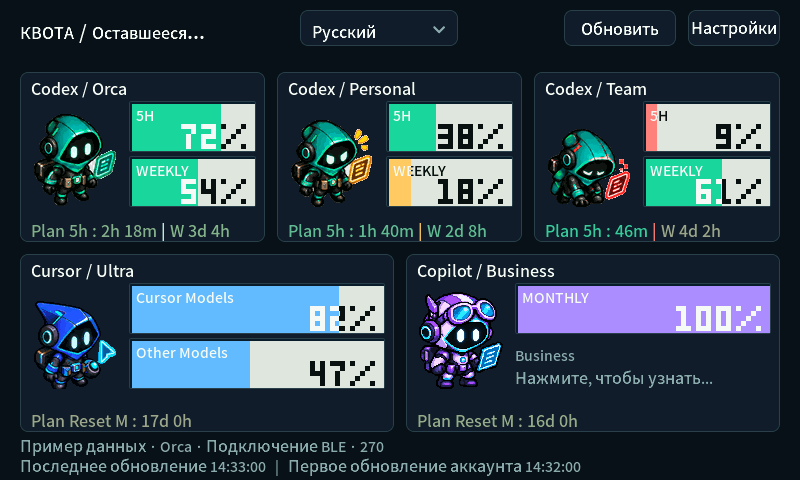
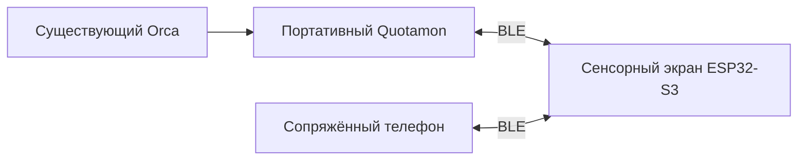

# Quotamon

**Остаток подписок на ИИ — на маленьком экране.**

Codex · Cursor · Copilot · Claude · Grok 
7-дюймовый монитор с пиксельными спутниками и полосами остатка

<strong>Русский</strong> · 16

[English](README.md) · [한국어](README.ko.md) · [简体中文](README.zh-CN.md) · [日本語](README.ja.md) · [Deutsch](README.de.md) · [हिन्दी](README.hi.md) · [Español](README.es.md) · [العربية](README.ar.md) 
[Français](README.fr.md) · [বাংলা](README.bn.md) · [Português](README.pt.md) · [Bahasa Indonesia](README.id.md) · [اردو](README.ur.md) · **Русский** · [Naijá](README.pcm.md) · [العربية المصرية](README.ar-EG.md)

[Открыть на языке браузера](https://cdn.jsdelivr.net/gh/guyster323/ESP32_7inch_Quotamon@main/assets/readme/language.html) · [Быстрый старт](#quick-start) · [Что нового](#whats-new) · [История](#changelog) · [Портативная версия](docs/PORTABLE_BRIDGE.md) · [Прошивка](docs/UPLOAD.md) · [Архитектура](docs/ARCHITECTURE.md)

Картинка и движение сделаны тем же **кодом LVGL, что и на плате**. Числа — примеры. Рамка, касание, гашение и включение экрана — имитация, а не съёмка устройства.

## Сначала обзор, подробности по касанию

| Пять учётных записей сразу | Время до сброса | Насколько свежие данные |
|---|---|---|
| Три записи Codex рядом с Cursor и Copilot. До 20 записей по страницам. | Пятичасовой и недельный планы видны вместе. У Cursor общий сброс. | Обновление экрана и время сбора источника показаны отдельно. |

| Персонаж показывает состояние | Подробности касанием | Текущий Orca остаётся |
|---|---|---|
| Норма, внимание, критично, исчерпано, нет связи, устаревшие данные. | Каждый лимит, выбор записей и настройки экрана. | Портативное приложение Windows передаёт данные по BLE. |

## Что сейчас на экране

Codex показывает только два ближайших кредита сброса. `R.T.1` крупнее, `R.T.2` мельче. Третий кредит, количество, дата и часовой пояс не выводятся. Время записывается как `d / h / m`. План Codex — это `Plan 5h` и `W`, а Cursor и Copilot — `Plan Reset M`. Чем меньше времени осталось, тем краснее текст.

## Как подключается

ESP32 рисует экран и принимает касания. Ближний компьютер с запущенным Orca и портативным мостом отдаёт данные подписок. Wi-Fi и вход на самом экране не нужны. Передача каждые **60 секунд**, пульс каждые **10 секунд**. Разрыв или **35 секунд** без годного обмена очищают экран.

## Быстрый старт

1. **Подготовьте плату.** Нужна **Waveshare ESP32-S3-Touch-LCD-7 Rev1.2, 800×480**. [Прошивка](docs/UPLOAD.md).
2. **Запустите портативное приложение.** Скачайте `Quotamon-Portable-win-x64-preview` из успешной [сборки Windows](https://github.com/guyster323/ESP32_7inch_Quotamon/actions/workflows/build.yml), распакуйте весь ZIP и запустите **Quotamon.exe**.
3. **Выберите записи.** Откройте Orca и сохраните записи, псевдонимы, планы и порядок.
4. **Подключитесь по BLE.** Начните сопряжение на устройстве, найдите экран на компьютере и подтвердите одинаковые 6 цифр с обеих сторон.

Нужны Windows 10 2004 или новее / Windows 11, x64 и Bluetooth LE. Храните папку целиком. Если сопряжение обрывается до цифр, смотрите [восстановление в Windows](docs/PORTABLE_BRIDGE.md).

## Язык и расписание гашения

На **первом экране** портативной веб-страницы или ESP32 выбор одного из 16 языков сохраняется сразу. Можно и через **Настройки → Язык → Сохранить**. **Настройки → Расписание гашения** выключает только подсветку по местному времени компьютера. BLE продолжает приём. Касание погашенного экрана включает его на **5 минут**. На ESP32 коснитесь времени и введите 4 цифры: `0730` — это `07:30`. [Описание](docs/LANGUAGES_AND_SCREEN_SCHEDULE.md)

## Экран и напрямую сопряжённый телефон

Плата отдельно сопрягает **один компьютер и один телефон**. Компьютер передаёт расход, а проверенное соединение телефона определяет присутствие. На LCD откройте **Соединение BLE → Обнаружение телефона → Регистрация телефона**, выберите Quotamon в Bluetooth телефона и подтвердите одинаковый номер.

- Через **60 секунд** после отключения зарегистрированного телефона экран гаснет и загорается при проверенном автоматическом подключении.
- Расписание важнее обнаружения. Касание включает экран на 5 минут с сохранённой яркостью.
- Не используются дополнительное приложение, поиск объявлений, сопоставление имён и Wi-Fi. Телефон не читает данные записей.
- Проверенное автоподключение — это HID управления потребителем, без клавиатуры, мыши и автоматического ввода.

## Пиксельная команда

Они моргают, дышат и меняют жест по остатку и состоянию источника. Несколько записей одной службы двигаются в разное время.

| Служба | Данные | Записи |
|---|---|---|
| Codex | Пятичасовые и недельные лимиты Orca и срок кредитов сброса | Основная + управляемые |
| Claude | Недельные и дополнительные лимиты моделей Orca | Основная + управляемые |
| Cursor | Cursor Models · Other Models | Текущая активная |
| Grok | Пулы, которые отдаёт Orca | Текущая активная |
| Copilot | SDK квоты Windows Copilot CLI: глобальный npm или путь GitHub Copilot CLI | Текущая запись CLI · опытная |

## Что нового

### 2026-11-18 — Кнопки главного экрана и 16 языков

Обновление и Настройки имеют высоту 36px и отстоят от первой карточки не меньше чем на 16px. Язык с первого экрана сохраняется сразу. Это руководство на русском.

### 2026-11-17 — Кредиты сброса Codex и остаток плана

Карточка Codex показывает только два ближайших кредита как `R.T.1` / `R.T.2` в `d/h/m`. Остаток плана меняет цвет. Панель компьютера совпадает с LCD.

## История

- **2026-11-18:** кнопки главного экрана стали компактнее, 16 языков сохраняются с первого экрана.
- **2026-11-17:** кредиты сброса Codex, цвет плана и распознавание Windows Copilot CLI.
- **2026-10-20:** отдельные проверенные связи компьютера и телефона управляют экраном.
- **2026-10-16:** пять языков, ежедневное гашение и анимация персонажей.
- Более ранние записи — в [английском README](README.md#changelog).

## Разработка и документы

| | |
|---|---|
| [Portable](docs/PORTABLE_BRIDGE.md) | [Architecture](docs/ARCHITECTURE.md) |
| [Firmware](docs/UPLOAD.md) | [BLE](docs/BLE_PROTOCOL.md) |

## Благодарности

Пиксели и полосы процентов взяты из [F108pro Usage Monitor](https://github.com/guyster323/F108pro_Usage_monitor). Фиолетовый робот Copilot — новый рисунок этого проекта. Код: [MIT](LICENSE). Сторонние лицензии: [THIRD_PARTY_NOTICES.md](THIRD_PARTY_NOTICES.md).

