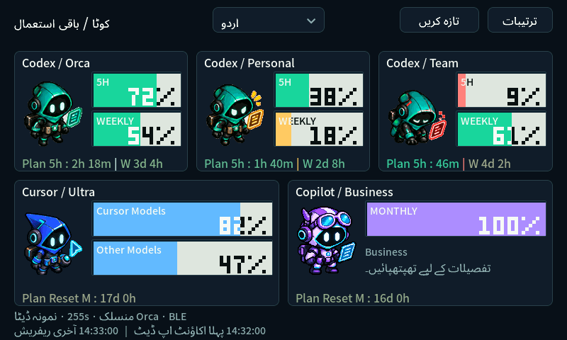
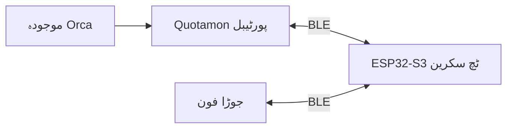

# Quotamon

**AI سبسکرپشن کا بچا حصہ، میز کی چھوٹی سکرین پر۔**

Codex · Cursor · Copilot · Claude · Grok 
پکسل ساتھیوں اور بقیہ پٹیوں والا 7 انچ مانیٹر

<strong>اردو</strong> · 16

[English](README.md) · [한국어](README.ko.md) · [简体中文](README.zh-CN.md) · [日本語](README.ja.md) · [Deutsch](README.de.md) · [हिन्दी](README.hi.md) · [Español](README.es.md) · [العربية](README.ar.md) 
[Français](README.fr.md) · [বাংলা](README.bn.md) · [Português](README.pt.md) · [Bahasa Indonesia](README.id.md) · **اردو** · [Русский](README.ru.md) · [Naijá](README.pcm.md) · [العربية المصرية](README.ar-EG.md)

[براؤزر کی زبان میں کھولیں](https://cdn.jsdelivr.net/gh/guyster323/ESP32_7inch_Quotamon@main/assets/readme/language.html) · [شروع](#quick-start) · [نیا](#whats-new) · [تبدیلیاں](#changelog) · [پورٹیبل](docs/PORTABLE_BRIDGE.md) · [فرم ویئر](docs/UPLOAD.md) · [ڈھانچہ](docs/ARCHITECTURE.md)

تصویر اور حرکت بورڈ والے **LVGL کوڈ** سے بنتی ہے۔ اعداد مثال ہیں۔ فریم، ٹچ، سکرین بند اور روشن ہونا نقل ہے، اصل تصویر نہیں۔

## پہلے ایک نظر، ضرورت پر ٹچ

| ایک سکرین پر پانچ اکاؤنٹ | ری سیٹ تک وقت | ڈیٹا کتنا نیا ہے |
|---|---|---|
| تین Codex اکاؤنٹ، Cursor اور Copilot ساتھ۔ زیادہ سے زیادہ 20 صفحات میں۔ | 5 گھنٹے اور ہفتہ وار منصوبہ ساتھ۔ Cursor کا ری سیٹ مشترک ہے۔ | سکرین کی تازہ کاری اور ماخذ کا وقت الگ ہیں۔ |

| کردار حالت بتاتا ہے | ٹچ سے تفصیل | موجودہ Orca ویسے ہی |
|---|---|---|
| عام، احتیاط، ہنگامی، ختم، آف لائن اور پرانی معلومات۔ | ہر حد، اکاؤنٹ کا انتخاب اور ڈسپلے سیٹنگ۔ | بغیر انسٹال Windows ٹرے ایپ BLE سے ڈیٹا بھیجتی ہے۔ |

## اب سکرین پر کیا ہے

Codex صرف دو قریب ترین ری سیٹ کریڈٹ دکھاتا ہے۔ `R.T.1` بڑا ہے، `R.T.2` چھوٹا۔ تیسرا، تعداد، تاریخ اور منطقۂ وقت نہیں۔ وقت `d / h / m` میں ہے۔ Codex منصوبہ `Plan 5h` اور `W` ہے؛ Cursor اور Copilot `Plan Reset M` لکھتے ہیں۔ وقت جتنا کم، رنگ اتنا سرخ۔

## کنکشن

ESP32 تصویر اور ٹچ سنبھالتا ہے۔ قریبی PC جس پر Orca اور پورٹیبل برج چل رہے ہوں سبسکرپشن ڈیٹا بھیجتا ہے۔ Wi-Fi یا سکرین پر لاگ اِن نہیں چاہیے۔ بھیجنا ہر **60 سیکنڈ**، دھڑکن ہر **10 سیکنڈ**۔ ٹوٹنے یا **35 سیکنڈ** درست رابطے کے بغیر ڈسپلے مٹ جاتا ہے۔

## شروع

1. **بورڈ تیار کریں۔** ہدف **Waveshare ESP32-S3-Touch-LCD-7 Rev1.2، 800×480** ہے۔ [فرم ویئر](docs/UPLOAD.md)۔
2. **پورٹیبل ایپ چلائیں۔** کامیاب [Windows Actions بلڈ](https://github.com/guyster323/ESP32_7inch_Quotamon/actions/workflows/build.yml) سے `Quotamon-Portable-win-x64-preview` لیں، پوری ZIP کھولیں اور **Quotamon.exe** چلائیں۔
3. **اکاؤنٹ چنیں۔** موجودہ Orca کھولیں اور اکاؤنٹ، عرف، منصوبے اور ترتیب محفوظ کریں۔
4. **BLE سے جوڑیں۔** ڈیوائس پر جوڑنا شروع کریں، PC پر ڈسپلے ڈھونڈیں اور دونوں طرف ایک ہی 6 ہندسے منظور کریں۔

Windows 10 2004 یا نیا / Windows 11، x64 اور Bluetooth LE چاہیے۔ پورا فولڈر رکھیں۔ ہندسوں سے پہلے ناکامی ہو تو [Windows بحالی](docs/PORTABLE_BRIDGE.md) دیکھیں۔

## زبان اور سکرین بند کرنے کا وقت

پورٹیبل ویب یا ESP32 کی **پہلی سکرین** پر 16 زبانوں میں سے ایک چننا فوراً محفوظ ہو جاتا ہے۔ **سیٹنگ → زبان → محفوظ** سے بھی بدل سکتے ہیں۔ **سیٹنگ → شیڈول بند** صرف بیک لائٹ بند کرتا ہے، PC کے مقامی وقت پر۔ BLE ڈیٹا لیتا رہتا ہے۔ بند سکرین چھونے سے **5 منٹ** جلتی ہے۔ ESP32 پر وقت چھو کر 4 ہندسے لکھیں: `0730` یعنی `07:30`۔ [رہنما](docs/LANGUAGES_AND_SCREEN_SCHEDULE.md)

## فون جوڑ کر سکرین کنٹرول

بورڈ **ایک PC اور ایک فون** الگ جوڑتا ہے۔ PC استعمال بھیجتا ہے، تصدیق شدہ فون کنکشن موجودگی بتاتا ہے۔ LCD پر **BLE کنکشن → فون شناخت → فون رجسٹریشن** کھولیں، فون کے Bluetooth میں Quotamon چنیں اور دونوں طرف ایک ہی نمبر منظور کریں۔

- رجسٹرڈ فون ٹوٹنے کے **60 سیکنڈ** بعد سکرین بند ہوتی ہے اور تصدیق شدہ خودکار کنکشن پر جلتی ہے۔
- شیڈول فون شناخت سے اوپر ہے۔ ٹچ محفوظ چمک پر 5 منٹ جلاتا ہے۔
- اضافی ایپ، اشتہار اسکین، نام ملانا یا Wi-Fi نہیں۔ فون اکاؤنٹ ڈیٹا نہیں پڑھتا۔
- جانچا گیا خودکار کنکشن صارف کنٹرول HID ہے، بغیر کی بورڈ، ماؤس یا خودکار ان پٹ کے۔

## پکسل ساتھی

وہ پلک جھپکتے اور سانس لیتے ہیں، اور حرکت باقی مقدار اور ماخذ کی حالت پر بدلتی ہے۔ ایک سروس کے کئی اکاؤنٹ الگ وقت پر ہلتے ہیں۔

| سروس | ڈیٹا | اکاؤنٹ |
|---|---|---|
| Codex | Orca کی 5 گھنٹے اور ہفتہ وار حد اور ری سیٹ کریڈٹ کی میعاد | بنیادی + منظم اکاؤنٹ |
| Claude | Orca کی ہفتہ وار اور اضافی ماڈل حد | بنیادی + منظم اکاؤنٹ |
| Cursor | Cursor Models · Other Models | فعال اکاؤنٹ |
| Grok | Orca کے دیے استعمال پول | فعال اکاؤنٹ |
| Copilot | Windows Copilot CLI کا quota SDK، npm عالمی یا GitHub Copilot CLI راستہ | موجودہ CLI اکاؤنٹ · تجرباتی |

## نیا

### 2026-11-18 — ہوم بٹن اور 16 زبانیں

ریفریش اور سیٹنگ 36px اونچے ہیں اور پہلے کارڈ سے کم از کم 16px دور۔ پہلی سکرین پر زبان فوراً محفوظ ہوتی ہے۔ یہ صفحہ اردو رہنما ہے۔

### 2026-11-17 — Codex ری سیٹ کریڈٹ اور منصوبے کا باقی وقت

ہر Codex کارڈ صرف دو قریب ترین کریڈٹ `R.T.1` / `R.T.2` اور `d/h/m` میں دکھاتا ہے۔ منصوبے کا وقت رنگ بدلتا ہے۔ PC ڈیش بورڈ LCD جیسا ہے۔

## تبدیلیاں

- **2026-11-18:** ہوم بٹن چھوٹے اور 16 زبانیں پہلی سکرین سے محفوظ۔
- **2026-11-17:** Codex ری سیٹ کریڈٹ، منصوبے کا رنگ اور Windows Copilot CLI کی پہچان۔
- **2026-10-20:** PC اور فون کے تصدیق شدہ کنکشن الگ ہیں اور سکرین کنٹرول کرتے ہیں۔
- **2026-10-16:** پانچ زبانیں، روزانہ سکرین بند اور پکسل حرکت۔
- پرانے انگریزی ریکارڈ [English README](README.md#changelog) میں ہیں۔

## ترقی اور دستاویز

| | |
|---|---|
| [Portable](docs/PORTABLE_BRIDGE.md) | [Architecture](docs/ARCHITECTURE.md) |
| [Firmware](docs/UPLOAD.md) | [BLE](docs/BLE_PROTOCOL.md) |

## اسناد

پکسل آرٹ اور فیصد پٹیاں [F108pro Usage Monitor](https://github.com/guyster323/F108pro_Usage_monitor) سے ہیں۔ جامنی Copilot روبوٹ اس منصوبے کی نئی تصویر ہے۔ کوڈ: [MIT](LICENSE)۔ تیسرا فریق: [THIRD_PARTY_NOTICES.md](THIRD_PARTY_NOTICES.md)۔

