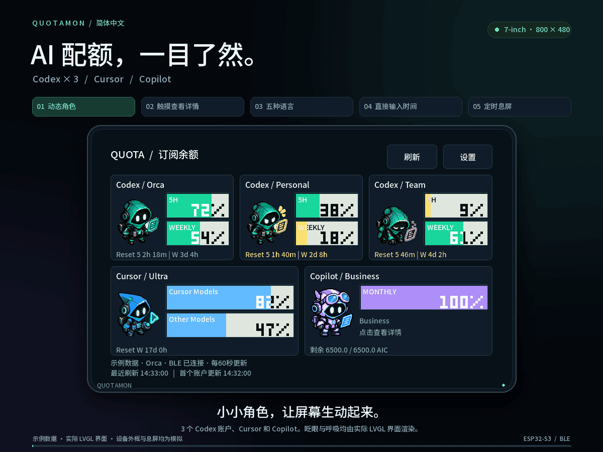
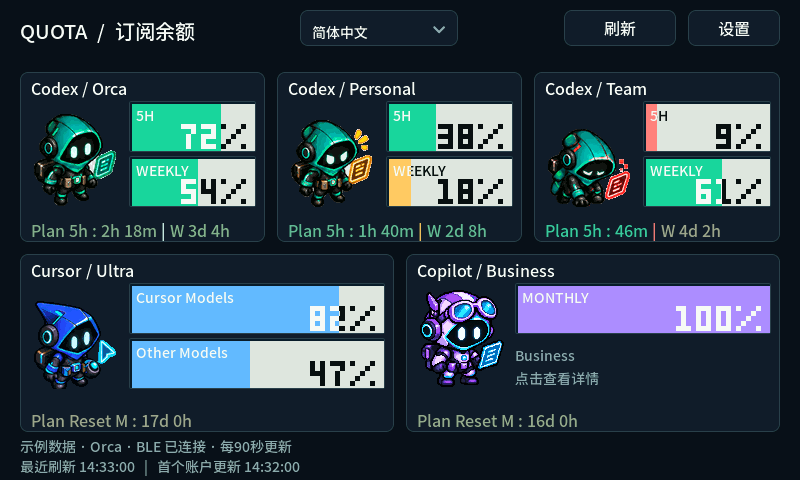
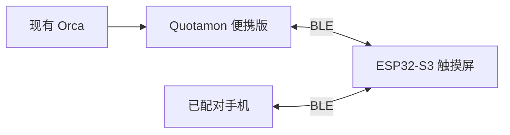

# Quotamon

**把 AI 订阅余量，放在桌面的小屏幕上。**

Codex · Cursor · Copilot · Claude · Grok 
带像素角色的 7 英寸订阅余量显示器

<strong>简体中文</strong> · 16

[English](README.md) · [한국어](README.ko.md) · **简体中文** · [日本語](README.ja.md) · [Deutsch](README.de.md) · [हिन्दी](README.hi.md) · [Español](README.es.md) · [العربية](README.ar.md) 
[Français](README.fr.md) · [বাংলা](README.bn.md) · [Português](README.pt.md) · [Bahasa Indonesia](README.id.md) · [اردو](README.ur.md) · [Русский](README.ru.md) · [Naijá](README.pcm.md) · [العربية المصرية](README.ar-EG.md)

[用浏览器语言打开](https://cdn.jsdelivr.net/gh/guyster323/ESP32_7inch_Quotamon@main/assets/readme/language.html) · [快速开始](#quick-start) · [新变化](#whats-new) · [更新记录](#changelog) · [便携版](docs/PORTABLE_BRIDGE.md) · [固件](docs/UPLOAD.md) · [架构](docs/ARCHITECTURE.md)

Codex 3 个账户 + Cursor + Copilot · 24 秒循环 · <a href="assets/readme/zh-CN/quotamon-demo.mp4">播放视频</a> · <a href="assets/readme/zh-CN/quotamon-display.png">PNG</a>

画面和角色动作使用与开发板相同的 **LVGL 代码**渲染。数值是示例。设备外框、触摸标记、息屏和点亮是演示模拟，不是实机拍摄。

## 先看一眼，需要时再触摸

| 一屏五个账户 | 距离重置还有多久 | 分清数据有多新 |
|---|---|---|
| Codex 三个账户与 Cursor、Copilot 同屏。最多 20 个账户分页。 | 5 小时和每周安排同时显示。Cursor 共用一次重置。 | 屏幕刷新时间和来源采集时间分开显示。 |

| 角色表示状态 | 触摸打开详情 | 沿用现有 Orca |
|---|---|---|
| 正常、注意、紧急、用尽、等待连接、信息过旧。 | 查看每个限额、选择账户并调整显示。 | 免安装的 Windows 托盘程序通过 BLE 发送。包含 Node 和 .NET。 |

## 当前屏幕上读到的内容

Codex 只显示最近到期的两张重置券：`R.T.1` 更大，`R.T.2` 更小。第三张、数量、日期和时区不显示。时间用 `d / h / m`。Codex 计划写为 `Plan 5h` 与 `W`，Cursor 和 Copilot 写为 `Plan Reset M`。剩余时间越短颜色越接近红色。

## 连接方式

ESP32 负责画面和触摸。附近正在运行 Orca 与便携中继的电脑提供订阅数据。不需要 Wi-Fi，也不在显示器上登录。默认每 **60 秒**发送一次，心跳 **10 秒**。断开或 **35 秒**没有有效通信时清除显示。

## 快速开始

1. **准备开发板。** 目标是 **Waveshare ESP32-S3-Touch-LCD-7 Rev1.2，800×480**。[固件上传](docs/UPLOAD.md)。
2. **运行便携程序。** 从成功的 [Windows Actions 构建](https://github.com/guyster323/ESP32_7inch_Quotamon/actions/workflows/build.yml) 下载 `Quotamon-Portable-win-x64-preview`，解压整个 ZIP，运行 **Quotamon.exe**。
3. **选择账户。** 打开现有 Orca，在设置里保存账户、别名、方案和顺序。
4. **用 BLE 连接。** 在设备上开始连接，在电脑上寻找显示器，两边确认相同的 6 位数字。之后会自动重连。

需要 Windows 10 2004 或更高版本 / Windows 11、x64 和 Bluetooth LE。请保持整个文件夹在一起。配对在出现号码前失败时，查看 [Windows 配对恢复](docs/PORTABLE_BRIDGE.md)。

## 语言与定时息屏

在便携网页或 ESP32 **首页**选择 16 种语言之一会立即保存。也可以在 **设置 → 语言 → 保存** 中更改。**设置 → 定时息屏** 按电脑本地时间只关闭背光，BLE 仍然接收数据。触摸熄灭的屏幕会点亮 **5 分钟**。在 ESP32 上触摸时间，输入 4 位数字，例如 `0730` 就是 `07:30`。[说明](docs/LANGUAGES_AND_SCREEN_SCHEDULE.md)

## 用手机直接配对来控制屏幕

开发板分别配对 **一台电脑和一台手机**。电脑发送用量，手机的已认证连接用来判断人是否在旁。在 LCD 打开 **BLE 连接 → 手机检测 → 注册手机**，在手机系统蓝牙里选择 Quotamon，并在两边批准相同号码。

- 注册手机断开 **60 秒**后关屏，认证后的自动重连会重新点亮。
- 定时息屏优先于手机检测。触摸可按保存的亮度点亮 5 分钟。
- 不使用手机额外应用、广播扫描、名字匹配或 Wi-Fi。手机不能读取账户数据。
- 测试中的自动重连使用消费者控制 HID，没有键盘或鼠标集合，也不会自动发送输入。

## 像素伙伴

角色会眨眼、呼吸，并随余量和采集状态改变动作。同一服务的多个账户各自按不同时间活动。

| 服务 | 读取的数据 | 账户范围 |
|---|---|---|
| Codex | Orca 的 5 小时、每周限额和重置券到期 | 默认账户 + 管理账户 |
| Claude | Orca 的每周和附加模型限额 | 默认账户 + 管理账户 |
| Cursor | Cursor Models · Other Models | 当前活动账户 |
| Grok | Orca 提供的用量池 | 当前活动账户 |
| Copilot | Windows Copilot CLI 的 quota SDK。会查找 npm 全局安装和 GitHub Copilot CLI 路径 | 当前 CLI 账户 · 实验性 |

## 新变化

### 2026-11-18 — 首页按钮与 16 种语言

首页的刷新和设置按钮高度为 36px，与第一张卡片至少相距 16px。同一行可以选择语言。便携网页和 ESP32 首页选择语言后立即保存。本页是简体中文说明。

### 2026-11-17 — Codex 重置券与计划剩余时间

每张 Codex 卡片只显示最近的两张重置券，格式为 `R.T.1` / `R.T.2` 和 `d/h/m`。计划剩余时间按剩余长短变色。电脑仪表板与 LCD 使用相同信息。

## 更新记录

- **2026-11-18：** 缩小首页按钮间距，并在首页直接保存 16 种语言。阿拉伯语和乌尔都语从右向左阅读。
- **2026-11-17：** 加入 Codex 重置券和彩色计划倒计时，并识别 Windows 版 Copilot CLI 的安装路径。
- **2026-10-20：** 电脑与手机分开进行已认证连接，并用手机在场状态控制屏幕。
- **2026-10-16：** 加入五种语言、每日息屏计划和像素角色动画。
- 更早的英文记录见 [English README](README.md#changelog)。

## 开发与文档

| | |
|---|---|
| [便携版运行与恢复](docs/PORTABLE_BRIDGE.md) | [架构](docs/ARCHITECTURE.md) |
| [固件与 BOOT/RESET](docs/UPLOAD.md) | [BLE 协议](docs/BLE_PROTOCOL.md) |

## 致谢

像素素材和百分比条来自 [F108pro Usage Monitor](https://github.com/guyster323/F108pro_Usage_monitor)。Copilot 的紫色机器人是本项目的新插画。项目代码为 [MIT](LICENSE)。第三方许可见 [THIRD_PARTY_NOTICES.md](THIRD_PARTY_NOTICES.md)。

