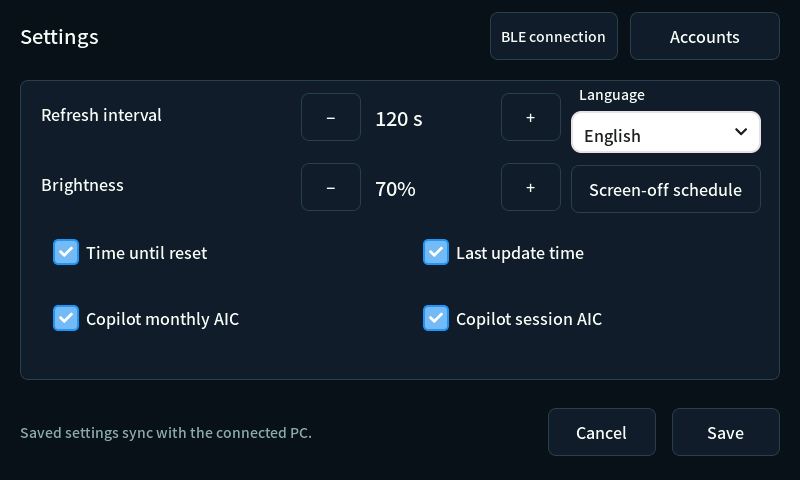
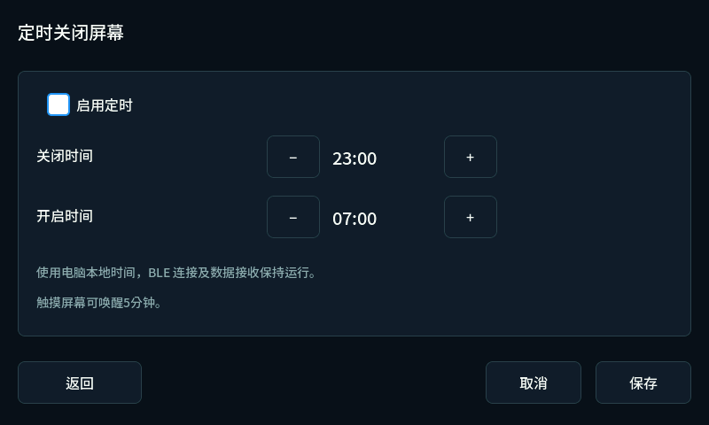

# 언어와 화면 끄기 예약

웹과 ESP32에서 한국어(`ko`), 중국어 간체(`zh-CN`), 일본어(`ja`), 영어(`en`), 독일어(`de`)를 선택합니다. 기존 설정은 한국어·예약 해제로 읽습니다.

## 언어 선택

- 웹: **설정 → 언어 → 디스플레이 설정 저장**. 저장 전 미리 보기, 취소 시 복원.
- ESP32: **설정 → 언어 → 저장**. 언어를 바꿔도 갱신 주기·밝기 등 초안 유지.
- 연결 시 같은 언어 설정을 공유합니다. 별칭·계정 이름·서비스의 요금제 이름은 번역하지 않습니다.
- ESP32는 언어·예약을 로컬 NVS에도 저장합니다. 연결되면 PC의 확정 설정이 기준이며 revision 검사로 오래된 초안의 덮어쓰기를 막습니다.



## 화면 끄기 예약

웹과 ESP32의 **설정 → 화면 끄기 예약**에서 예약 사용과 시작·종료 시각을 저장합니다. 기본값은 **예약 해제 / 23:00~07:00**입니다.

| 항목 | 동작 |
|---|---|
| 시간 입력 | 웹은 24시간제 `HH:MM`, ESP32는 `−`·`+`로 15분씩 조정 |
| 기준 | PC 현지 시각. Unix 시각과 UTC offset을 스냅샷으로 전달 |
| 구간 | 매일 반복, 자정 경과 지원. 시작 시각부터 끄고 종료 시각부터 켬. 같은 시각은 거부 |
| 꺼지는 대상 | CH422G EXIO2 백라이트. ESP32 deep sleep을 사용하지 않음 |
| 계속 실행 | BLE 연결·heartbeat·데이터 수신·터치·시계. 화면이 꺼진 동안 캐릭터 타이머 정지 |
| 터치 | 기존 밝기로 5분 점등. 이후 예약 구간이면 다시 끔 |
| 부팅·시각 미확인 | 예약은 복원하지만 유효한 PC 시각을 받기 전까지 화면은 켜 둠 |
| 연결 상실 | 한 번 받은 시각으로 예약 유지. 기존 정책대로 구독 수치는 삭제 |

시간대·서머타임 변경은 다음 PC 스냅샷으로 반영합니다. 완전한 전원 차단 후에는 PC 시각을 다시 받기 전까지 켜 둡니다.



## 구현·자원

`locales/messages.json`이 공통 원본입니다. `tools/generate_locales.py`가 웹·TypeScript 언어 목록·ESP32 번역 테이블을 만들고 `--check`로 생성물과 번역 형식 인자를 검사합니다.

폰트는 기존 현대 한글 11,172자·ASCII·확장 라틴을 유지하며 다섯 언어 UI와 언어 이름의 모든 글자를 추가합니다. Noto Sans KR에 없는 글자는 고정 리비전·SHA-256을 검증한 Noto Sans SC에서 가져옵니다. 모두 SIL OFL 1.1이며 [명세](../native/generated/asset-manifest.json)·[라이선스](../THIRD_PARTY_NOTICES.md)에 기록합니다. UI 부분집합 밖의 임의 중국어·일본어 계정 이름은 추가 글자가 필요합니다. 웹은 운영체제 폰트를 사용합니다.

바이너리 6,233,984바이트, 프로그램 74.9%, 정적 RAM 54,320바이트(16.6%)입니다. XIP·RGB 버퍼 두 개·LVGL 스택 이후 보수적인 PSRAM 예산 여유는 610,304바이트입니다. [배포 기록](character-animation-build.json)에 실제 업로드·기동 상태를 기록합니다. 화면 밀림을 수정한 idle 카운터 직접 조회는 유지합니다.

백라이트 근거: [Waveshare LCD-7 핀 표](https://docs.waveshare.com/ESP32-S3-Touch-LCD-7). EXIO2만 바꿔 터치 reset·LCD reset·USB 선택 출력을 유지합니다.

## 검증

```powershell
npm test --prefix orca-integration
tools\build_native.cmd
build\native\quotamon_ui_fonts_test.exe
build\native\quotamon_screen_schedule_test.exe
build\native\quotamon_runtime_metrics_test.exe
python tools/generate_locales.py --check
python tools/verify_localized_ui.py
python tools/verify_localized_lcd.py
python tools/verify_native_visuals.py
python tools/verify_character_animation.py
python tools/verify_animation_budget.py
```

웹 검사는 5개 언어의 모든 페이지·저장·새로고침·취소·예약·잘못된 시간·430px 배치를 확인합니다. LCD 검사는 실제 드롭다운 이벤트·초안 보존·저장·예약 화면·스냅샷 호환성과 거부를 검사합니다. 폰트는 번역 테이블 전체와 언어 이름을 14/16/20px에서 검사합니다. 예약은 주간·자정·UTC offset·시각 미확인·터치 점등 경계를 검사합니다.

이미지는 실제 UI의 모의 데이터 렌더이며 실물 촬영이 아닙니다. 결과: [웹](../visuals/locales/web-checks.json) · [LCD](../visuals/locales/lcd-checks.json).
