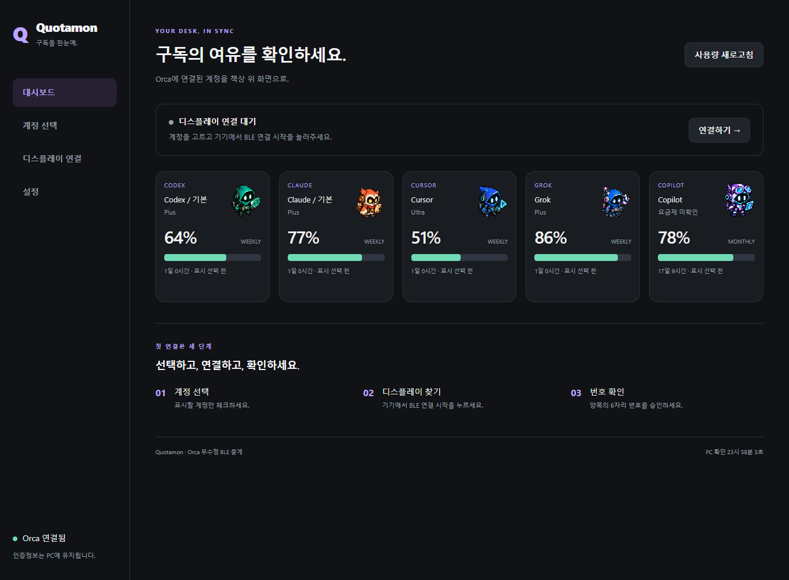
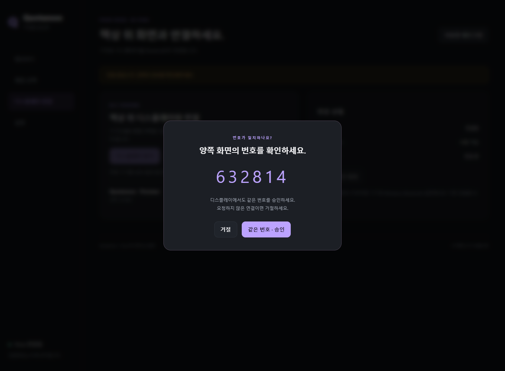
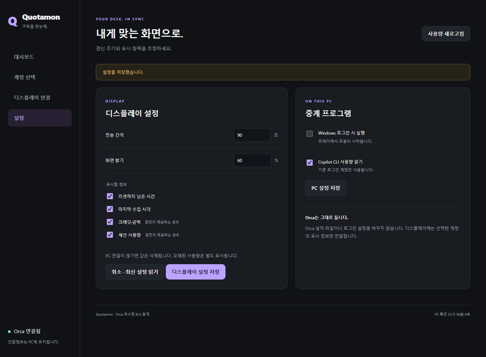

# Orca를 그대로 쓰는 포터블 BLE 중계

기존 Orca에 로그인한 계정을 읽어 7인치 디스플레이로 전달합니다. Orca 수정·재설치·로그인 정보 복사가 필요하지 않습니다. Windows 10 2004 이상/11, x64, Bluetooth LE가 필요합니다. Node와 .NET은 패키지에 포함되므로 따로 설치하지 않습니다.

## 실행과 첫 연결

1. 성공한 [Windows Actions 빌드](https://github.com/guyster323/ESP32_7inch_Quotamon/actions/workflows/build.yml)의 `Quotamon-Portable-win-x64-preview` 아티팩트를 받습니다. 안의 ZIP 전체를 유지할 폴더에 풉니다.
2. **Quotamon.exe**를 실행합니다. 설정 페이지가 기본 브라우저에 열리고 트레이 아이콘이 생깁니다. 브라우저를 닫아도 중계는 계속 실행됩니다.
3. **기존 Orca를 켭니다.** 대시보드에 기본/관리 Codex·Claude 계정과 활성 Cursor·Grok이 나타납니다. 기존 Windows npm Copilot CLI가 있으면 해당 계정도 읽습니다. 로그인되지 않은 provider placeholder는 계정으로 만들지 않습니다.
4. **계정 선택**에서 표시할 계정을 체크합니다. 별칭·요금제·순서를 정하고 저장하세요. 처음에는 자동으로 모든 계정을 전송하지 않습니다.
5. Quotamon 펌웨어를 올린 보드에서 **BLE 연결 시작**을 누릅니다. PC의 **디스플레이 연결 → 디스플레이 찾기**로 검색합니다.
6. 발견된 기기에 연결한 뒤 PC와 디스플레이의 **같은 6자리 번호를 양쪽에서 승인**합니다. 이후 저장된 기기에 자동 재연결합니다.
7. **설정 → 중계 프로그램**에서 Windows 로그인 시 자동 실행과 Copilot 읽기를 선택해 저장합니다. 자동 실행은 트레이에서 시작하고 브라우저를 자동으로 열지 않습니다.

**번호 화면이 뜨기 전에 연결이 실패하면:** 보드에서 **뒤로 → BLE 연결 시작**으로 2분 허용 창을 다시 열고, **Windows 설정 → Bluetooth 및 장치 → 장치 추가 → Bluetooth → Quotamon**에서 먼저 페어링하세요. Windows와 보드에 표시되는 같은 6자리 번호를 비교해 양쪽에서 승인한 다음, 이 앱으로 돌아와 **연결**을 누릅니다. 이미 저장된 페어링은 앱에서도 그대로 사용합니다. 재부팅하거나 페어링을 먼저 삭제할 필요는 없습니다.

2026-10-15 개발 PC에서는 앱의 custom `PairAsync`가 번호 이벤트 전에 `Failed`를 반환했지만, Windows 기본 창에서는 같은 보드의 번호 비교·양쪽 승인이 성공했습니다. `AssociationEndpoint` 종류와 `CanPair=true`는 확인했으므로 장치 객체 종류 문제로 확정하지 않습니다. 앱 자체 페어링 경로의 세부 원인은 아직 조사 중입니다.

`node.exe`, `bridge.cjs`, `web/`, `assets/`, `licenses/`는 Quotamon.exe와 함께 유지하세요. 단일 EXE만 옮기면 실행할 수 없습니다. 폴더를 옮겼다면 새 위치에서 자동 실행 설정을 다시 저장하세요.

업데이트 파일을 풀기 전에는 트레이에서 종료하세요. 중계 설정은 패키지 폴더 바깥에 저장되어 업데이트 후에도 유지됩니다.

## 설정 화면

| 대시보드 | 계정 선택 |
|---|---|
|  |  |
| 번호 승인 | 화면·PC 설정 |
|  |  |

실제 제품 UI로 만든 개발 예시이며 수치와 BLE 장치는 모의 데이터입니다. 별도로 현재 PC의 Orca 1.4.224에서 5계정 조회·실제 adapter·설정 저장을 확인했습니다. 2026-10-15에는 Windows 기본 번호 비교 페어링, 수정 helper의 실물 5계정 전송·보드 ACK 및 사용자 5카드 표시를 확인했습니다. 저장된 기기 검색과 Windows 서비스 조회 호환성을 수정한 앱을 사용자 승인 후 기존 경로에 적용했습니다.

## 운영과 복구

- 트레이 아이콘을 두 번 누르면 설정을 다시 엽니다. 트레이의 **종료**는 중계·BLE·SDK 자식 프로세스를 함께 끝냅니다.
- Orca가 닫히면 다음 확인에서 중계의 계정 데이터를 비우고 BLE 연결을 끊습니다. 캐시 확인은 15초마다, 전송은 기본 60초마다, heartbeat는 10초마다입니다. 보드 자체는 무응답 35초 후에도 모든 값을 지웁니다.
- Orca를 다시 켜면 새 데이터를 읽고 저장한 기기에 재연결합니다. 기존 수치를 최신으로 바꿔 표시하지 않습니다.
- 원천 갱신은 최대 15분마다 기존 Orca 로컬 IPC에 요청합니다. 최소화/백그라운드 상태에서도 Orca의 사용량 캐시를 갱신하며, Orca 내부의 제한·실패 상태를 따릅니다. 원천 30분 초과/조회 실패/리셋 경과는 오래된 정보로 표시합니다.
- 새 LCD 펌웨어는 하단에 **최근 갱신**(PC가 현재 화면 데이터를 생성한 시각)과 **첫 카드 수집/계정 수집**(서비스 원천 수집 시각)을 구분해 표시합니다. 리셋은 `Reset 5 2h 41m | W 5d 3h`로 줄이고, Cursor는 공통 `Reset W` 하나만 표시합니다. 긴 일정은 두 줄로 표시합니다. 이 레이아웃은 해당 펌웨어를 보드에 업로드한 뒤 사용할 수 있습니다.
- PC와 디스플레이에서 동시에 설정을 바꾼 경우 **최신 설정 읽기**로 다시 시작하세요. 저장 revision이 다르면 덮어쓰지 않습니다.
- **자동 연결 해제**는 대상 주소를 지우고 연결을 끊습니다. 다른 PC로 옮길 때는 보드에서 페어링 초기화, 이전 Windows Bluetooth 설정에서 기기 삭제도 필요합니다.
- 설정은 `%APPDATA%\Quotamon\settings.json`에 저장합니다. 표시 옵션·해시 계정 ID·별칭·요금제·BLE 주소만 저장하며 인증정보를 저장하지 않습니다. 손상된 파일 때문에 실행되지 않으면 중계를 종료한 뒤 파일을 별도로 옮겨 보관하고 다시 실행하세요.
- 포터블 앱을 제거할 때 먼저 자동 실행을 끄고 종료한 뒤 폴더를 삭제하세요. 자동 실행 항목은 현재 사용자의 `HKCU\Software\Microsoft\Windows\CurrentVersion\Run\Quotamon`입니다.

설정 페이지는 **127.0.0.1의 임시 포트**에서만 열립니다. 런타임마다 새 접근 키를 사용하며 다른 웹사이트의 API 요청을 거부합니다. 이 접근 키는 Orca/구독 인증정보가 아닙니다. 앱 재시작 후에는 트레이에서 페이지를 다시 여세요.

기본 Orca 설치 위치 또는 `ORCA_CLI_COMMAND`의 기존 실행 파일을 사용합니다. 사용자 지정 설치의 CLI가 자동 인식되지 않으면 `ORCA_CLI_COMMAND`를 해당 `resources/bin/orca.exe`의 절대 경로로 설정한 뒤 중계를 다시 실행하세요. 명령 문자열이나 쉘 스크립트를 넣지 않습니다.

## 개발 빌드와 검사

개발 PC에는 Node 22 이상, .NET 10 SDK, PowerShell이 필요합니다. 제품 사용자는 필요하지 않습니다.

```powershell
npm ci --prefix orca-integration
npm test --prefix orca-integration
powershell -NoProfile -ExecutionPolicy Bypass -File tools/build_portable.ps1
powershell -NoProfile -ExecutionPolicy Bypass -File tools/verify_portable_launcher.ps1
```

산출물: `dist/Quotamon-Portable/`와 `dist/Quotamon-Portable-win-x64.zip`. 빌드 manifest에는 파일 크기·SHA-256·Node 버전·하드웨어 검증 여부를 기록합니다. 라이선스도 함께 패키징합니다.

실행 중인 Orca가 있는 Windows 개발 PC에서는 `python tools/verify_portable_runtime.py`로 실제 조회·adapter·임시 설정 저장을 확인할 수 있습니다. 페어링/펌웨어 쓰기/자동 실행 등록은 하지 않습니다. 브라우저 검사는 `python -m pip install playwright` 후 `python tools/verify_portable_ui.py`를 실행합니다. Edge가 없으면 `python -m playwright install chromium`도 필요합니다. UI 검사는 모의 원천·BLE를 사용합니다.

기존 [Orca 내부 소스 통합](ORCA_INTEGRATION.md)은 선택적인 개발 경로로 유지합니다. 포터블 중계 사용에 해당 패치를 적용할 필요는 없습니다.
